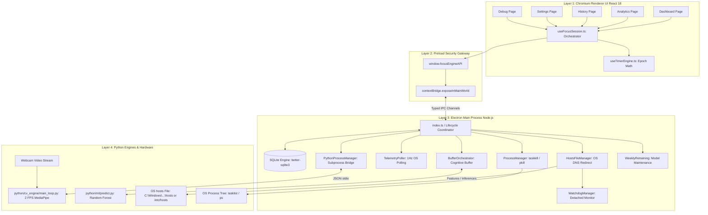

# Focus Engine

> **A high-performance, multi-modal cognitive focus tracker, OS-level distraction blocker, and offline machine learning productivity suite built with Electron, React 18, TypeScript, Python, OpenCV, MediaPipe, and Scikit-Learn.**

---

## 1. Executive Summary & Problem Statement

Modern knowledge work and software engineering are besieged by continuous digital distractions: social media notifications, context switching between browser tabs, and fragmented focus. Traditional productivity tools suffer from fundamental flaws:
1. **Shallow Enforcement**: Browser extensions can be bypassed by opening an incognito window or switching browsers.
2. **Naive Timer Drift**: Web-based timers relying on sequential JavaScript counter ticks (`setInterval`) suffer severe drift from CPU throttling and fail when laptops sleep.
3. **Passive Assumption of Focus**: Existing tools assume that if a code editor is open on the screen, the user is focused. In reality, users often stare at smartphones or daydream while their editor sits idle.
4. **Cloud Privacy Liabilities**: Many commercial tracking tools upload raw keystrokes, screenshots, and browsing histories to third-party cloud servers.

**Focus Engine** was engineered from the ground up to solve these challenges through an integrated, multi-process desktop architecture that operates **100% locally and privately**:
- **Hardware-Level Precision Timing**: Time is calculated mathematically from OS-level epoch timestamps (`Date.now()`), eliminating timer drift across CPU throttling and system sleep.
- **System-Wide Network & Process Enforcement**: Modifies the operating system `hosts` file to block domains across all browsers and CLI tools, terminates active keep-alive browser sockets, forcefully terminates blacklisted processes, and maintains an independent detached watchdog daemon to prevent lockouts.
- **Non-Invasive Computer Vision Attention Tracking**: Samples the webcam at 2.0 FPS using Google MediaPipe Face Landmarker to evaluate 3D head pose (Perspective-n-Point) and eye gaze, distinguishing between active monitor focus, productive keyboard work, and external distractions without saving a single video frame to disk.
- **Adaptive Cognitive Focus Buffer**: Models the user's attention as a live, dynamic energy reservoir that recovers during sustained focus and decays during distractions.
- **Offline Machine Learning Analytics**: Trains local Scikit-Learn Random Forest and Isolation Forest models on a 40-session sliding window, delivering real-time cognitive state predictions and personalized productivity coaching.

---

## 2. High-Level System Architecture

Focus Engine operates across three coordinated execution layers:



---

## 3. Technology Stack

| Subsystem | Technology | Version / Specification | Architectural Role |
|---|---|---|---|
| **Desktop Shell** | Electron | `^39.2.6` | Native OS integration, multi-process orchestration, window management |
| **Frontend Framework** | React | `^19.2.1` | Declarative UI, concurrent rendering, real-time dashboard visualization |
| **Frontend Language**| TypeScript | `^5.9.3` (`strict: true`) | Strict type contracts between UI hooks and IPC response envelopes |
| **Build Tooling** | Vite (`electron-vite`) | `^5.0.0` | Instant HMR development server and optimized Rollup bundling |
| **Embedded Database** | SQLite (`better-sqlite3`) | `^12.11.1` | Local timeseries storage, WAL journal mode, 14 relational tables |
| **Styling & Icons** | Vanilla CSS + `lucide-react` | `^1.21.0` | Dark glassmorphism theme (`#0f0f17`), responsive SVG timer dials |
| **Computer Vision** | OpenCV + MediaPipe | Python 3.10–3.12 | 478 3D facial landmarks, solvePnP head pose, horizontal iris gaze |
| **Machine Learning** | Scikit-Learn | `^1.4.0` | Random Forest Regressor, Isolation Forest, 5-fold cross-validation |
| **System Blocking** | OS Hosts + PowerShell / AppleScript | Native OS APIs | Loopback domain redirection (`127.0.0.1`) and active tab termination |

---

## 4. Key Subsystems & Core Capabilities

### 1. Hardware-Anchored Differential Time Calculation
- **Zero Drift**: Eliminates `setInterval` tick lag using epoch millisecond differences:
  $$E_{\text{total}} = A + \left\lfloor \frac{\text{Date.now}() - t_{\text{start}}}{1000} \right\rfloor$$
- **Sleep & Suspend Immune**: Accurately recalculates elapsed time when the laptop lid reopens.
- **Multi-Mode Support**: Supports both target-based **Pomodoro countdowns** (25m, 5m, 15m) and open-ended **Standard stopwatches**.

### 2. Multi-Signal Cognitive Focus Buffer
- Models user attention as a continuous dynamic reservoir ($0.0 \dots 100.0$).
- Integrates four real-time sensory inputs:
  1. **Visual Attention Signal ($S_{\text{cv}}$)**: Webcam head orientation and gaze direction.
  2. **Typing Rhythm Signal ($S_{\text{kb}}$)**: Keystrokes per minute cadence.
  3. **Cursor Kinematics Signal ($S_{\text{mouse}}$)**: Movement velocity and click continuity.
  4. **Active Application Signal ($S_{\text{win}}$)**: Foreground software categorization.
- Dynamically shifts states: `focused` ($\ge 50$), `warning` ($20 - 49$), and `critical` ($< 20$).

### 3. Dual-Layer OS Distraction Blocker
- **System-Wide DNS Loopback**: Injects `# FOCUS_ENGINE_BLOCK_START` markers into `C:\Windows\System32\drivers\etc\hosts` (or `/etc/hosts`), routing distracting domains to `127.0.0.1`.
- **Keep-Alive Socket Termination**: Closes active browser windows (Windows PowerShell `CloseMainWindow`) and tabs (macOS AppleScript `close t`) matching blocked keywords.
- **Process Force-Kill**: Periodically enumerates the OS process tree (`tasklist` / `ps`), force-terminating blacklisted applications (Steam, Discord, Spotify) and logging kill audits.
- **Detached Watchdog Daemon**: A detached headless Node.js child process monitors parent process liveness every second, guaranteeing automatic `hosts` restoration even if Focus Engine crashes or is terminated in Task Manager.

### 4. Privacy-First Computer Vision Attention Engine
- Runs locally at **2.0 FPS** to preserve battery life and keep CPU consumption under $3\%$.
- Solves Perspective-n-Point (`cv2.solvePnP`) using 6 3D facial reference points to derive Euler angles (Yaw, Pitch, Roll).
- Classifies downward pitch ($-35^\circ \le \theta < -15^\circ$) as **`looking_at_keyboard` (100% focus)**, ensuring programmers and note-takers are not falsely penalized.
- Computes horizontal iris gaze ratios while intentionally ignoring vertical gaze to eliminate eyelid occlusion noise.
- **Absolute Privacy**: Zero video frames or images are ever written to disk or transmitted over the network. Only anonymized numerical telemetry is emitted over stdout.

### 5. Local Machine Learning Suite
- **Regression**: Predicts post-session focus scores ($0 \dots 100$) using a 100-tree Random Forest Regressor.
- **Anomaly Detection**: Flags erratic task-switching or artificial simulation using an Isolation Forest.
- **Gini Importance Insight**: Confirms that task-switching frequency (`app_switches`, $38.5\%$) and average buffer level (`avg_buffer`, $13.6\%$) are the top drivers of productivity.
- **Cold-Start Bootstrap**: Uses a 40-session sliding window initialized with synthetic data that naturally phases out as real user sessions are recorded.
- **Automated Weekly Retraining**: A background daemon audits model performance every 7 days, replacing production models only when 5-fold cross-validation R² improves.

---

## 5. Directory Structure

```text
Focus_Engine/
│
├── README.md                          # Master project documentation & guide
├── package.json                       # Scripts, dependencies, and native build configs
├── electron.vite.config.ts            # Vite multi-process build configuration
├── electron-builder.yml               # Native installer packaging configuration
├── tsconfig.json                      # TypeScript root configuration
├── tsconfig.node.json                 # TypeScript node configuration (main & preload)
├── tsconfig.web.json                  # TypeScript web configuration (renderer)
│
├── docs/                              # Comprehensive Technical Documentation Suite
│   ├── 00-overview/                   # System architecture, lifecycle, and data flow
│   ├── 01-database/                   # SQLite schema, 14 tables, queries, ER diagrams
│   ├── 02-frontend/                   # React components, state, time calculation engine
│   ├── 03-blocking/                   # Hosts blocker, process manager, watchdog daemon
│   ├── 04-main-process/               # Electron lifecycle, IPC architecture, background loops
│   ├── 05-preload/                    # ContextBridge security, exposed APIs, unsubscribe pattern
│   ├── 06-telemetry/                  # OS window tracking, KPM sliding window, idle detection
│   ├── 07-computer-vision/            # MediaPipe FaceLandmarker, solvePnP head pose, gaze
│   ├── 08-machine-learning/           # Random Forest regression, Isolation Forest, retraining
│   ├── 09-integration/                # Cross-module data flow, failure matrices, dependencies
│   └── 10-development/                # Setup guides, debugging, testing, contribution rules
│
├── src/
│   ├── main/                          # Electron Main Process (Node.js)
│   │   ├── index.ts                   # Main application entry point & lifecycle
│   │   ├── analytics/                 # Heatmap queries, streak calculator, recommendations
│   │   ├── blocking/                  # Hosts file manager, process manager, tab closer, watchdog
│   │   ├── buffer/                    # Focus Buffer orchestrator, signal mappers, state machine
│   │   ├── cv/                        # Python CV engine subprocess bridge
│   │   ├── database/                  # SQLite schema DDL, connection handle, 12 repositories
│   │   ├── ipc/                       # 8 domain IPC handler modules
│   │   ├── ml/                        # Prediction service, weekly retraining daemon
│   │   ├── telemetry/                 # Active window tracker, KPM tracker, mouse metrics
│   │   └── utils/                     # Structured logger, path resolvers
│   │
│   ├── preload/                       # Preload Process
│   │   ├── index.ts                   # ContextBridge implementation & unsubscription wrappers
│   │   └── index.d.ts                 # Ambient TypeScript definitions for window.focusEngineAPI
│   │
│   └── renderer/                      # Chromium Renderer Process (React 18)
│       ├── main.tsx                   # React root mount
│       ├── App.tsx                    # Top-level router & state provider
│       ├── context/                   # FocusSessionContext singleton
│       ├── hooks/                     # Custom hooks (useTimerEngine, useFocusSession, etc.)
│       ├── layouts/                   # MainLayout with sidebar navigation
│       ├── pages/                     # Dashboard, Analytics, History, Settings, Debug
│       └── components/                # UI primitives (Card, Button) & domain widgets (Gauges, HUD)
│
└── python/
    ├── cv_env/                        # Python virtual environment (ignored from VCS)
    ├── cv_engine/                     # Computer Vision Engine
    │   ├── main_loop.py               # Headless production loop (2.0 FPS, stdout JSON)
    │   ├── face_detector.py           # MediaPipe FaceLandmarker task wrapper
    │   ├── face_landmarker.task       # 3.7MB neural network bundle
    │   ├── head_pose_estimator.py     # cv2.solvePnP 3D Euler angle estimator
    │   ├── gaze_estimator.py          # Horizontal iris distance ratio estimator
    │   ├── attention_combiner.py      # Multi-modal CV attention scorer
    │   ├── score_smoother.py          # Exponential Moving Average (EMA) smoother
    │   ├── webcam_capture.py          # Threaded OpenCV video capture sampler
    │   └── requirements.txt           # Python dependencies (mediapipe, opencv-python, numpy)
    │
    └── ml/                            # Machine Learning Pipeline
        ├── constants.py               # 13 aligned feature definitions
        ├── dataset_builder.py         # 40-session sliding window dataset builder
        ├── synthetic_generator.py     # Cold-start synthetic session generator
        ├── real_data_extractor.py     # SQLite historical session extractor
        ├── train_focus_model.py       # Random Forest Regressor with 5-fold CV & deployment gate
        ├── train_anomaly_model.py     # Isolation Forest anomaly detector
        ├── predict.py                 # Single-call stdin/stdout inference CLI
        ├── data/                      # dataset.csv, real_sessions.csv, synthetic_pool.csv
        └── models/                    # focus_model.pkl, anomaly_model.pkl, metadata JSONs
```

---

## 6. Installation & Development Setup

> [!TIP]
> For an exhaustive, standalone setup walkthrough with troubleshooting steps and verification checklists, consult **[INSTALL_AND_RUN.md](INSTALL_AND_RUN.md)**.

### 1. Prerequisites
- **Node.js**: `>= 20.x LTS` (Node 22 supported)
- **npm**: `>= 10.x`
- **Python**: `3.10`, `3.11`, or `3.12` (64-bit) — *Note: MediaPipe does not support Python 3.13+ yet*
- **Git**: `>= 2.40`
- **Operating System Privileges**: **Administrator** (Windows) or `sudo` (Unix) required for hosts file blocking.

### 2. Node.js Installation
```bash
# Clone the repository
git clone https://github.com/your-org/Focus_Engine.git
cd Focus_Engine

# Install dependencies & compile native SQLite bindings
npm install
```

### 3. Python Virtual Environment Setup (CV & ML)
#### On Windows (PowerShell as Administrator):
```powershell
# Create virtual environment
python -m venv python\cv_env

# Activate virtual environment
.\python\cv_env\Scripts\Activate.ps1

# Upgrade pip and install dependencies
pip install --upgrade pip
pip install -r python\cv_engine\requirements.txt
pip install pandas numpy scikit-learn joblib
```

#### On macOS / Linux:
```bash
# Create and activate virtual environment
python3 -m venv python/cv_env
source python/cv_env/bin/activate

# Install dependencies
pip install --upgrade pip
pip install -r python/cv_engine/requirements.txt
pip install pandas numpy scikit-learn joblib
```

---

## 7. Running & Testing

### Development Mode
> [!IMPORTANT]
> Run your terminal as **Administrator** (Windows) so Focus Engine can modify the OS hosts file during sessions:

```bash
npm run dev
```

### Quality Assurance & Verification Commands
```bash
# Strict TypeScript validation (Main + Web)
npm run typecheck

# Code formatting and ESLint checks
npm run lint
npm run format

# Standalone Python CV test with interactive visual overlay
cd python/cv_engine
python main_loop.py --preview

# Standalone Machine Learning pipeline test
cd python/ml
python dataset_builder.py
python train_focus_model.py
```

### Building for Production
```bash
# Compile production bundles
npm run build

# Package unpacked executable directory
npm run build:unpack
```

---

## 8. Complete Documentation Index

The `docs/` directory contains comprehensive technical specifications written for architects, developers, and QA engineers. For quick environment setup and execution steps, refer to [Installation & Execution Guide (INSTALL_AND_RUN.md)](INSTALL_AND_RUN.md).

| Category | Document Link | Focus & Coverage |
|---|---|---|
| **00 - Overview** | [01 - Project Overview](docs/00-overview/01-project-overview.md) | Mission, problem statement, high-level capabilities |
| | [02 - System Architecture](docs/00-overview/02-system-architecture.md) | Multi-process topology, security zones, and communication |
| | [03 - Technology Stack](docs/00-overview/03-technology-stack.md) | Tooling, libraries, framework evaluations, and justifications |
| | [04 - Application Lifecycle](docs/00-overview/04-application-lifecycle.md) | Startup, active runtime, pause/resume, and teardown |
| | [05 - System Data Flow](docs/00-overview/05-system-data-flow.md) | End-to-end data pipelines from HCI sensors to SQLite |
| **01 - Database** | [01 - Database Overview](docs/01-database/01-database-overview.md) | SQLite architecture, WAL mode, connection management |
| | [02 - Database Schema](docs/01-database/02-database-schema.md) | Column-level schema for all 14 tables with ER diagrams |
| | [03 - Data Models](docs/01-database/03-data-models.md) | TypeScript interface mappings to SQLite relational rows |
| | [04 - Database Operations](docs/01-database/04-database-operations.md) | SQL query catalog, parameters, return types, and indexing |
| | [05 - Data Lifecycle](docs/01-database/05-data-lifecycle.md) | Journey of session and telemetry data from RAM to disk |
| | [06 - Database Decisions](docs/01-database/06-database-decisions.md) | Rationale, trade-offs, constraints, and WAL performance |
| **02 - Frontend** | [01 - Frontend Overview](docs/02-frontend/01-frontend-overview.md) | React 18 architecture, page routes, and layout shells |
| | [02 - Component Architecture](docs/02-frontend/02-component-architecture.md) | UI primitives, domain widgets, props contracts, error boundary |
| | [03 - State Management](docs/02-frontend/03-state-management.md) | FocusSessionContext, custom hooks, ref anchors, render isolation |
| | [04 - Time Calculation Engine](docs/02-frontend/04-time-calculation.md) | Mathematical formulas, epoch math, drift elimination, numerical traces |
| | [05 - Timer Lifecycle](docs/02-frontend/05-timer-lifecycle.md) | State machine transitions, pause/resume loops, break automations |
| | [06 - Frontend-Backend Communication](docs/02-frontend/06-frontend-backend-communication.md) | IPC channels, payload normalization, error envelopes |
| | [07 - Frontend Decisions](docs/02-frontend/07-frontend-decisions.md) | Engineering trade-offs, 200ms tick interval, atomic save guards |
| **03 - Blocking** | [01 - Blocking Overview](docs/03-blocking/01-blocking-overview.md) | System-wide domain redirection and process enforcement |
| | [02 - Blocking Architecture](docs/03-blocking/02-blocking-architecture.md) | Activation sequences, continuous 30s audit loops, shutdown paths |
| | [03 - Application Detection](docs/03-blocking/03-application-detection.md) | `tasklist`/`ps` parsing, command injection regex defense, `taskkill` |
| | [04 - Website Blocking](docs/03-blocking/04-website-blocking.md) | OS hosts redirection, socket keep-alive problem, PowerShell/AppleScript |
| | [05 - Enforcement Mechanism](docs/03-blocking/05-enforcement-mechanism.md) | Detached crash-resilient watchdog daemon, parent PID monitoring |
| | [06 - Blocking Decisions](docs/03-blocking/06-blocking-decisions.md) | Hosts vs. local proxy vs. browser extension trade-offs |
| **04 - Main Process** | [01 - Main Process Overview](docs/04-main-process/01-main-process-overview.md) | Node.js kernel role, 8 IPC routers, directory layout |
| | [02 - Application Lifecycle](docs/04-main-process/02-application-lifecycle.md) | Window construction, context isolation security, `before-quit` |
| | [03 - IPC Architecture](docs/04-main-process/03-ipc-architecture.md) | `ipcMain.handle`, `webContents.send`, standard response envelopes |
| | [04 - Background Services](docs/04-main-process/04-background-services.md) | 1Hz poller, Focus Buffer orchestrator, Python process manager |
| | [05 - Main Process Decisions](docs/04-main-process/05-main-process-decisions.md) | Centralized Node process vs. native services, stdio IPC rationale |
| **05 - Preload** | [01 - Preload Overview](docs/05-preload/01-preload-overview.md) | Security mediator role, ambient TypeScript declarations |
| | [02 - ContextBridge](docs/05-preload/02-context-bridge.md) | Prototype poisoning defense, V8 structured clone algorithm |
| | [03 - IPC Communication](docs/05-preload/03-ipc-communication.md) | Channel mapping, React hook unsubscription pattern |
| | [04 - Security Boundaries](docs/05-preload/04-security-boundaries.md) | Threat modeling, RCE elimination, input sanitization rules |
| **06 - Telemetry** | [01 - Telemetry Overview](docs/06-telemetry/01-telemetry-overview.md) | HCI sensor architecture, privacy guarantees, no-keylogger policy |
| | [02 - Event Collection](docs/06-telemetry/02-event-collection.md) | Win32 C# dynamic compilation, AppleScript, mouse kinematics |
| | [03 - Activity Tracking](docs/06-telemetry/03-activity-tracking.md) | URL/app categorization heuristics, idle tiers, distraction alerts |
| | [04 - Data Processing](docs/06-telemetry/04-data-processing.md) | Sliding window KPM scaling, post-session aggregation, Focus Score formula |
| | [05 - Telemetry Decisions](docs/06-telemetry/05-telemetry-decisions.md) | 1Hz polling vs. native hooks, 60s chunking trade-offs |
| **07 - Computer Vision** | [01 - Computer Vision Overview](docs/07-computer-vision/01-computer-vision-overview.md) | Visual attention tracking, privacy guarantee, JSON protocol |
| | [02 - Image Processing Pipeline](docs/07-computer-vision/02-image-processing-pipeline.md) | Frame capture, color conversion, 478 landmark regression |
| | [03 - Detection Mechanism](docs/07-computer-vision/03-detection-mechanism.md) | 3D solvePnP Euler angles, keyboard pitch detection, iris gaze ratio |
| | [04 - Frame Processing](docs/07-computer-vision/04-frame-processing.md) | 2.0 FPS regulation, monotonic timing, preview streaming, teardown |
| | [05 - CV Model Integration](docs/07-computer-vision/05-cv-model-integration.md) | MediaPipe task bundle, Python subprocess bridge, DB ingestion |
| | [06 - Computer Vision Decisions](docs/07-computer-vision/06-computer-vision-decisions.md) | MediaPipe vs. Dlib, classical PnP vs. deep pose, horizontal gaze |
| **08 - Machine Learning** | [01 - Machine Learning Overview](docs/08-machine-learning/01-machine-learning-overview.md) | Regression and anomaly detection objectives, dataset layout |
| | [02 - Model Architecture](docs/08-machine-learning/02-model-architecture.md) | Random Forest Regressor math, Isolation Forest path lengths |
| | [03 - Feature Engineering](docs/08-machine-learning/03-feature-engineering.md) | 13 aligned feature definitions, Gini importances, median imputation |
| | [04 - Training & Inference](docs/08-machine-learning/04-training-and-inference.md) | 40-session sliding window, 5-fold CV, deployment gate, CLI predictor |
| | [05 - Prediction Pipeline](docs/08-machine-learning/05-prediction-pipeline.md) | 5s polling loop, subprocess safety timeouts, weekly retraining daemon |
| | [06 - Machine Learning Decisions](docs/08-machine-learning/06-machine-learning-decisions.md) | Random Forest vs. Deep Learning, sliding window vs. infinite data |
| **09 - Integration** | [01 - Module Interactions](docs/09-integration/01-module-interactions.md) | Process boundaries, interface definitions, subsystem topology |
| | [02 - End-to-End Data Flow](docs/09-integration/02-end-to-end-data-flow.md) | Tracing sessions from launch to analytics across 4 phases |
| | [03 - Error Handling](docs/09-integration/03-error-handling.md) | Fault tolerance matrix, error boundaries, watchdog recovery |
| | [04 - Cross-Module Dependencies](docs/09-integration/04-cross-module-dependencies.md) | Table access patterns, shared types, team collaboration model |
| **10 - Development** | [01 - Setup Guide](docs/10-development/01-setup-guide.md) | Prerequisites, Node/Python installation, native module rebuilds |
| | [02 - Development Workflow](docs/10-development/02-development-workflow.md) | HMR feedback loops, standalone subsystem testing, git conventions |
| | [03 - Debugging Guide](docs/10-development/03-debugging-guide.md) | In-app debug console, database inspection, troubleshooting pitfalls |
| | [04 - Testing Guide](docs/10-development/04-testing-guide.md) | Static type checking, unit harnesses, interactive E2E checklist |
| | [05 - Contribution Guidelines](docs/10-development/05-contribution-guidelines.md) | Code preservation rules, PR standards, four workstream assignments |
| **11 - Focus Buffer** | [01 - Focus Buffer Overview](docs/11-focus-buffer/01-focus-buffer-overview.md) | Dynamic energy reservoir model, cognitive momentum, real-time feedback |
| | [02 - Buffer Math and Dynamics](docs/11-focus-buffer/02-buffer-math-and-dynamics.md) | Multiplicative decay, linear additive recovery, clamping limits |
| | [03 - Signal Mapping Architecture](docs/11-focus-buffer/03-signal-mapping-architecture.md) | CV, keyboard, mouse, and window telemetry translation to [0.95, 1.0] |
| | [04 - State Machine & Transitions](docs/11-focus-buffer/04-state-machine-and-transitions.md) | Focused, Warning, Critical, Paused states and transition database logging |
| | [05 - Distraction Penalty Calculation](docs/11-focus-buffer/05-distraction-penalty-calculation.md) | Event penalty points and domain deduplication logic |
| | [06 - Focus Score Aggregation](docs/11-focus-buffer/06-focus-score-aggregation.md) | Multi-factor session scoring formula and dynamic CV rebalancing |
| | [07 - Focus Buffer Decisions](docs/11-focus-buffer/07-focus-buffer-decisions.md) | Additive recovery rationale, contextual overrides, and grace periods |
| **12 - Analytics** | [01 - Analytics Overview](docs/12-analytics/01-analytics-overview.md) | Behavioral intelligence, aggregated KPI summary, architectural layout |
| | [02 - Heatmap Matrix Aggregation](docs/12-analytics/02-heatmap-matrix-aggregation.md) | 7x24 DayOfWeek vs HourOfDay SQL matrix and weighted sum collapses |
| | [03 - Streak Calculation Engine](docs/12-analytics/03-streak-calculation-engine.md) | Pure habit streak math, DST immunity, and liveness semantics |
| | [04 - Productivity Metrics & KPIs](docs/12-analytics/04-productivity-metrics-and-kpis.md) | Best/worst hour, uninterrupted focus stamina, total focused time |
| | [05 - Recommendation Engine Heuristics](docs/12-analytics/05-recommendation-engine-heuristics.md) | 2-hour peak windows, culprit app/domain ranking, and NLP coaching |
| | [06 - Analytics Decisions](docs/12-analytics/06-analytics-decisions.md) | SQLite-side local time rebasing, 10-session sufficiency gating |

---

## 9. Engineering Team Ownership & Collaboration Matrix

Focus Engine's architecture is structured to support four engineers collaborating in parallel across clearly segregated workstreams:

| Workstream | Lead Engineer | Primary Module Ownership | Core Technical Responsibilities |
|---|---|---|---|
| **Workstream 1** | **Engineer 1** *(Placeholder)* | Database & Storage (`docs/01-database/`, `src/main/database/`, `src/main/analytics/`) | SQLite schema migrations, WAL tuning, index optimization, SQL analytics aggregations (heatmaps, streaks, productivity summaries). |
| **Workstream 2** | **Engineer 2** *(Placeholder)* | Frontend & Time Calculation (`docs/02-frontend/`, `src/renderer/`) | React 18 UI layout, differential epoch time engine (`useTimerEngine`), session orchestrator (`useFocusSession`), dynamic SVG dials. |
| **Workstream 3** | **Engineer 3** *(Placeholder)* | Blocking, Main Process & Security (`docs/03-blocking/`, `docs/04-main-process/`, `docs/05-preload/`) | Electron lifecycle coordinator, ContextBridge security, OS hosts loopback blocker, detached watchdog crash daemon, process force-kill. |
| **Workstream 4** | **Engineer 4** *(Placeholder)* | Telemetry, Computer Vision & ML (`docs/06-telemetry/`, `docs/07-computer-vision/`, `docs/08-machine-learning/`, `python/`) | Win32 active window polling, KPM tracking, MediaPipe 3D head pose & gaze estimation, Random Forest regression, weekly retraining. |

---

## 10. Known Limitations & Future Roadmap

1. **DNS-over-HTTPS (DoH)**:
   - *Limitation*: Browsers with hardcoded DoH enabled by default may bypass OS hosts file redirection.
   - *Roadmap*: Pair the hosts file blocker with an optional Focus Engine native messaging companion browser extension.
2. **Subdomain URL Filtering**:
   - *Limitation*: Hosts files operate on domain granularity (`youtube.com`), unable to selectively permit specific URLs (`youtube.com/watch?v=educational`).
   - *Roadmap*: Develop a local transparent loopback proxy for granular HTTP path filtering.
3. **ONNX Native Inference**:
   - *Limitation*: Spawning `predict.py` every 5 seconds incurs small OS process creation overhead ($\approx 80\text{ ms}$).
   - *Roadmap*: Export Scikit-Learn models to ONNX format and execute directly inside Node.js via `onnxruntime-node`.
4. **System Tray Minimization**:
   - *Limitation*: Closing the main window currently terminates the application on Windows.
   - *Roadmap*: Implement an Electron `Tray` icon allowing the app to stay active in the background while users work in full-screen IDEs.

---

## 11. License

Focus Engine is an open-source engineering project licensed under the [MIT License](LICENSE).
