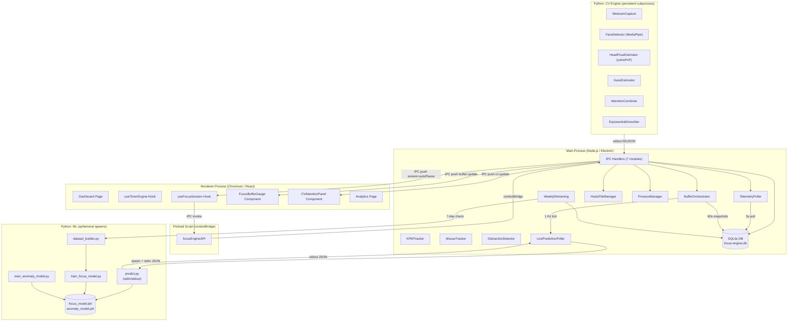

# System Architecture

## Overview

Focus Engine is a **multi-process desktop application**. Three runtime environments cooperate to deliver the full feature set:

| Process | Runtime | Responsibility |
|---------|---------|---------------|
| Main Process | Node.js (Electron) | App lifecycle, IPC, database, background services |
| Renderer Process | Chromium (React) | UI, timer, user interaction |
| Python Subprocesses | CPython 3.12 | Computer vision (persistent) and ML inference (ephemeral) |

These processes are isolated from each other and communicate through well-defined channels.

---

## High-Level Architecture Diagram

---

## Process Isolation and Communication Channels

### Renderer ↔ Main: IPC via contextBridge

The Renderer process cannot directly access Node.js APIs. All communication goes through:

1. **Preload script** (`src/preload/index.ts`) — exposes `window.focusEngineAPI` object to the renderer via `contextBridge.exposeInMainWorld()`.
2. **`ipcRenderer.invoke()`** (renderer side) — sends a request and awaits a Promise.
3. **`ipcMain.handle()`** (main side) — registers async handlers that return values to the renderer.
4. **`win.webContents.send()`** (main → renderer push) — used for event-driven updates like `buffer:update`, `cv:update`, `session:autoPause`.

### Main ↔ Python CV: Persistent Subprocess with stdout NDJSON

The CV engine runs as a **long-lived subprocess** for the duration of a focus session:

- Spawned by `PythonCVProcessManager.start()` when a focus session begins.
- Communicates via **newline-delimited JSON** written to `stdout`.
- Main process reads `stdout` line-by-line, parses each JSON object, persists it to SQLite, and broadcasts it to the renderer via IPC push.
- Terminated via SIGTERM (with SIGKILL fallback after 2 seconds) when the session ends.

### Main ↔ Python ML: Ephemeral Subprocess with stdin/stdout

The ML prediction engine is **spawned on demand** every 60 seconds:

- `LivePredictionPoller` assembles a feature vector JSON string.
- Spawns `predict.py` as a child process.
- Writes the JSON string to the child's `stdin`.
- Reads the response JSON from `stdout`.
- The child process exits immediately after responding.
- A **5-second kill timeout** is enforced to prevent hangs.

This spawn-per-call pattern avoids maintaining a persistent Python process in memory between predictions.

### Main ↔ Python ML: Retraining Pipeline

Weekly retraining spawns **three Python scripts sequentially**:
1. `dataset_builder.py` — builds the 40-row sliding window CSV.
2. `train_focus_model.py` — trains and conditionally deploys `focus_model.pkl`.
3. `train_anomaly_model.py` — trains and unconditionally deploys `anomaly_model.pkl`.

Each is launched with `spawn()` and awaited via a Promise that resolves on `close` event with exit code 0.

---

## Security Architecture

### Context Isolation

`contextIsolation: true` is set in the BrowserWindow `webPreferences`. This means:
- The renderer runs in a separate JavaScript context from the preload script.
- The renderer cannot access Node.js globals (`require`, `process`, `__dirname`).
- Only the explicitly exposed `focusEngineAPI` and `electronAPI` objects are accessible.

### Sandbox

`sandbox: false` is set. This was required to allow the preload script to access Node.js APIs (specifically `ipcRenderer`). This is a trade-off: it enables the preload bridge but means the renderer is not in a fully sandboxed process.

### Process Name Sanitization

Before killing any process by name, `processManager.ts` runs `sanitizeProcessName()`, which whitelists only `[a-zA-Z0-9_-]` characters, preventing shell command injection.

### Hosts File Write Privilege

The hosts file blocking requires elevated OS permissions:
- **Windows**: The application must be launched as Administrator.
- **macOS/Linux**: Must be launched with `sudo`.

If permissions are insufficient, the error is surfaced to the UI with specific instructions.

---

## Module Ownership Map

| Module | Location | Engineer |
|--------|----------|---------|
| Database | `src/main/database/` | Engineer 1 |
| Frontend / Timer | `src/renderer/` | Engineer 2 |
| Blocking | `src/main/blocking/` | Engineer 3 |
| Main Process / IPC | `src/main/index.ts`, `src/main/ipc/` | Engineer 3 |
| Preload | `src/preload/` | Engineer 3 |
| Telemetry | `src/main/telemetry/` | Engineer 4 |
| Buffer Engine | `src/main/buffer/` | Engineer 4 |
| Computer Vision | `python/cv_engine/` | Engineer 4 |
| Machine Learning | `python/ml/` | Engineer 4 |
| Analytics | `src/main/analytics/` | Engineer 1 |
