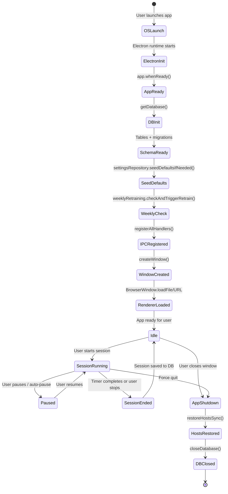
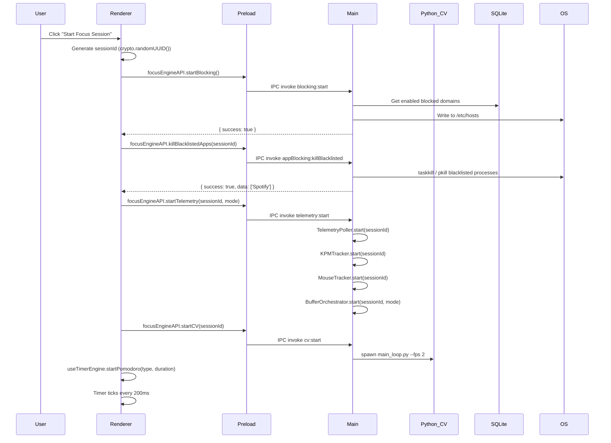

# Application Lifecycle

This document traces every phase of the Focus Engine application's life — from OS launch through session activity to shutdown — explaining what happens, when, why, and what code drives each step.

---

## Lifecycle Phases



---

## Phase 1: OS Launch to `app.whenReady()`

**Source**: `src/main/index.ts`

When the user launches Focus Engine (by double-clicking the executable or running `npm run dev`):

1. The Electron runtime starts the **main process** (`out/main/index.js` in production, transpiled from `src/main/index.ts`).
2. Electron performs internal initialization (Chromium setup, IPC infrastructure).
3. `app.whenReady()` fires — this is the first safe moment to use Electron APIs.

```typescript
// src/main/index.ts:53
app.whenReady().then(() => {
  electronApp.setAppUserModelId('com.electron')
  app.on('browser-window-created', (_, window) => {
    optimizer.watchWindowShortcuts(window)
  })
  ipcMain.on('ping', () => console.log('pong'))
  // ... startup sequence continues
})
```

`electronApp.setAppUserModelId('com.electron')` sets the Windows taskbar app ID. This is boilerplate from the electron-vite template but is important for Windows notification grouping.

`optimizer.watchWindowShortcuts(window)` enables F12 to open DevTools in development and disables `Ctrl+R` in production (to prevent accidental reload).

---

## Phase 2: Database Initialization

**Source**: `src/main/database/db.ts`

```typescript
// src/main/index.ts:68
getDatabase()
```

`getDatabase()` is called **once** at startup. It:

1. Computes the database path: `{app.getPath('userData')}/focus-engine.db`
   - On Windows: `C:\Users\{user}\AppData\Roaming\focus-engine-temp\focus-engine.db`
   - On macOS: `~/Library/Application Support/focus-engine-temp/focus-engine.db`
2. Opens (or creates) the SQLite file with `better-sqlite3`.
3. Enables **WAL mode** (`PRAGMA journal_mode = WAL`) for concurrent read performance.
4. Runs `CREATE TABLE IF NOT EXISTS` for all 14 tables.
5. Runs inline **migrations** (checking for missing columns via `PRAGMA table_info()` and adding them with `ALTER TABLE ADD COLUMN`).
6. **Seeds default data** if tables are empty:
   - Inserts default blocked domains from `blockedDomainsList.ts`.
   - Inserts default blacklisted apps from `blacklistedAppsList.ts`.

After this call, the database is guaranteed to have the full current schema and is ready for use by all repository modules.

---

## Phase 3: Settings Seeding

**Source**: `src/main/database/settingsRepository.ts`

```typescript
// src/main/index.ts:71
settingsRepository.seedDefaultsIfNeeded()
```

Seeds the `app_settings` table with default calibration values for the CV system if no settings exist yet. This is the user's first-launch initialization for CV calibration defaults.

---

## Phase 4: Weekly ML Retraining Check

**Source**: `src/main/ml/weeklyRetraining.ts`

```typescript
// src/main/index.ts:74
weeklyRetraining.checkAndTriggerRetrain().catch((err) => {
  console.error('[WeeklyRetraining] Startup check failed:', err)
})
```

This runs **asynchronously** (the `.catch()` prevents it from blocking startup). It checks if 7+ days have elapsed since `last_retrain_time` in `app_settings`. If so, it spawns the Python ML retraining pipeline (3 sequential Python scripts). If retraining fails, the error is logged but the app continues normally with the existing model.

---

## Phase 5: IPC Handler Registration

**Source**: `src/main/index.ts:79–86`

All IPC handlers are registered before the window is created. This ensures handlers are ready when the renderer first loads and makes IPC calls:

```typescript
registerSessionHandlers()      // session:save, session:getAll
registerBlockingHandlers()     // blocking:start/stop/status/domains
registerAppBlockingHandlers()  // appBlocking:killBlacklisted/getApps/addApp/removeApp/toggleApp
registerTelemetryHandlers()    // telemetry:start/stop/getWindowHistory/etc.
registerCVHandlers()           // cv:start/stop/getSummary, settings:getCalibration/setCVEnabled
registerBufferHandlers()       // buffer:getCurrent/resume/pause/getSnapshots/etc.
registerAnalyticsHandlers()    // analytics:getHeatmap/getStreaks/getProductivitySummary/getRecommendations
registerMLHandlers()           // ml:triggerRetrain, ml:getRetrainHistory
```

---

## Phase 6: Window Creation

**Source**: `src/main/index.ts:17–48`

```typescript
function createWindow(): void {
  const mainWindow = new BrowserWindow({
    width: 900,
    height: 670,
    show: false,              // Hidden until ready-to-show
    autoHideMenuBar: true,
    webPreferences: {
      preload: join(__dirname, '../preload/index.js'),
      sandbox: false,
      contextIsolation: true
    }
  })

  mainWindow.on('ready-to-show', () => {
    mainWindow.show()         // Show only after renderer has loaded
  })
```

The window starts hidden (`show: false`) to avoid a flash of unstyled content. It only becomes visible when the `ready-to-show` event fires, meaning the renderer has painted its first frame.

**Development**: Loads `process.env.ELECTRON_RENDERER_URL` (the Vite dev server URL, e.g., `http://localhost:5173`). Hot Module Replacement (HMR) is active.

**Production**: Loads `../renderer/index.html` from the compiled output.

---

## Phase 7: Renderer Initialization

**Source**: `src/renderer/main.tsx`, `src/renderer/App.tsx`

Once the HTML loads in the BrowserWindow:
1. React mounts at the `<div id="root">` element.
2. `react-router-dom` provides client-side routing.
3. `FocusSessionContext` wraps the app, providing `useFocusSession` state to all routes.
4. The Dashboard route renders by default.
5. The `useFocusSession` hook initializes with all state at defaults (timer idle, no session running).

---

## Phase 8: Active Session Lifecycle

When the user starts a session, the following sequence occurs simultaneously:



---

## Phase 9: Application Shutdown

**Source**: `src/main/index.ts:100–114`

Two shutdown events are handled:

### `window-all-closed`
```typescript
app.on('window-all-closed', () => {
  if (process.platform !== 'darwin') {
    app.quit()
  }
})
```
On non-macOS platforms, closing the last window quits the app. On macOS, the app stays running (dock icon remains).

### `before-quit`
```typescript
app.on('before-quit', () => {
  try {
    restoreHostsSync()    // Synchronously remove blocking entries from hosts file
  } catch (error) {
    console.error('Failed to restore hosts on shutdown:', error)
  }
  closeDatabase()          // Close SQLite connection gracefully
})
```

`restoreHostsSync()` uses **synchronous** file I/O intentionally because `before-quit` runs on the event loop's final tick and async operations cannot be reliably awaited during shutdown. This guarantees the hosts file is always cleaned up even if the app is force-quit.

`closeDatabase()` closes the `better-sqlite3` connection, which flushes any pending WAL writes.

> **Note**: The Python CV subprocess is not explicitly killed in `before-quit`. It is killed when the session ends (via `stopCV()`). If the app is force-quit during an active session, the Python process will become an orphan. This is a known limitation documented in the code.

---

## macOS Re-activation

```typescript
app.on('activate', function () {
  if (BrowserWindow.getAllWindows().length === 0) createWindow()
})
```

Standard macOS behavior: clicking the dock icon re-creates the window if it was closed.
