# System Data Flow

This document traces how data moves between every major component in Focus Engine during a live focus session — from user input through processing, storage, and display.

---

## End-to-End Data Flow Diagram

```mermaid
flowchart TD
    subgraph UserInput["User Actions"]
        StartBtn["Click Start Focus"]
        Keyboard["Keystroke events (global)"]
        Mouse["Mouse events (global)"]
        Webcam["Camera frames (hardware)"]
        ActiveApp["OS window focus changes"]
    end

    subgraph RendererLayer["Renderer Process"]
        TimerHook["useTimerEngine\n(200ms interval)"]
        SessionHook["useFocusSession\n(coordinates all services)"]
        BufferGauge["FocusBufferGauge\n(visualizes buffer)"]
        CVPanel["CVAttentionPanel\n(visualizes gaze)"]
        LiveTelPanel["LiveTelemetryPanel\n(visualizes KPM/window)"]
    end

    subgraph IPCLayer["Preload / IPC Bridge"]
        CTX["contextBridge\nfocusEngineAPI"]
    end

    subgraph MainLayer["Main Process Background Services"]
        TelPoller["TelemetryPoller\n(5s poll)"]
        KPMTrack["KPMTracker\n(global key hook)"]
        MouseTrack["MouseTracker\n(global mouse hook)"]
        DistDet["DistractionDetector\n(event classifier)"]
        BufOrch["BufferOrchestrator\n(1s tick)"]
        LivePred["LivePredictionPoller\n(60s cycle)"]
        CVMgr["PythonCVProcessManager\n(stdout reader)"]
    end

    subgraph PythonLayer["Python Subprocesses"]
        CVLoop["main_loop.py\n(2 fps)"]
        MLPredict["predict.py\n(ephemeral, stdin/stdout)"]
    end

    subgraph Storage["SQLite Database"]
        Sessions[("sessions")]
        WindowFocus[("window_focus")]
        KBMetrics[("keyboard_metrics")]
        MouseMetrics[("mouse_metrics")]
        CVMetrics[("cv_metrics")]
        BufSnaps[("buffer_snapshots")]
        BufTrans[("buffer_state_transitions")]
        DistrEvents[("distraction_events")]
    end

    StartBtn --> SessionHook
    SessionHook --> CTX
    CTX -->|"IPC invoke"| TelPoller & KPMTrack & MouseTrack & BufOrch & CVMgr

    Keyboard --> KPMTrack
    KPMTrack -->|"KPM value every 10s"| BufOrch
    KPMTrack -->|"IPC push kpmUpdate"| CTX
    CTX --> LiveTelPanel
    KPMTrack -->|"batch insert"| KBMetrics

    Mouse --> MouseTrack
    MouseTrack -->|"idle seconds"| BufOrch
    MouseTrack -->|"IPC push activityUpdate"| CTX
    MouseTrack -->|"batch insert"| MouseMetrics

    ActiveApp --> TelPoller
    TelPoller -->|"classify domain+category"| DistDet
    TelPoller -->|"IPC push activeWindowUpdate"| CTX
    TelPoller -->|"batch insert (12 records)"| WindowFocus
    DistDet -->|"insert distraction event"| DistrEvents

    Webcam --> CVLoop
    CVLoop -->|"stdout NDJSON\n{ts, face_present, yaw, pitch, smoothed_attention_score...}"| CVMgr
    CVMgr -->|"insert"| CVMetrics
    CVMgr -->|"IPC push cv:update"| CTX
    CTX --> CVPanel
    CVMgr -->|"getLastRecord()"| BufOrch

    BufOrch -->|"1s tick: compute multipliers"| BufOrch
    BufOrch -->|"query new events"| DistrEvents
    BufOrch -->|"60s snapshot"| BufSnaps
    BufOrch -->|"state transitions"| BufTrans
    BufOrch -->|"IPC push buffer:update"| CTX
    CTX --> BufferGauge
    BufOrch -->|"auto-pause: IPC push session:autoPause"| CTX

    BufOrch -->|"every 60s trigger"| LivePred
    LivePred -->|"aggregate features from DB"| Sessions & KBMetrics & MouseMetrics & BufSnaps
    LivePred -->|"spawn + stdin JSON"| MLPredict
    MLPredict -->|"stdout JSON {focus_score, is_anomaly}"| LivePred
    LivePred -->|"IPC push ml:prediction"| CTX

    SessionHook -->|"session end: IPC invoke session:save"| CTX
    CTX -->|"INSERT INTO sessions"| Sessions

    TimerHook -->|"200ms tick updates display"| RendererLayer
```



---

## Key Data Flows Explained

### 1. Keyboard Signal Path

```
Global key hook (OS) 
  → KPMTracker (main process, node-global-key-listener)
  → Counts keystrokes in a 10-second rolling window
  → Calculates KPM = (keystroke_count / window_duration) × 60
  → Broadcasts via IPC push: telemetry:kpmUpdate → renderer LiveTelemetryPanel
  → Every 10s: inserts KPM record to keyboard_metrics table
  → BufferOrchestrator reads last KPM every 1s tick via kpmTracker.getLastKPM()
  → Maps KPM to multiplier via keyboardSignalMapper
  → Multiplier feeds into FocusBuffer.update()
```

### 2. CV Signal Path

```
Webcam hardware 
  → cv2.VideoCapture (Python, WebcamCapture)
  → FaceDetector.process_frame() → MediaPipe FaceLandmarker → 478 landmarks
  → HeadPoseEstimator.estimate() → cv2.solvePnP → {yaw, pitch, roll}
  → GazeEstimator.estimate() → iris landmark ratio → {direction, ratio}
  → AttentionCombiner.combine() → raw_attention_score ∈ {0.2, 0.5, 1.0}
  → ExponentialSmoother(α=0.15) → smoothed_attention_score [0.0–1.0]
  → stdout NDJSON → PythonCVProcessManager.handleStdoutData()
  → INSERT INTO cv_metrics
  → IPC push: cv:update → renderer CVAttentionPanel
  → BufferOrchestrator reads lastRecord every 1s tick
  → Maps smoothed_attention_score to multiplier via cvSignalMapper
  → Multiplier feeds into FocusBuffer.update()
```

### 3. Focus Buffer Update Cycle (1 Hz)

Every second, `BufferOrchestrator.tick()` executes:

```
1. Read CV last record  → cvMult ∈ [0.0, 1.0] (with 10s grace period)
2. Read active window category → windowMult ∈ [0.1, 1.0]
3. Read last KPM → keyboardMult ∈ [0.8, 1.0]
4. Read idle seconds → mouseMult ∈ [0.8, 1.0]
5. Apply integrated overrides (CV attentive → no idle penalty)
6. Query new distraction_events since last tick → penalty ∈ [0, N]
7. FocusBuffer.update(multipliers, penalty) → new buffer value [0, 100]
8. Evaluate state machine (focused/warning/critical/paused)
9. If buffer < 10 → trigger auto-pause or force-end
10. Every 60s → persist snapshot to buffer_snapshots
11. Broadcast buffer:update to renderer
```

### 4. ML Prediction Cycle (60 Hz)

Every 60 seconds, `LivePredictionPoller` runs:

```
1. Query partial session features from SQLite:
   - avg/min/max buffer values (buffer_snapshots)
   - avg KPM (keyboard_metrics)
   - mouse activity count (mouse_metrics)
   - app switches count (window_focus)
   - session duration (elapsed seconds)
   - hour of day, day of week
   - session mode (standard=1, pomodoro=0)

2. Serialize as JSON string: {"avg_buffer": 78.3, "avg_kpm": 42, ...}

3. Spawn predict.py as child process
4. Write JSON to child stdin
5. Read response from child stdout: {"success": true, "focus_score": 81.5, "is_anomaly": false}
6. Child process exits immediately

7. IPC push: ml:prediction → renderer LivePredictionBadge
8. (If session ends): focus_score logged into sessions table
```

### 5. Session Finalization

When a session ends (manual stop, pomodoro completion, force-end):

```
1. useTimerEngine.stop() → state transitions to 'completed'
2. useFocusSession.finalizeSession(completed, endReason):
   a. getElapsedSeconds() → actual duration
   b. Date.now() → end timestamp
   c. performBlockingCleanup():
      - focusEngineAPI.stopTelemetry() → TelemetryPoller.stop() + buffer flush
      - focusEngineAPI.stopCV() → PythonCVProcessManager.stop() (SIGTERM)
      - focusEngineAPI.getCVSummary() → aggregate cv_metrics → cv_metrics_summary
      - focusEngineAPI.stopBlocking() → restoreHosts() from /etc/hosts
   d. focusEngineAPI.saveSession(args) → INSERT INTO sessions (all fields)
3. Session summary displayed in UI
4. Timer resets to idle state
```

---

## Data Retention Policy

| Table | Retention |
|-------|-----------|
| `sessions` | Permanent (append-only) |
| `window_focus` | Permanent (append-only) |
| `keyboard_metrics` | Permanent (append-only) |
| `mouse_metrics` | Permanent (append-only) |
| `cv_metrics` | Short-lived raw telemetry (no automatic purge implemented in current codebase) |
| `cv_metrics_summary` | Permanent (per-session summary) |
| `buffer_snapshots` | Permanent (per-minute snapshots) |
| `buffer_state_transitions` | Permanent (state changes) |
| `distraction_events` | Permanent (append-only) |
| `retrain_history` | Permanent (append-only log) |
| `app_settings` | Permanent key-value store |
| `blocked_domains` | User-managed |
| `blacklisted_apps` | User-managed |
| `app_kill_events` | Permanent (append-only) |

> **Note**: No automatic data cleanup or purge mechanism is implemented in the current codebase. The database will grow indefinitely. This is a known limitation.
