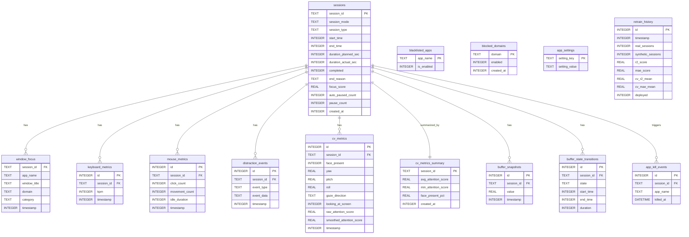

# Database Schema

This document provides the complete, column-level schema for all 14 tables in `focus-engine.db`.

---

## Entity Relationship Diagram

---

## Table: `sessions`

**Purpose**: The primary record of every focus session. One row is written when a session ends.

| Column | Type | Nullable | Default | Description |
|--------|------|----------|---------|-------------|
| `session_id` | TEXT | NO | — | UUID generated by `crypto.randomUUID()` in the renderer |
| `session_mode` | TEXT | NO | — | `'pomodoro'` or `'standard'` |
| `session_type` | TEXT | YES | NULL | `'focus'`, `'shortBreak'`, `'longBreak'`, or NULL for standard mode |
| `start_time` | INTEGER | NO | — | Unix timestamp in milliseconds (`Date.now()` at session start) |
| `end_time` | INTEGER | YES | NULL | Unix timestamp in milliseconds at session end |
| `duration_planned_sec` | INTEGER | YES | NULL | Target duration in seconds (Pomodoro only; NULL for standard) |
| `duration_actual_sec` | INTEGER | YES | NULL | Actual elapsed duration in seconds |
| `completed` | INTEGER | NO | 0 | Boolean: 1 if session completed normally, 0 if abandoned/force-ended |
| `end_reason` | TEXT | YES | NULL | `'auto_complete'`, `'manual_stop'`, `'abandoned'`, `'force_ended'` |
| `focus_score` | REAL | YES | NULL | ML-predicted focus score (0–100). Nullable if prediction not yet run |
| `auto_paused_count` | INTEGER | NO | 0 | Number of times the buffer auto-paused this session |
| `pause_count` | INTEGER | NO | 0 | Total pauses (auto + manual) |
| `created_at` | INTEGER | NO | `unixepoch()*1000` | Insert timestamp in milliseconds |

**Indexes**: `session_id` is PRIMARY KEY (implicit index).

**Note on `focus_score`**: This column is written by the analytics aggregation layer, not by the session save operation itself. It may be NULL for sessions where ML prediction was not available.

---

## Table: `window_focus`

**Purpose**: Stores the active window state sampled every 5 seconds by `TelemetryPoller`. This is the primary data source for app usage analysis.

| Column | Type | Nullable | Description |
|--------|------|----------|-------------|
| `session_id` | TEXT | NO | Foreign key to `sessions.session_id` |
| `app_name` | TEXT | NO | OS process name of the active window (e.g., `"Code.exe"`, `"Chrome"`) |
| `window_title` | TEXT | NO | Window title at time of capture |
| `domain` | TEXT | YES | Extracted domain if app is a browser (e.g., `"github.com"`) |
| `category` | TEXT | YES | Classification: `'productive'`, `'distraction'`, `'neutral'`, `'unknown'` |
| `timestamp` | INTEGER | NO | Unix ms timestamp of the reading |

**Index**: `idx_window_focus_session_id ON window_focus(session_id)` — for fast session-scoped history queries.

**No primary key**: This table has no surrogate key. Each row is a time-series sample, not a unique entity.

---

## Table: `keyboard_metrics`

**Purpose**: Stores keystrokes-per-minute readings sampled approximately every 10 seconds.

| Column | Type | Nullable | Description |
|--------|------|----------|-------------|
| `id` | INTEGER | NO | Auto-increment primary key |
| `session_id` | TEXT | NO | Foreign key to `sessions.session_id` |
| `kpm` | INTEGER | NO | Keystrokes per minute at time of recording |
| `timestamp` | INTEGER | NO | Unix ms timestamp |

**Index**: `idx_keyboard_metrics_session_id ON keyboard_metrics(session_id)`

---

## Table: `mouse_metrics`

**Purpose**: Stores mouse activity readings per interval.

| Column | Type | Nullable | Description |
|--------|------|----------|-------------|
| `id` | INTEGER | NO | Auto-increment primary key |
| `session_id` | TEXT | NO | Foreign key to `sessions.session_id` |
| `click_count` | INTEGER | NO | Mouse click count since last reading |
| `movement_count` | INTEGER | NO | Mouse movement event count since last reading |
| `idle_duration` | INTEGER | NO | Consecutive idle seconds at time of reading |
| `timestamp` | INTEGER | NO | Unix ms timestamp |

**Index**: `idx_mouse_metrics_session_id ON mouse_metrics(session_id)`

---

## Table: `distraction_events`

**Purpose**: Records discrete distraction incidents detected during a session. Used by the `BufferOrchestrator` to compute subtractive penalties.

| Column | Type | Nullable | Description |
|--------|------|----------|-------------|
| `id` | INTEGER | NO | Auto-increment primary key |
| `session_id` | TEXT | NO | Foreign key to `sessions.session_id` |
| `event_type` | TEXT | NO | Type of distraction (e.g., `'blacklisted_window'`, `'blocked_domain_attempt'`) |
| `event_data` | TEXT | NO | JSON string with event-specific detail |
| `timestamp` | INTEGER | NO | Unix ms timestamp when the distraction occurred |

**Index**: `idx_distraction_events_session_id ON distraction_events(session_id)`

---

## Table: `cv_metrics`

**Purpose**: Raw per-frame CV readings from the Python subprocess. Short-lived telemetry — no automatic purge is implemented.

| Column | Type | Nullable | Description |
|--------|------|----------|-------------|
| `id` | INTEGER | NO | Auto-increment primary key |
| `session_id` | TEXT | NO | Foreign key to `sessions.session_id` |
| `face_present` | INTEGER | NO | Boolean: 1 if face detected in frame, 0 if not |
| `yaw` | REAL | YES | Head yaw angle in degrees (positive = looking right) |
| `pitch` | REAL | YES | Head pitch angle in degrees (positive = looking up after correction) |
| `roll` | REAL | YES | Head roll angle in degrees |
| `gaze_direction` | TEXT | YES | `'center'`, `'left'`, `'right'`, `'up'`, `'down'` |
| `looking_at_screen` | INTEGER | NO | Boolean: 1 if attention combiner classified as on-screen |
| `raw_attention_score` | REAL | NO | Raw score: 0.2, 0.5, or 1.0 (see CV documentation) |
| `smoothed_attention_score` | REAL | NO | Exponentially smoothed score [0.0–1.0] |
| `timestamp` | INTEGER | NO | Unix ms timestamp from Python (`int(time.time() * 1000)`) |

**Index**: `idx_cv_metrics_session_id ON cv_metrics(session_id)`

---

## Table: `cv_metrics_summary`

**Purpose**: Permanent per-session aggregate of CV data. Computed when a session ends.

| Column | Type | Nullable | Description |
|--------|------|----------|-------------|
| `session_id` | TEXT | NO | Primary key; same as `sessions.session_id` |
| `avg_attention_score` | REAL | NO | Mean smoothed attention score over the session |
| `min_attention_score` | REAL | NO | Minimum smoothed attention score over the session |
| `face_present_pct` | REAL | NO | Percentage of frames where a face was detected |
| `created_at` | INTEGER | NO | Unix ms insert timestamp |

---

## Table: `buffer_snapshots`

**Purpose**: Persistent record of the focus buffer value, saved every 60 seconds. Used by `LivePredictionPoller` to compute ML features.

| Column | Type | Nullable | Description |
|--------|------|----------|-------------|
| `id` | INTEGER | NO | Auto-increment primary key |
| `session_id` | TEXT | NO | Foreign key to `sessions.session_id` |
| `value` | REAL | NO | Focus buffer value at snapshot time [0.0–100.0] |
| `timestamp` | INTEGER | NO | Unix ms timestamp |

**Index**: `idx_buffer_snapshots_session_id ON buffer_snapshots(session_id)`

---

## Table: `buffer_state_transitions`

**Purpose**: Records every time the focus buffer transitions between states (`focused` → `warning` → `critical` → `paused` and back). Used for time-in-state analytics.

| Column | Type | Nullable | Description |
|--------|------|----------|-------------|
| `id` | INTEGER | NO | Auto-increment primary key |
| `session_id` | TEXT | NO | Foreign key to `sessions.session_id` |
| `state` | TEXT | NO | `'focused'`, `'warning'`, `'critical'`, `'paused'` |
| `start_time` | INTEGER | NO | Unix ms when this state was entered |
| `end_time` | INTEGER | YES | Unix ms when this state was exited (NULL if still active) |
| `duration` | INTEGER | YES | Duration in ms (NULL if still active) |

**Index**: `idx_buffer_state_transitions_session_id ON buffer_state_transitions(session_id)`

---

## Table: `blocked_domains`

**Purpose**: User's website blocklist. Seeded with defaults on first launch.

| Column | Type | Nullable | Description |
|--------|------|----------|-------------|
| `domain` | TEXT | NO | Primary key; the domain to block (e.g., `"twitter.com"`) |
| `enabled` | INTEGER | NO | Default 1; 0 to disable without deleting |
| `created_at` | INTEGER | NO | Unix ms insert timestamp |

---

## Table: `blacklisted_apps`

**Purpose**: User's application blocklist. Seeded with defaults on first launch.

| Column | Type | Nullable | Description |
|--------|------|----------|-------------|
| `app_name` | TEXT | NO | Primary key; process name without extension (e.g., `"Spotify"`) |
| `is_enabled` | INTEGER | YES | Default 1; 0 to disable without deleting |

---

## Table: `app_kill_events`

**Purpose**: Audit log of every application termination performed during sessions.

| Column | Type | Nullable | Description |
|--------|------|----------|-------------|
| `id` | INTEGER | NO | Auto-increment primary key |
| `session_id` | TEXT | NO | Foreign key to `sessions.session_id` |
| `app_name` | TEXT | NO | Name of the killed application |
| `killed_at` | DATETIME | YES | Default `CURRENT_TIMESTAMP` (SQLite datetime, not Unix ms) |

> **Note**: This table uses `CURRENT_TIMESTAMP` (SQLite's text datetime), unlike all other tables which use Unix millisecond integers. This inconsistency is a known implementation detail.

---

## Table: `app_settings`

**Purpose**: Key-value configuration store for application settings.

| Column | Type | Nullable | Description |
|--------|------|----------|-------------|
| `setting_key` | TEXT | NO | Primary key; setting identifier |
| `setting_value` | TEXT | NO | JSON-encoded value |

**Known keys**:

| Key | Value Type | Description |
|-----|-----------|-------------|
| `cv_enabled` | `"true"` / `"false"` | Whether webcam attention tracking is active |
| `cv_permission` | `"granted"` / `"denied"` / `"pending"` | User's camera permission state |
| `cv_calibration` | JSON string | Calibration data (v1 or v2 format) |
| `last_retrain_time` | Integer string (ms) | Unix timestamp of last ML retraining |

---

## Table: `retrain_history`

**Purpose**: Append-only log of every ML retraining run. Never deleted.

| Column | Type | Nullable | Description |
|--------|------|----------|-------------|
| `id` | INTEGER | NO | Auto-increment primary key |
| `timestamp` | INTEGER | NO | Unix ms when retraining was triggered |
| `real_sessions` | INTEGER | NO | Number of real sessions in the training window |
| `synthetic_sessions` | INTEGER | NO | Number of synthetic sessions in the training window |
| `r2_score` | REAL | YES | Test set R² score of the new model |
| `mae_score` | REAL | YES | Test set MAE of the new model |
| `cv_r2_mean` | REAL | YES | 5-fold cross-validated mean R² |
| `cv_mae_mean` | REAL | YES | 5-fold cross-validated mean MAE |
| `deployed` | INTEGER | NO | 1 if the new model was deployed, 0 if rejected |
