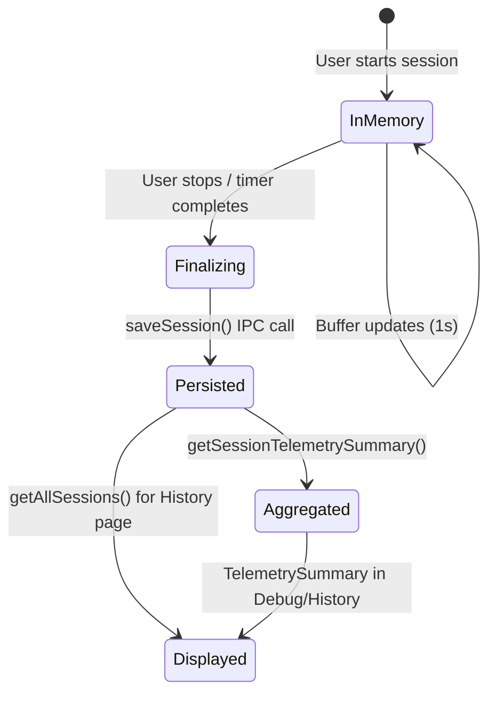
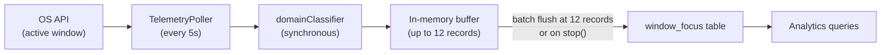
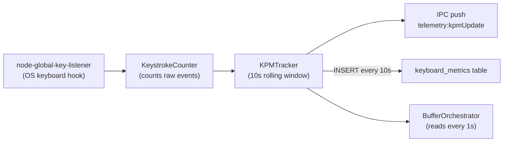
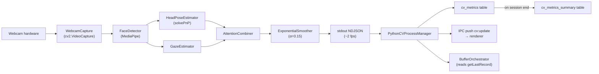
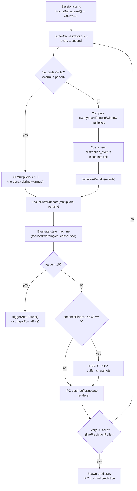
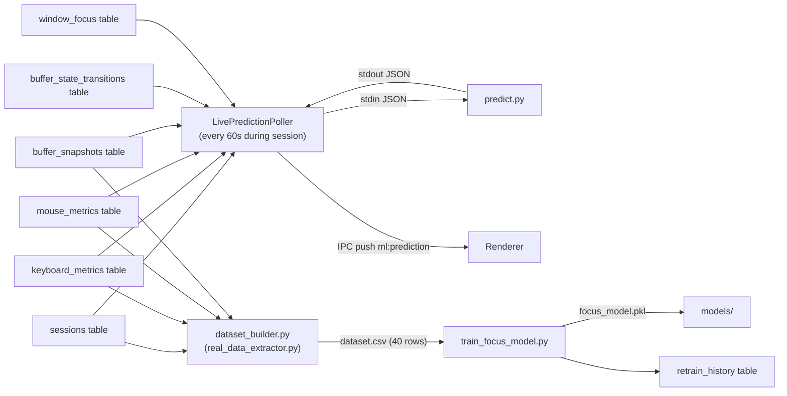

# Data Lifecycle

This document traces the complete journey of every data type from creation to final storage and consumption.

---

## Session Data Lifecycle

**Key insight**: Session data lives entirely in React state during the session. The database only receives a single write at the very end. This means:
- If the app crashes mid-session, **that session is lost** (no partial saves).
- Database writes never block the timer or UI.

---

## Window Focus Data Lifecycle

**Batch size**: 12 records × 5s interval = flush every ~60 seconds.

**On stop**: `TelemetryPoller.stop()` calls `flushBuffer()` unconditionally before clearing state, ensuring no records are lost when a session ends.

---

## Keyboard Metrics Lifecycle

---

## CV Data Lifecycle

**Privacy boundary**: Everything to the left of `stdout NDJSON` runs in the Python process. No pixel data crosses the process boundary. Only the numeric fields shown in the JSON schema are transmitted.

---

## Focus Buffer Lifecycle

---

## ML Feature Data Lifecycle

---

## Data Retention Summary

| Data | Created | Updated | Deleted |
|------|---------|---------|---------|
| Session row | At session end | Never (except focus_score update) | Never |
| Window focus | Every 5s during session | Never | Never |
| Keyboard metrics | Every ~10s during session | Never | Never |
| Mouse metrics | Every ~10s during session | Never | Never |
| CV metrics | ~Every 500ms during session | Never | Never |
| CV summary | At session end | Never | Never |
| Buffer snapshots | Every 60s during session | Never | Never |
| Buffer transitions | On state change | `end_time`/`duration` set on next change | Never |
| Distraction events | On detection | Never | Never |
| App kill events | On app termination | Never | Never |
| Settings | On first launch / user change | On user change | Never |
| Retrain history | On each retrain | Never | Never |

> **No data is ever deleted from the database.** The application has no purge, archival, or GDPR-style deletion mechanism. As sessions accumulate over months and years, the database will grow. This is a known limitation with no current mitigation.
