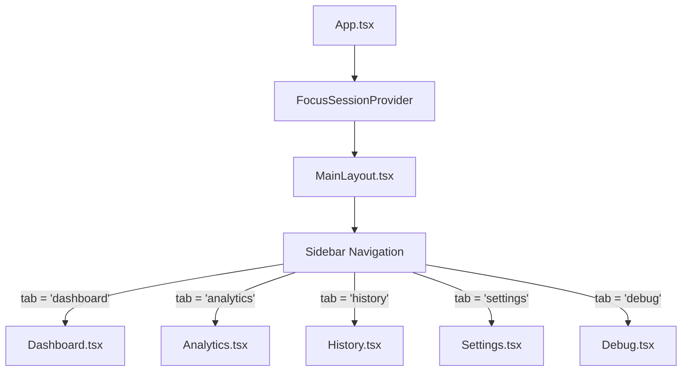

# Frontend Overview

## 1. Introduction & Purpose

The frontend of **Focus Engine** is an interactive, real-time desktop UI built in **React 18** and **TypeScript**, executed within the Electron Chromium renderer process. It acts as the command center for the entire Focus Engine ecosystem:
- Managing session configuration, countdowns, and stopwatch timings.
- Subscribing to high-frequency telemetry (keystrokes, mouse events, window changes).
- Rendering live cognitive state estimates via the multi-modal Focus Buffer gauge.
- Providing visual warnings when attention degrades or unauthorized applications/domains are accessed.
- Visualizing retrospective analytics (weekly focus heatmaps, productivity metrics, distraction trends, and automated ML recommendations).
- Offering administrative and hardware calibration tooling (camera attention calibration, domain/app blacklists, diagnostic logging).

---

## 2. Technology Stack & Tooling

| Layer / Concern | Technology | Purpose |
|---|---|---|
| **Core Framework** | React 18 (`react`, `react-dom`) | Declarative, component-driven UI with concurrent rendering primitives |
| **Language** | TypeScript 5 (`strict: true`) | Strict type contracts between UI hooks and IPC data models |
| **Build Tooling** | Vite (`electron-vite`) | Instant HMR development server and optimized rollup bundling |
| **Styling & Theme** | CSS Modules / Custom Design Tokens | Sleek dark-mode aesthetic (`#0f0f17`, `#181824`, `#222235`, indigo `#818cf8`) |
| **Iconography** | `lucide-react` | Unified SVG icons (Play, Pause, Shield, Camera, AlertCircle, etc.) |
| **Runtime Environment** | Electron 30+ Renderer Process | Chromium window with strict context isolation (`contextIsolation: true`, `nodeIntegration: false`) |

---

## 3. Directory Layout

The frontend source code is organized under `src/renderer/`:

```text
src/renderer/
│
├── App.tsx                           # Main router & global state providers
├── main.tsx                          # React 18 createRoot bootstrap
├── env.d.ts                          # Vite and global environment definitions
├── index.html                        # HTML entry point (SF Pro / Inter font loading)
│
├── assets/                           # SVG assets, base stylesheet, design tokens
│   ├── base.css                      # Global reset, typography, and utility tokens
│   ├── main.css                      # Global scrollbars, pulse animations, layout styles
│   ├── electron.svg
│   └── wavy-lines.svg
│
├── types/                            # Frontend domain type declarations
│   └── timer.ts                      # SessionMode, SessionType, TimerState, TimerDurations
│
├── context/                          # Global React Context providers
│   └── FocusSessionContext.tsx       # Singleton provider for timer engine & session state
│
├── hooks/                            # Core custom business logic hooks
│   ├── useTimerEngine.ts             # High-precision Date.now() timer engine
│   ├── useFocusSession.ts            # Session orchestration, blocking, and IPC lifecycle
│   ├── useFocusBuffer.ts             # Real-time Focus Buffer state subscription
│   ├── useLiveTelemetry.ts           # Telemetry poller subscription (KPM, idle, window)
│   └── useAnalyticsData.ts           # Asynchronous loader for heatmaps, streaks, stats
│
├── layouts/                          # App shell & persistent navigation
│   └── MainLayout.tsx                # Sidebar navigation, route header, status indicator
│
├── pages/                            # Top-level view routes
│   ├── Dashboard.tsx                 # Real-time timer, gauge, live telemetry, and CV HUD
│   ├── Analytics.tsx                 # Weekly heatmap, streaks, productivity breakdown, ML advice
│   ├── History.tsx                   # Historical session table with expandable drill-down cards
│   ├── Settings.tsx                  # Domain blocking, app blacklist, webcam calibration
│   └── Debug.tsx                     # Live IPC inspection, event logs, buffer manipulation
│
└── components/                       # Shared and domain-specific UI components
    ├── ui/                           # Primitive reusable design components
    │   ├── Button.tsx                # Variants (primary, secondary, danger, ghost), loading state
    │   ├── Card.tsx                  # Elevated dark glass container with border glows
    │   ├── Modal.tsx                 # Backdrop blur overlay with keyboard focus trap
    │   ├── StatCard.tsx              # Metric display tile with trend indicator
    │   ├── SettingsPanel.tsx         # Section container with action headers
    │   └── TimerDisplay.tsx          # SVG circular countdown/stopwatch with monospace readout
    │
    ├── FocusBufferGauge.tsx          # Real-time animated SVG arc (0–100%) with color shifting
    ├── BufferSignalBreakdown.tsx     # 4-bar breakdown (CV, Keyboard, Mouse, Window)
    ├── LiveTelemetryPanel.tsx        # Live active window, KPM counter, and idle indicator
    ├── CVAttentionPanel.tsx          # Head pose (pitch/yaw/roll), gaze vector, attention state
    ├── CVCalibrationHelper.tsx       # 5-step webcam calibration wizard for user head alignment
    ├── CVPermissionPrompt.tsx        # Camera permission banner with privacy disclosure
    ├── DistractionAlert.tsx          # Floating ambient alert for productive violations
    ├── LivePredictionBadge.tsx       # Real-time Random Forest cognitive state classification badge
    ├── FocusHeatmap.tsx              # 7-day x 24-hour interactive canvas/grid productivity matrix
    ├── StreakDisplay.tsx             # Daily habit tracker with flame badges and streak milestones
    ├── ProductivityStatsGrid.tsx     # Aggregate KPI tiles (best hour, total time, focus score)
    ├── RecommendationsPanel.tsx      # Rule-based and ML-generated behavioral advice cards
    └── ErrorBoundary.tsx             # Class-based React error boundary with fallback UI
```

---

## 4. Page Architecture & Routing

Focus Engine avoids third-party router libraries (such as `react-router-dom`) in favor of a lean, stateful client-side page switcher housed in `App.tsx`:



### 1. Dashboard (`Dashboard.tsx`)
- The operational core of the application.
- Embeds `TimerDisplay` with dynamic SVG circular progress.
- Renders `FocusBufferGauge` and `BufferSignalBreakdown` during active focus sessions.
- Displays live telemetry (`LiveTelemetryPanel`), real-time ML state (`LivePredictionBadge`), and computer vision head/gaze metrics (`CVAttentionPanel`).
- Hosts auto-pause and force-end notification modals when user absence or sustained distraction occurs.

### 2. Analytics (`Analytics.tsx`)
- High-level productivity intelligence dashboard.
- Fetches aggregated database metrics via `useAnalyticsData()`.
- Renders:
  - `ProductivityStatsGrid`: Average focus score, total focused minutes, longest focus streak, and best/worst performing hours.
  - `StreakDisplay`: Current daily streak, longest streak record, and weekly streak activity indicators.
  - `FocusHeatmap`: Day-of-week vs. Hour-of-day productivity heatmap highlighting optimal focus windows.
  - `RecommendationsPanel`: Data-driven coaching recommendations (identifying top distraction domains and killer applications).

### 3. History (`History.tsx`)
- Comprehensive tabular log of all recorded sessions (`sessions` table).
- Features expandable row cards showing detailed analytics:
  - Time breakdown across productive, neutral, and distraction categories.
  - Distraction events timeline with exact timestamps, offending apps/domains, and buffer penalty values.
  - Computer vision metrics (average face presence, average attention score, distraction duration).

### 4. Settings (`Settings.tsx`)
- Configuration interface for user preferences and blocking rules.
- Manages blocked domains list (`blocked_domains` table) with input sanitization.
- Manages blacklisted executable processes (`blacklisted_apps` table).
- Provides webcam toggles and launches the interactive `CVCalibrationHelper` wizard.

### 5. Debug (`Debug.tsx`)
- Diagnostic control console for system developers and quality assurance.
- Allows real-time inspection of active IPC event streams.
- Provides direct test controls to trigger synthetic buffer penalties, auto-pauses, force-ends, and simulated distraction events.

---

## 5. Security & Isolation Model

The frontend adheres strictly to the Principle of Least Privilege:
1. **No Node.js Access**: `nodeIntegration` is disabled. The UI cannot invoke `fs`, `child_process`, or `net`.
2. **Context Isolation**: The DOM and React component tree execute in a sandboxed JavaScript context.
3. **Explicit Bridge**: All interactions with the main process and hardware pass through `window.focusEngineAPI`, defined in `src/preload/index.ts` via `contextBridge.exposeInMainWorld()`.
4. **Input Sanitization**: All user inputs in forms (domain names, application names) are trimmed, lowercased, and validated before submission to IPC handlers.
