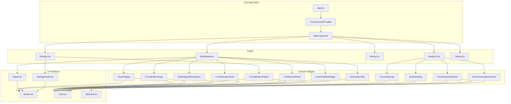

# Component Architecture

## 1. Overview & Architectural Hierarchy

The Focus Engine frontend is designed around modular, composable, and loosely coupled components. It separates pure visual presentation primitives from stateful domain widgets and complex orchestration views.



---

## 2. UI Component Primitives (`src/renderer/components/ui/`)

Focus Engine maintains a lightweight design system implemented with vanilla CSS inlined into component modules to ensure zero build-time styling dependencies and instant render performance.

### 1. `Button.tsx`
- **Location**: `src/renderer/components/ui/Button.tsx`
- **Variants**: `primary`, `secondary`, `danger`, `ghost`
- **Sizes**: `sm`, `md`, `lg`
- **Features**: Disabled state styling, loading spinner rendering, Lucide icon slot support, and ripple/hover transitions.
- **Props Interface**:
  ```typescript
  export interface ButtonProps extends React.ButtonHTMLAttributes<HTMLButtonElement> {
    variant?: 'primary' | 'secondary' | 'danger' | 'ghost'
    size?: 'sm' | 'md' | 'lg'
    isLoading?: boolean
    icon?: React.ReactNode
  }
  ```

### 2. `Card.tsx`
- **Location**: `src/renderer/components/ui/Card.tsx`
- **Purpose**: Elevated container providing visual hierarchy against the dark background.
- **Styling**: Background `#181824`, 1px border `#2a2a3c`, rounded 16px corners, subtle drop shadow, and optional hover glow.
- **Props Interface**:
  ```typescript
  export interface CardProps {
    children: React.ReactNode
    style?: React.CSSProperties
    className?: string
    onClick?: () => void
  }
  ```

### 3. `Modal.tsx`
- **Location**: `src/renderer/components/ui/Modal.tsx`
- **Purpose**: Urgent interaction overlays (Auto-Pause alert, Force-End warning, CV calibration prompt).
- **Features**: Full-screen backdrop blur (`backdrop-filter: blur(8px)`), ESC key event handler, focus trapping, and centered presentation.
- **Props Interface**:
  ```typescript
  export interface ModalProps {
    isOpen: boolean
    onClose?: () => void
    title?: string
    children: React.ReactNode
    width?: string
  }
  ```

### 4. `StatCard.tsx`
- **Location**: `src/renderer/components/ui/StatCard.tsx`
- **Purpose**: Key performance metric display widget used in analytics and summary modals.
- **Features**: Big numeric readout, descriptive subtitle, optional icon badge, and trend indicator (positive/negative/neutral).

### 5. `TimerDisplay.tsx`
- **Location**: `src/renderer/components/ui/TimerDisplay.tsx`
- **Purpose**: Central visual element for running and paused sessions.
- **Implementation**:
  - Dynamically renders an SVG ring (`<svg viewBox="0 0 200 200">`) with radius $r = 90\text{px}$ and circumference $C = 2 \times \pi \times 90 \approx 565.48\text{px}$.
  - Stroke dash offset calculated from `progress` ratio ($0.0 \dots 1.0$).
  - Monospace digital readout displaying `HH:MM:SS` (or `MM:SS`).
  - Text badge indicating current state (`idle`, `running`, `paused`, `completed`) with color matching:
    - Running: Indigo (`#818cf8`)
    - Paused: Amber (`#f59e0b`)
    - Completed: Emerald (`#10b981`)
    - Idle: Slate (`#64748b`)

---

## 3. Domain-Specific Widgets

### 1. `FocusBufferGauge.tsx`
- **File**: `src/renderer/components/FocusBufferGauge.tsx`
- **Role**: Visualizes the live cognitive energy buffer value ($0 \dots 100$).
- **Features**:
  - Animated radial gauge arc.
  - Three visual state zones:
    - **Focused** ($> 50$): Cyan/Emerald gradient glow.
    - **Warning** ($20 - 50$): Amber warning pulse.
    - **Critical** ($< 20$): Rapid red heartbeat pulse.
  - Displays warmup status indicator during the first 30 seconds of a session.

### 2. `BufferSignalBreakdown.tsx`
- **File**: `src/renderer/components/BufferSignalBreakdown.tsx`
- **Role**: Decomposes the composite buffer score into four individual real-time component signals:
  1. **CV Signal** ($0.0 - 1.0$): Webcam head pose & eye gaze attention.
  2. **Keyboard Signal** ($0.0 - 1.0$): Keystrokes per minute and typing burst rhythm.
  3. **Mouse Signal** ($0.0 - 1.0$): Movement velocity and click continuity.
  4. **Window Signal** ($0.0 - 1.0$): Foreground application categorization (productive vs. distraction).

### 3. `CVAttentionPanel.tsx`
- **File**: `src/renderer/components/CVAttentionPanel.tsx`
- **Role**: Displays computer vision telemetry generated by the Python CV engine:
  - Face presence indicator.
  - Head pose angular displacement: Pitch (nodding), Yaw (turning), Roll (tilting).
  - Gaze vector coordinates ($x, y$).
  - Real-time attention score ($0 \dots 100\%$).

### 4. `CVCalibrationHelper.tsx`
- **File**: `src/renderer/components/CVCalibrationHelper.tsx`
- **Role**: Interactive multi-step calibration wizard guiding the user to calibrate camera pitch, yaw, and gaze neutral centers.
- **Workflow**:
  1. Center face in camera view.
  2. Maintain natural forward gaze for 5 seconds.
  3. Look left, right, up, down to determine extreme bounding thresholds.
  4. Persists baseline calibration offsets to SQLite (`settings` table) via IPC.

### 5. `LiveTelemetryPanel.tsx`
- **File**: `src/renderer/components/LiveTelemetryPanel.tsx`
- **Role**: Displays low-level OS telemetry:
  - Active foreground window title and executable name.
  - Extracted browser domain (if active window is Chrome, Edge, Brave, Firefox).
  - Calculated category badge (`Productive`, `Distraction`, `Neutral`).
  - Current Typing Velocity (KPM - Keystrokes Per Minute).
  - Idle duration counter (seconds since last physical input event).

### 6. `FocusHeatmap.tsx`
- **File**: `src/renderer/components/FocusHeatmap.tsx`
- **Role**: Renders a 7-day (Monday to Sunday) by 24-hour matrix of productivity intensity.
- **Data Source**: Aggregated from `sessions` and `window_focus_events` via `analytics.getHeatmap()`.
- **Interactivity**: Hover tooltips showing exact average focus score and session count for each 1-hour block.

### 7. `RecommendationsPanel.tsx`
- **File**: `src/renderer/components/RecommendationsPanel.tsx`
- **Role**: Displays personalized actionable feedback derived from user behavioral patterns.
- **Logic**: Combines rule-based heuristic audits (identifying highest kill count apps and distraction domains) with machine learning output.

---

## 4. Fault Tolerance: Error Boundary (`ErrorBoundary.tsx`)

To prevent an unexpected UI rendering exception from crashing the entire Electron window, critical components are wrapped in `ErrorBoundary.tsx`:
- Implements `componentDidCatch(error: Error, errorInfo: React.ErrorInfo)`.
- Renders a graceful fallback card displaying the error message and an "Attempt Recovery" button.
- Ensures the background session timer and IPC communication continue uninterrupted even if a specific visualization widget fails.
