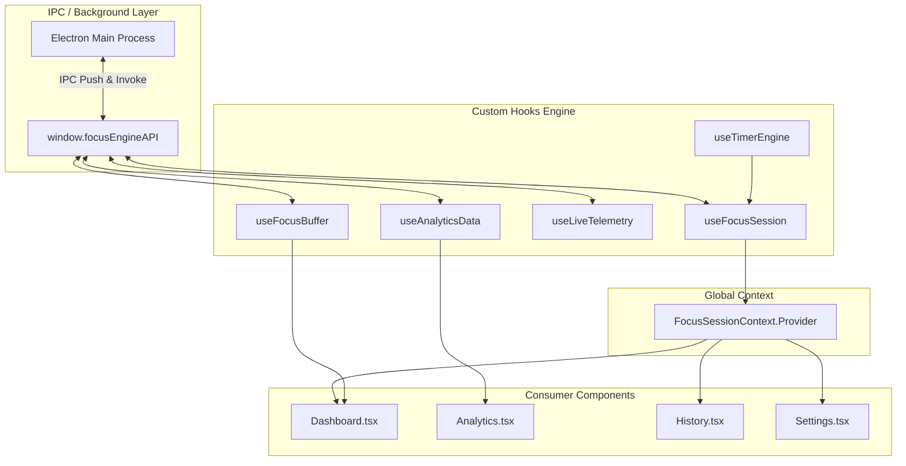

# State Management

## 1. State Management Philosophy

Focus Engine uses a pragmatic, lightweight, and robust state architecture designed for real-time desktop applications. Rather than introducing heavy external state libraries (such as Redux, MobX, or Zustand), it leverages:
1. **React 18 Context API** (`FocusSessionContext.tsx`): Singleton source of truth for global timer and active session state.
2. **Specialized Custom Hooks**: Encapsulated stateful machines (`useTimerEngine`, `useFocusSession`, `useFocusBuffer`, `useLiveTelemetry`, `useAnalyticsData`).
3. **Ref Anchors (`useRef`)**: Imperative mutable references for timestamps, interval timers, and database write-guards to eliminate stale closures and prevent duplicate operations.



---

## 2. State Partitioning

State is divided into four distinct operational categories:

| State Tier | Scope | Storage Location | Example Variables |
|---|---|---|---|
| **High-Precision Ephemeral** | Hook-internal | `useRef` anchors | `startTimeRef`, `accumulatedSecondsRef`, `sessionIdRef`, `hasSavedRef` |
| **Reactive Session State** | Application-wide | `FocusSessionContext` | `timerState`, `mode`, `time`, `appsKilled`, `summary`, `blockingStatus` |
| **High-Frequency Telemetry** | View-level | `useFocusBuffer`, `useLiveTelemetry` | `bufferValue`, `bufferState`, `activeWindow`, `kpm`, `idleSeconds` |
| **Persistent Historical State** | Database-backed | SQLite via IPC | Completed sessions, heatmap matrix, blacklisted rules, streaks |

---

## 3. The `FocusSessionContext` Architecture

### 1. Structure & Implementation
Located in `src/renderer/context/FocusSessionContext.tsx`:
```typescript
import React, { createContext, useContext } from 'react'
import { useFocusSession } from '../hooks/useFocusSession'

type FocusSessionContextType = ReturnType<typeof useFocusSession>

const FocusSessionContext = createContext<FocusSessionContextType | null>(null)

export const FocusSessionProvider: React.FC<{ children: React.ReactNode }> = ({ children }) => {
  const session = useFocusSession()
  return (
    <FocusSessionContext.Provider value={session}>
      {children}
    </FocusSessionContext.Provider>
  )
}
```

### 2. Why Context is Essential Here
- The running timer, active session ID, and blocking status must be accessible across multiple views (e.g. `Dashboard`, `History`, `Settings`).
- If a user navigates to `History` or `Settings` while a focus session is running, the timer and telemetry subscribers must NOT unmount or reset. By lifting `FocusSessionProvider` above `MainLayout` in `App.tsx`, the session lifecycle remains continuous across tab switches.

---

## 4. Mitigating Stale Closures & Race Conditions

In real-time React applications using `setInterval`, JavaScript closures frequently capture stale state values. Focus Engine systematically prevents this using three core patterns:

### Pattern A: The Latest Callback Ref Pattern
In `useTimerEngine.ts`, the timer tick function depends on reactive values (`mode`, `totalDurationSeconds`). To ensure the active interval always invokes the latest logic without tearing down and recreating the interval every render:
```typescript
// Latest callback ref pattern to avoid stale closures in setInterval
const tickRef = useRef<() => void>(tick)
useEffect(() => {
  tickRef.current = tick
}, [tick])

useEffect(() => {
  intervalRef.current = setInterval(() => {
    tickRef.current()
  }, 200)
}, [])
```

### Pattern B: Double-Save Prevention Guard
When a countdown reaches `0:00`, multiple React effect triggers or user clicks could theoretically invoke `finalizeSession()` multiple times. A boolean ref anchor acts as an atomic execution lock:
```typescript
const hasSavedRef = useRef<boolean>(false)

const finalizeSession = async () => {
  if (hasSavedRef.current || !sessionIdRef.current) return
  hasSavedRef.current = true
  // ... execute single database write
}
```

### Pattern C: Epoch Timestamp Anchoring
Rather than incrementing a numeric state variable (`count = count + 1`), the timer records the true system wall-clock time (`Date.now()`) in `startTimeRef.current`. Even if the JavaScript event loop is delayed by 500ms due to heavy background operations, the subsequent calculation:
$$\text{elapsed} = \lfloor(\text{Date.now}() - \text{startTimeRef.current}) / 1000\rfloor$$
computes mathematically accurate duration without drift.

---

## 5. Performance Optimization & Re-render Isolation

High-frequency telemetry updates (e.g. 1Hz active window checks and 200ms timer ticks) can cause catastrophic UI re-renders if state is improperly scoped:

1. **Sub-second ticks isolate to `TimerDisplay`**: Only the timer clock re-renders on ticks; sidebar navigation and background panels remain static.
2. **Buffer subscription decoupled from Timer**: `useFocusBuffer` maintains its own internal state and only notifies components listening to the gauge, avoiding full Dashboard re-renders on minor signal shifts.
3. **Memoized Handlers**: All action dispatchers (`startPomodoroSession`, `pauseSession`, `resumeSession`, `stopSession`) are wrapped in `useCallback` with strict dependency lists to preserve reference equality across renders.
