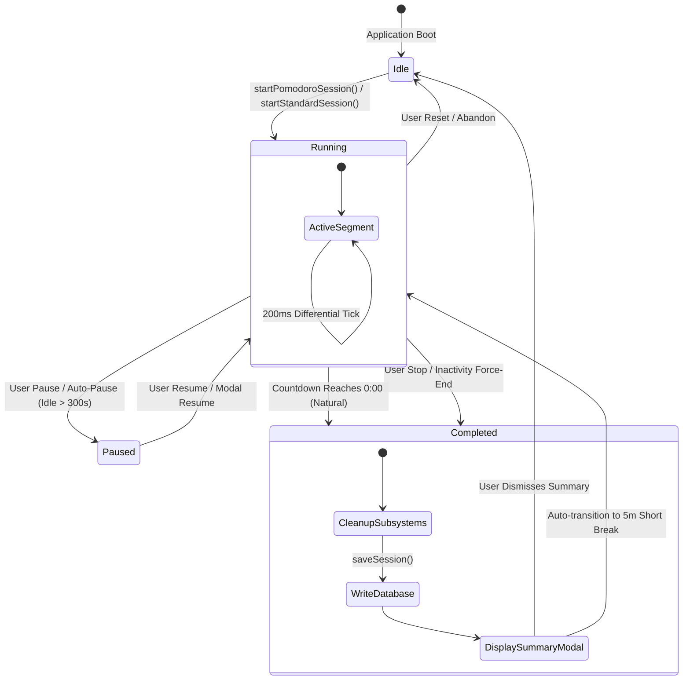

# Timer Lifecycle

## 1. Overview & Lifecycle State Machine

A timer in Focus Engine transitions through five formal states: `idle`, `running`, `paused`, `completed`, and `persisted`. The lifecycle is orchestrated by `useFocusSession.ts` in combination with `useTimerEngine.ts`.

---

## 2. Detailed Lifecycle Stages

### Stage 1: Pre-Launch & Configuration
- User is on the `Dashboard` page. The timer is in the `'idle'` state.
- User selects either:
  1. **Pomodoro Mode**: Focus (25m), Short Break (5m), or Long Break (15m).
  2. **Standard Mode**: Open-ended stopwatch with no pre-allocated duration limit.
- No background workers, CV cameras, or OS blocking mechanisms are active.

---

### Stage 2: Session Initialization & Launch Sequence
When the user clicks the "Start" button:

```mermaid
sequenceDiagram
    autonumber
    actor User
    participant Dash as Dashboard.tsx
    participant UFS as useFocusSession.ts
    participant UTE as useTimerEngine.ts
    participant Preload as window.focusEngineAPI
    participant Main as Electron Main Process

    User->>Dash: Clicks "Start Focus (25m)"
    Dash->>UFS: startPomodoroSession('focus', 25)
    UFS->>UFS: Generate sessionId = crypto.randomUUID()
    
    rect rgb(30, 30, 50)
        Note over UFS,Main: Hardware & OS Blocking Initialization
        UFS->>Preload: startBlocking()
        Preload->>Main: IPC 'blocking:start' (hosts file modification)
        UFS->>Preload: killBlacklistedApps(sessionId)
        Preload->>Main: IPC 'blocking:kill-apps'
        UFS->>Preload: startTelemetry(sessionId, 'pomodoro')
        Preload->>Main: IPC 'telemetry:start' (starts active window & mouse polling)
        UFS->>Preload: startCV(sessionId)
        Preload->>Main: IPC 'cv:start' (spawns Python CV engine child process)
    end

    UFS->>UTE: startPomodoro('focus', 25)
    UTE->>UTE: Record sessionStartTime = Date.now()
    UTE->>UTE: startTimeRef = Date.now(), accumulated = 0
    UTE->>UTE: Start 200ms setInterval tick
    UTE-->>Dash: timerState = 'running'
```

---

### Stage 3: Active Running Loop
- Every 200ms, the internal tick callback executes:
  1. Computes total elapsed seconds: $E_{\text{total}} = A + \lfloor(t_{\text{now}} - t_{\text{start}}) / 1000\rfloor$.
  2. In Pomodoro mode: $T_{\text{remaining}} = D_{\text{planned}} - E_{\text{total}}$.
  3. Updates React state `setTime(remaining)`.
- Concurrently, the frontend receives incoming IPC event broadcasts:
  - `onActiveWindowUpdate`: Real-time application name and productive/distraction categorization.
  - `onFocusBufferUpdate`: Live cognitive energy buffer level ($0 \dots 100$).
  - `onKpmUpdate`: Keystrokes per minute.

---

### Stage 4: Pausing & Resuming

#### A. User-Initiated Pause
1. User clicks "Pause" in `Dashboard.tsx`.
2. `useFocusSession.pauseSession()` calls `window.focusEngineAPI.pauseBuffer()` to freeze the cognitive buffer decay rate.
3. `useTimerEngine.pause()` halts the 200ms interval, accumulates the segment elapsed time into `accumulatedSecondsRef.current`, and sets `startTimeRef.current = 0`.
4. Timer state becomes `'paused'`.

#### B. Auto-Pause (Inactivity Detection)
1. If the user stops typing and moving the mouse for $> 300$ seconds, the main process `BufferOrchestrator` detects sustained inactivity.
2. Main process emits IPC event `session:auto-pause`.
3. `useFocusSession.ts` listens via `onSessionAutoPause()`:
   - Increments `pauseCountRef.current`.
   - Calls `timer.pause()`.
   - Opens `showAutoPauseModal(true)` to alert the returning user.

#### C. Resuming
1. User clicks "Resume Focus" in the dashboard or modal.
2. Calls `resumeSession()`:
   - Invokes `window.focusEngineAPI.resumeBuffer()`.
   - Sets `startTimeRef.current = Date.now()`.
   - Restarts 200ms tick interval.
   - State returns to `'running'`.

---

### Stage 5: Termination & Teardown

A session terminates under one of four terminal end reasons:

| End Reason | Trigger Condition | Success Flag |
|---|---|---|
| `'auto_complete'` | Pomodoro countdown hits `0:00` naturally | `completed: true` |
| `'manual_stop'` | User clicks "Stop" in Standard mode | `completed: true` |
| `'abandoned'` | User clicks "Stop" / "Reset" early in Pomodoro mode | `completed: false` |
| `'force_ended'` | Buffer drops to 0 or idle timeout threshold exceeded | `completed: false` |

#### The Teardown Sequence (`finalizeSession`)

```mermaid
sequenceDiagram
    autonumber
    participant UFS as useFocusSession.ts
    participant Preload as window.focusEngineAPI
    participant DB as SQLite Database

    UFS->>UFS: hasSavedRef.current = true (atomic guard)
    
    rect rgb(40, 20, 20)
        Note over UFS,Preload: Subsystem Teardown
        UFS->>Preload: stopTelemetry()
        UFS->>Preload: stopCV()
        UFS->>Preload: stopBlocking() (restores original hosts file)
    end

    rect rgb(20, 40, 20)
        Note over UFS,DB: Database Commit
        UFS->>Preload: saveSession(sessionRecord)
        Preload->>DB: INSERT INTO sessions ...
        UFS->>Preload: getSessionSummary(sessionId)
        Preload->>DB: Aggregate telemetry & CV metrics
    end

    UFS-->>UFS: setSummary(summaryData)
```

---

### Stage 6: Break Transition Workflow
When a Pomodoro focus session finishes with `'auto_complete'`:
1. The `Dashboard` renders a completion modal with session statistics (focus score, apps killed, distraction count).
2. When the user clicks "Continue to Break" (`clearSummary()`):
   - Focus Engine automatically transitions into a **5-minute Short Break** (`startPomodoroSession('shortBreak', 5)`).
   - During break sessions, **blocking is disabled**, **webcam CV tracking is off**, and the **focus buffer loop is dormant**, allowing the user full access to rest without penalties.
