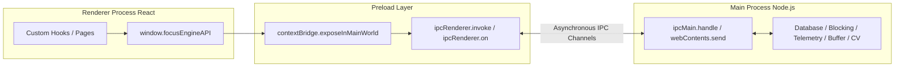

# Frontend-Backend Communication

## 1. IPC Architecture Overview

Focus Engine enforces a strict security boundary between the Chromium renderer (frontend) and the Node.js runtime (Electron main process). Direct Node.js access is disabled in the frontend (`nodeIntegration: false`, `contextIsolation: true`).

All communication occurs via **Inter-Process Communication (IPC)** channels bridged through the Preload script using `contextBridge.exposeInMainWorld('focusEngineAPI', api)`.



---

## 2. Communication Paradigms

Focus Engine utilizes two distinct IPC communication paradigms:

### Paradigm 1: Asynchronous Request-Response (`ipcRenderer.invoke`)
Used for queries, configuration updates, and lifecycle commands where the frontend requests an action and waits for a structured result.

- **Frontend Call**:
  ```typescript
  const result = await window.focusEngineAPI.saveSession(sessionData)
  ```
- **Preload Implementation**:
  ```typescript
  saveSession: (session) => ipcRenderer.invoke('session:save', session)
  ```
- **Main Process Handler**:
  ```typescript
  ipcMain.handle('session:save', async (_event, session) => {
    return sessionRepository.saveSession(session)
  })
  ```
- **Return Contract**:
  Every handler returns a standardized response envelope:
  ```typescript
  interface IPCResponse<T> {
    success: boolean
    data?: T
    error?: string
  }
  ```

---

### Paradigm 2: Real-Time Event Streams (`ipcRenderer.on`)
Used for high-frequency telemetry, cognitive buffer updates, and asynchronous system notifications pushed from background services to the UI.

- **Main Process Broadcast**:
  ```typescript
  mainWindow.webContents.send('telemetry:active-window', windowData)
  ```
- **Preload Listener & Teardown Wrapper**:
  ```typescript
  onActiveWindowUpdate: (callback) => {
    const subscription = (_event, data) => callback(data)
    ipcRenderer.on('telemetry:active-window', subscription)
    return () => ipcRenderer.removeListener('telemetry:active-window', subscription)
  }
  ```
- **Frontend Hook Subscription**:
  ```typescript
  useEffect(() => {
    const unsubscribe = window.focusEngineAPI.onActiveWindowUpdate((data) => {
      setActiveWindow(data)
    })
    return () => unsubscribe() // Clean teardown on component unmount!
  }, [])
  ```

---

## 3. Comprehensive IPC Channel Catalog

| Channel Name | Direction | Payload | Return / Response | Purpose |
|---|---|---|---|---|
| `session:save` | Two-Way | `SaveSessionArgs` | `IPCResponse<boolean>` | Persists completed or abandoned session |
| `session:get-all` | Two-Way | None | `IPCResponse<SessionRow[]>` | Fetches historical session log |
| `session:get-summary` | Two-Way | `sessionId: string` | `IPCResponse<SessionSummary>` | Aggregates telemetry, CV, and distraction stats |
| `blocking:start` | Two-Way | None | `IPCResponse<void>` | Activates `hosts` file domain redirection |
| `blocking:stop` | Two-Way | None | `IPCResponse<void>` | Restores original `hosts` file |
| `blocking:kill-apps` | Two-Way | `sessionId: string` | `IPCResponse<string[]>` | Scans running processes and terminates blacklisted EXEs |
| `telemetry:start` | Two-Way | `sessionId, mode` | `IPCResponse<void>` | Starts 1Hz OS active window and KPM poller |
| `telemetry:stop` | Two-Way | None | `IPCResponse<void>` | Halts OS telemetry polling loop |
| `cv:start` | Two-Way | `sessionId: string` | `IPCResponse<void>` | Spawns Python CV engine child process |
| `cv:stop` | Two-Way | None | `IPCResponse<void>` | Sends graceful SIGINT/SIGTERM to Python CV process |
| `telemetry:active-window` | One-Way (Push) | `ActiveWindowInfo` | None | Pushes active window title and domain classification |
| `telemetry:buffer-update` | One-Way (Push) | `BufferSnapshot` | None | Pushes live composite buffer score and 4 signals |
| `session:auto-pause` | One-Way (Push) | None | None | Signals user inactivity pause ($> 300\text{ s}$) |
| `session:force-end` | One-Way (Push) | None | None | Signals critical buffer depletion or timeout |
| `telemetry:health-warning` | One-Way (Push) | `HealthStatus` | None | Warns if OS telemetry listeners stall |

---

## 4. Error Handling & Resilience

1. **Structured Failure Envelopes**: If a database query fails or a process cannot be killed due to insufficient permissions, the main process catches the exception and returns `{ success: false, error: err.message }` rather than crashing the IPC pipeline.
2. **Subscription Leak Prevention**: All listener functions in the preload layer return an unsubscribe function that removes the exact event listener from `ipcRenderer`. This prevents memory leaks and phantom renders when navigating between pages.
3. **Graceful Degradation**: If the Python CV process fails to launch or crashes, the UI receives a failure notification, turns off webcam tracking HUD, and continues tracking the session purely with OS-level keyboard/window telemetry.
