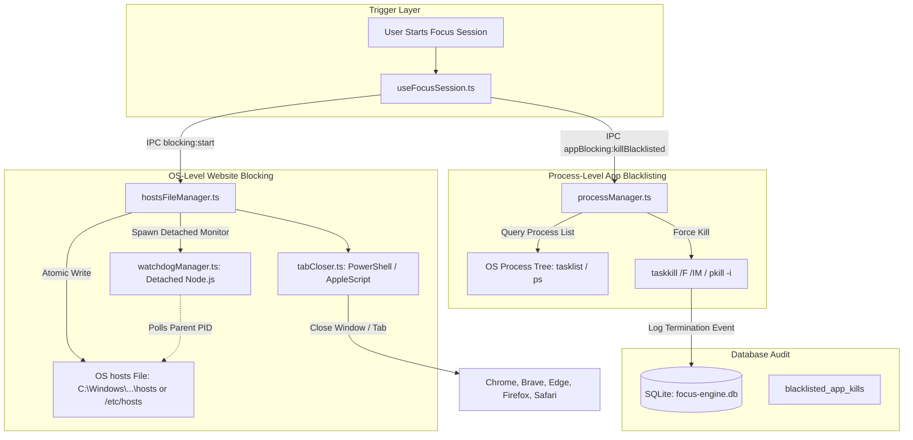

# Blocking Subsystem Overview

## 1. Introduction & Mission

The **Blocking Subsystem** in Focus Engine provides strict, OS-level digital environment enforcement during active focus sessions. Unlike browser extensions that can be bypassed by opening an incognito window or switching browsers, Focus Engine operates at the operating system layer:

1. **System-Wide Domain Blocking**: Direct loopback redirection via the operating system `hosts` file (`127.0.0.1`), terminating network traffic across **all browsers, CLI tools, and background processes**.
2. **Active Browser Window/Tab Cloner**: Scripted browser inspection (PowerShell on Windows, AppleScript on macOS) that forcibly closes pre-existing connections and active distracting tabs.
3. **Application Process Termination**: Real-time process tree monitoring and forceful termination (`taskkill` / `pkill`) of blacklisted native desktop applications (e.g. Steam, Discord, Spotify, League of Legends).
4. **Crash-Resilient Watchdog**: A detached, parent-monitoring background process ensuring the system `hosts` file is restored even if Focus Engine crashes or is killed via Task Manager.

---

## 2. The Two-Pronged Blocking Architecture

---

## 3. Core Component Roles

| Component File | Primary Role | OS / Technologies |
|---|---|---|
| `hostsFileManager.ts` | Safely modifies OS `hosts` file, maintains backups, provides sync/async restore | Node.js `fs.promises`, `fs.readFileSync` |
| `watchdogManager.ts` | Detached child process that cleans `hosts` if parent Electron app terminates unexpectedly | `child_process.spawn`, `ELECTRON_RUN_AS_NODE: '1'` |
| `tabCloser.ts` | Closes active browser windows or tabs displaying blocked domains | PowerShell `Get-Process`, AppleScript `osascript` |
| `processManager.ts` | Enumerates active OS processes, sanitizes process names, executes force-kill | `tasklist`, `taskkill` (Win), `ps`, `pkill` (Unix) |
| `blockedDomainsRepository.ts` | Manages list of target websites in SQLite | SQLite `blocked_domains` table |
| `blacklistedAppsRepository.ts` | Manages list of blacklisted EXEs and logs kill events in SQLite | SQLite `blacklisted_apps`, `blacklisted_app_kills` |

---

## 4. Default Block Rules

Focus Engine ships with pre-seeded baseline configurations:

### Default Blocked Domains (`blockedDomainsList.ts`)
- `youtube.com`
- `facebook.com`
- `twitter.com` (`x.com`)
- `instagram.com`
- `reddit.com`
- `netflix.com`
- `tiktok.com`
- `twitch.tv`

### Default Blacklisted Applications (`blacklistedAppsList.ts`)
- `steam` (`steam.exe`)
- `discord` (`Discord.exe`)
- `spotify` (`Spotify.exe`)
- `epicgameslauncher` (`EpicGamesLauncher.exe`)

---

## 5. Security & Principle of Least Privilege

1. **Injection Prevention**: Process names and domain keywords are sanitized using strict regex (`/^[a-zA-Z0-9_-]+$/` and `/[^a-zA-Z0-9]/g`) before being interpolated into OS commands.
2. **Direct Execution**: All external commands use `execFile` (passing arguments as an array) rather than `exec` (which invokes a subshell and is vulnerable to shell metacharacter injection).
3. **Safe Failure**: Process-not-found exit codes (Windows `128`, Unix `1`) are swallowed gracefully, preventing error panics when blacklisted apps are not running.
