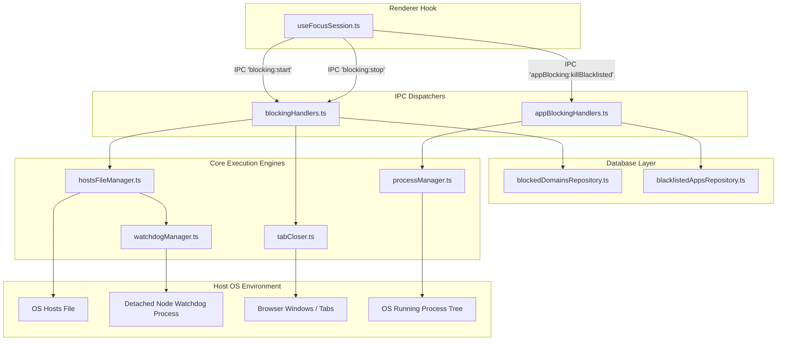
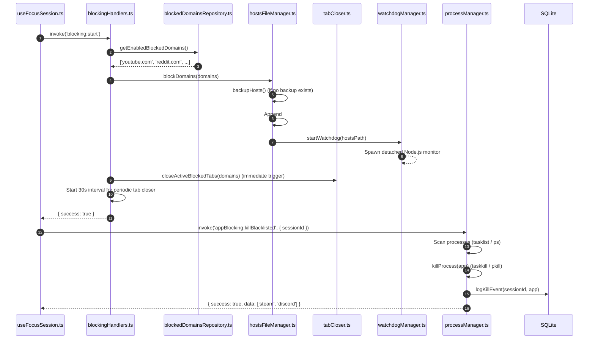
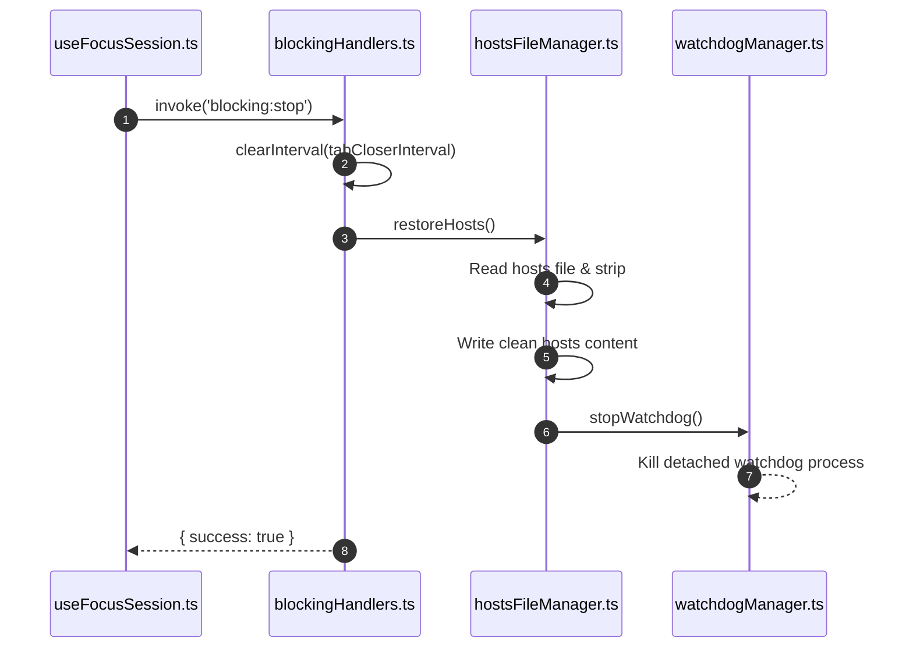

# Blocking Architecture & Data Flow

## 1. Subsystem Architecture

The Blocking Subsystem sits within the Electron main process, orchestrating OS-level network configuration and process control. It exposes clean IPC endpoints to the renderer while abstracting all operating system differences.



---

## 2. Activation Sequence (Session Start)

When a focus session starts (`type === 'focus'`), `useFocusSession.ts` initiates the dual blocking pipeline:



---

## 3. Continuous Enforcement Loop (While Session Runs)

Blocking is not merely a one-time event at session startup. Users may attempt to open blocked applications or launch distraction websites midway through a focus session:

1. **Active Application Watchdog**:
   - In `useFocusSession.ts`, an interval runs every **30 seconds** (`runActiveAppBlocking`):
     ```typescript
     intervalId = setInterval(runActiveAppBlocking, 30000)
     ```
   - Checks running processes and kills any blacklisted applications launched during the session.
   - Updates the UI `appsKilled` state list in real time.
2. **Periodic Tab Closer Loop**:
   - In `blockingHandlers.ts`, `tabCloserInterval` fires every **30 seconds** (`30,000 ms`):
     ```typescript
     tabCloserInterval = setInterval(() => {
       closeActiveBlockedTabs(domains).catch(...)
     }, 30000)
     ```
   - Scans browser window titles and closes any newly opened windows/tabs attempting to reach blocked keywords.
3. **Persistent DNS Redirection**:
   - The OS `hosts` file redirection remains active 100% of the time, causing any new HTTP/HTTPS requests to fail instantly with `ERR_CONNECTION_REFUSED`.

---

## 4. Deactivation Sequence (Session End / Stop)

When a session finishes naturally, is manually stopped, or is abandoned:



---

## 5. Emergency Shutdown Path (`restoreHostsSync`)

If the user initiates a sudden application quit (`app.on('before-quit')`), asynchronous IPC calls and Node.js event-loop microtasks cannot be awaited reliably:
- Focus Engine exposes `restoreHostsSync()` in `src/main/blocking/hostsFileManager.ts`.
- Uses `fs.readFileSync` and `fs.writeFileSync`.
- Executed synchronously on the main thread during `app.on('before-quit')` in `src/main/index.ts`, guaranteeing that the user's internet access is restored before the process terminates.
