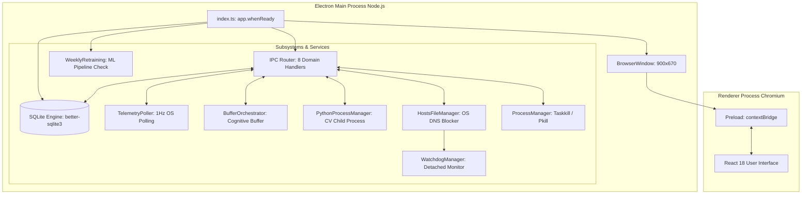

# Main Process Overview

## 1. Introduction & Responsibilities

In Electron's multi-process architecture, the **Main Process** acts as the operating system kernel for the application. It runs in a full Node.js environment with unrestricted access to the local filesystem, network sockets, OS process management, and native system APIs.

The main process in Focus Engine is responsible for:
1. **Application Lifecycle**: Managing window creation, hardware acceleration settings, startup checks, and graceful shutdown.
2. **Database Management**: Initializing the SQLite database (`focus-engine.db`), running migrations/table creations, connection pooling via `better-sqlite3`, and safe closing on shutdown.
3. **IPC Request & Broadcast Hub**: Registering 8 domain IPC handler modules (`session`, `blocking`, `appBlocking`, `telemetry`, `cv`, `buffer`, `analytics`, `ml`) and broadcasting real-time push events to the renderer.
4. **OS Enforcement & Process Control**: Modifying system `hosts` files, spawning detached watchdog daemons, inspecting the OS process tree, and killing unauthorized applications.
5. **Background Engine Orchestration**: Polling active windows (1Hz), computing keystrokes per minute (KPM), running mouse metrics listeners, managing the multi-signal Focus Buffer decay loop, and managing child Python processes (CV Engine & ML retraining).

---

## 2. Main Process Subsystem Topology



---

## 3. Directory Structure (`src/main/`)

```text
src/main/
├── index.ts                          # Main entry point & app lifecycle coordinator
├── analytics/                        # Analytics aggregation & recommendation algorithms
│   ├── heatmapRepository.ts          # 7x24 heatmap cell queries
│   ├── productivityAnalytics.ts      # KPI aggregation (best/worst hour, averages)
│   ├── recommendationEngine.ts       # Rule-based heuristics for distraction reduction
│   └── streakCalculator.ts           # Daily session streak calculator
│
├── blocking/                         # OS-level blocking mechanisms
│   ├── blacklistedAppsList.ts        # Default blacklisted desktop processes
│   ├── blockedDomainsList.ts         # Default blocked internet domains
│   ├── hostsFileManager.ts           # C:\Windows\...\hosts file read/write & backup
│   ├── processManager.ts             # tasklist/ps & taskkill/pkill enforcement
│   ├── tabCloser.ts                  # PowerShell/AppleScript active tab terminator
│   └── watchdogManager.ts            # Detached Node watchdog process manager
│
├── buffer/                           # Cognitive focus buffer state machine & mappers
│   ├── bufferDiagnostics.ts          # Buffer history & snapshot repository
│   ├── bufferOrchestrator.ts         # Core 1-second decay/recovery tick engine
│   ├── bufferStateMachine.ts         # focused -> warning -> critical transitions
│   ├── cvSignalMapper.ts             # Converts pitch/yaw/gaze into 0.0-1.0 CV score
│   ├── keyboardSignalMapper.ts       # Converts KPM into 0.0-1.0 keyboard score
│   ├── mouseSignalMapper.ts          # Converts cursor velocity into 0.0-1.0 score
│   ├── windowSignalMapper.ts         # Maps domain/category to 0.0-1.0 score
│   ├── distractionPenaltyCalculator.ts # Penalty deductions for blacklisted triggers
│   ├── focusBuffer.ts                # Clamped 0-100 numeric buffer math
│   ├── focusBufferSimulation.ts      # Synthetic simulation for testing
│   ├── focusScoreCalculator.ts       # Post-session aggregate 0-100 focus score
│   └── livePredictionPoller.ts       # 5-second ML prediction polling service
│
├── cv/                               # Computer vision child process bridge
│   └── pythonProcessManager.ts       # Spawns and manages python cv_engine.py
│
├── database/                         # SQLite repositories & schema initialization
│   ├── db.ts                         # Database initialization, pragmas, and schema DDL
│   ├── sessionRepository.ts          # Session CRUD & historical queries
│   ├── blockedDomainsRepository.ts   # Blocked domains table CRUD
│   ├── blacklistedAppsRepository.ts  # Blacklisted apps & kill events CRUD
│   ├── cvMetricsRepository.ts        # CV timeseries & calibration CRUD
│   ├── bufferSnapshotsRepository.ts  # Buffer telemetry timeseries
│   ├── bufferStateTransitionsRepository.ts # Buffer state changes
│   ├── distractionEventsRepository.ts # Distraction event log
│   ├── keyboardMetricsRepository.ts  # KPM timeseries
│   ├── mouseMetricsRepository.ts     # Mouse movement timeseries
│   ├── windowFocusRepository.ts      # Window switch timeseries
│   ├── settingsRepository.ts         # Key-value configuration & CV calibration
│   └── telemetryAggregator.ts        # Post-session metric aggregator
│
├── ipc/                              # IPC handler registration modules
│   ├── sessionHandlers.ts            # session:* handlers
│   ├── blockingHandlers.ts           # blocking:* handlers
│   ├── appBlockingHandlers.ts        # appBlocking:* handlers
│   ├── telemetryHandlers.ts          # telemetry:* handlers
│   ├── cvHandlers.ts                 # cv:* handlers
│   ├── bufferHandlers.ts             # buffer:* handlers
│   └── analyticsHandlers.ts          # analytics:* handlers
│
├── ml/                               # Machine learning integration
│   ├── predictionService.ts          # Calls python ml/predict.py
│   ├── personalizedRecommendations.ts # Recommendation ML models
│   └── weeklyRetraining.ts           # Startup check and retraining cron
│
├── telemetry/                        # Low-level OS activity tracking
│   ├── activeWindowTracker.ts        # Native active window polling
│   ├── activityTimestampTracker.ts   # Idle detection tracker
│   ├── distractionDetector.ts        # Checks active window against blacklists
│   ├── domainClassifier.ts           # Classifies URLs into productive/distraction
│   ├── keystrokeCounter.ts           # Global keystroke tracker
│   ├── kpmTracker.ts                 # Sliding 60-second KPM calculator
│   ├── mouseMetricsTracker.ts        # Cursor velocity & distance tracker
│   ├── mouseTracker.ts               # Raw cursor position sampler
│   ├── telemetryHealthCheck.ts       # Liveness watchdog for OS hooks
│   ├── telemetryPoller.ts            # Central 1Hz background polling loop
│   └── validateTelemetry.ts          # Data validation schemas
│
└── utils/                            # Shared utilities
    ├── logger.ts                     # Structured timestamped logging
    └── paths.ts                      # Absolute path resolvers for binaries and DB
```

---

## 4. Initialization & Shutdown Flow

### Startup Sequence (`app.whenReady`)
1. **Set Application User Model ID**: `com.electron` (for Windows notifications).
2. **Setup DevTools Optimization**: Registers `F12` and keyboard shortcuts via `@electron-toolkit/utils`.
3. **Database Bootstrap**: Calls `getDatabase()`, which ensures WAL mode, creates the SQLite file in `userData`, and executes the schema DDL.
4. **Seed Settings**: Ensures default CV calibration and system settings exist via `settingsRepository.seedDefaultsIfNeeded()`.
5. **ML Retraining Check**: Calls `weeklyRetraining.checkAndTriggerRetrain()`, initiating background retraining if 7 days have elapsed.
6. **Register IPC Handlers**: Attaches all 8 handler registration functions to `ipcMain`.
7. **Create Main Window**: Instantiates `BrowserWindow` ($900 \times 670$), hooks external link handlers to OS browser via `shell.openExternal`, and loads the UI.

### Shutdown Sequence (`app.on('before-quit')`)
1. **Synchronous Hosts Restoration**: Calls `restoreHostsSync()` to ensure no blocking entries remain in the OS `hosts` file.
2. **Database Teardown**: Calls `closeDatabase()` to checkpoint WAL journals and close the SQLite handle.
3. **Child Process Cleanup**: Dispatches termination signals to any running Python CV engine or ML sub-processes.
