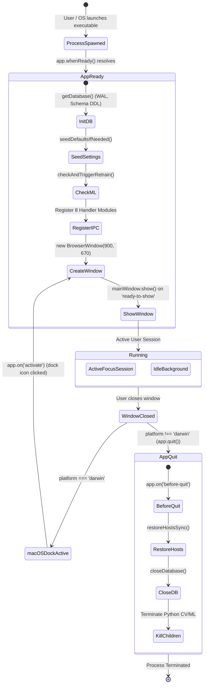

# Main Process Application Lifecycle

## 1. Overview

The lifecycle of the Focus Engine Electron main process governs the execution environment from the moment the operating system spawns the executable until all resources, child processes, and database handles are cleanly reclaimed.



---

## 2. Startup Phase Details (`app.whenReady()`)

Located in `src/main/index.ts`:

### 1. App User Model Identifier
```typescript
electronApp.setAppUserModelId('com.electron')
```
Ensures Windows notifications, taskbar grouping, and jump lists are registered under a unified identity rather than generic `electron.exe`.

### 2. Development Shortcuts Optimization
```typescript
app.on('browser-window-created', (_, window) => {
  optimizer.watchWindowShortcuts(window)
})
```
- In development (`is.dev`): Enables `F12` to toggle Chrome Developer Tools.
- In production: Disables destructive reloads (`Ctrl+R`, `Cmd+R`) that could interrupt an active focus session.

### 3. Database Bootstrap
```typescript
getDatabase()
```
- Opens `userData/focus-engine.db` with `better-sqlite3`.
- Enables WAL mode (`PRAGMA journal_mode = WAL;`).
- Executes schema DDL (`CREATE TABLE IF NOT EXISTS ...`) for all 14 tables.

### 4. Machine Learning Check
```typescript
weeklyRetraining.checkAndTriggerRetrain().catch((err) => {
  console.error('[WeeklyRetraining] Startup check failed:', err)
})
```
- Non-blocking asynchronous task.
- Queries `settings` for `last_retrained_at`. If $\ge 7\text{ days}$ have passed, spawns Python background extraction and model fitting.

### 5. IPC Handler Attachment
Attaches all 8 handler registration functions to `ipcMain` before the renderer window loads, eliminating race conditions where the UI attempts to invoke an unregistered channel.

---

## 3. Window Construction & Security Configuration

```typescript
const mainWindow = new BrowserWindow({
  width: 900,
  height: 670,
  show: false,
  autoHideMenuBar: true,
  ...(process.platform === 'linux' ? { icon } : {}),
  webPreferences: {
    preload: join(__dirname, '../preload/index.js'),
    sandbox: false,
    contextIsolation: true
  }
})
```

### Security Directives
1. **`contextIsolation: true`**: Guarantees that the Preload script and the Chromium frontend execute in completely isolated JavaScript runtime contexts. Frontend code cannot access Preload internal variables or tamper with Node.js APIs.
2. **`sandbox: false`**: Allows the Preload script to utilize Node.js IPC primitives (`ipcRenderer`) to construct the secure bridge.
3. **`show: false` + `ready-to-show`**: Prevents "white flash" during startup. The window remains hidden until Chromium finishes initial DOM layout, creating an instant, sleek dark-mode appearance upon display.
4. **External Link Interception**:
   ```typescript
   mainWindow.webContents.setWindowOpenHandler((details) => {
     shell.openExternal(details.url)
     return { action: 'deny' }
   })
   ```
   Blocks the Chromium renderer from opening untrusted secondary Electron browser windows, redirecting all external URLs (e.g. documentation, support links) to the user's default OS browser.

---

## 4. Teardown & Graceful Exit Phase

### 1. `window-all-closed` Event
```typescript
app.on('window-all-closed', () => {
  if (process.platform !== 'darwin') {
    app.quit()
  }
})
```
- On Windows and Linux: Closing the main window initiates application termination.
- On macOS (`darwin`): The application stays resident in the dock until explicitly terminated via `Cmd+Q`, adhering to macOS HIG. Clicking the dock icon triggers `app.on('activate')`, which recreates the window.

### 2. `before-quit` Synchronous Flush
```typescript
app.on('before-quit', () => {
  try {
    restoreHostsSync()
  } catch (error) {
    console.error('Failed to restore hosts on shutdown:', error)
  }
  closeDatabase()
})
```
- Executed synchronously on the main thread.
- Ensures the system `hosts` file is restored to its original unblocked state before the process terminates.
- Flushes pending SQLite WAL transactions to disk and closes the file descriptor cleanly.
