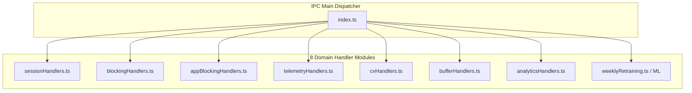

# Main Process IPC Architecture

## 1. Overview & Router Organization

In Focus Engine, the Main Process acts as the central IPC router. Rather than bloating `src/main/index.ts` with hundreds of raw handlers, IPC registration is organized into **eight domain-specific handler modules** under `src/main/ipc/`:



---

## 2. IPC Handling Paradigms

### 1. `ipcMain.handle` (Two-Way Asynchronous Invocation)
The dominant pattern in Focus Engine. The renderer dispatches `ipcRenderer.invoke(channel, args)` and receives a Promise resolving to a typed response envelope:

```typescript
ipcMain.handle('session:save', async (_event, session) => {
  try {
    saveSession(session)
    return { success: true }
  } catch (error: any) {
    console.error('[IPC session:save]', error)
    return { success: false, error: error.message || String(error) }
  }
})
```

#### The Standard Response Envelope
All two-way IPC handlers return an envelope adhering to:
```typescript
interface IPCResponse<T = any> {
  success: boolean
  data?: T
  error?: string
}
```
This guarantees that exceptions never crash the IPC communication channel or result in unhandled Promise rejections in the renderer.

---

### 2. `webContents.send` (Asynchronous One-Way Broadcasts)
Used by background workers to push high-frequency telemetry and notifications directly to the active UI window:

```typescript
// Pushing 1Hz telemetry update to renderer
const window = BrowserWindow.getAllWindows()[0]
if (window && !window.isDestroyed()) {
  window.webContents.send('telemetry:active-window', windowData)
  window.webContents.send('telemetry:buffer-update', bufferSnapshot)
}
```

---

## 3. Comprehensive IPC Channel Catalog

| Module | Channel | Mode | Payload | Return / Action |
|---|---|---|---|---|
| **Session** | `session:save` | Two-Way | `SaveSessionArgs` | Persists session record into `sessions` |
| | `session:getAll` | Two-Way | None | Returns array of historical sessions |
| | `session:getSummary` | Two-Way | `sessionId: string` | Returns aggregated metrics & distraction timeline |
| **Blocking** | `blocking:start` | Two-Way | None | Injects loopback entries into OS `hosts` file |
| | `blocking:stop` | Two-Way | None | Strips block markers & restores clean `hosts` |
| | `blocking:status` | Two-Way | None | Returns boolean active status of `hosts` block |
| | `blocking:getDomains` | Two-Way | None | Returns configured domains from SQLite |
| | `blocking:addDomain` | Two-Way | `domain: string` | Inserts domain into `blocked_domains` |
| | `blocking:removeDomain`| Two-Way | `domain: string` | Deletes domain from `blocked_domains` |
| | `blocking:toggleDomain`| Two-Way | `{ domain, enabled }` | Updates enabled flag in SQLite |
| **App Blocking** | `appBlocking:killBlacklisted` | Two-Way | `{ sessionId }` | Scans and kills blacklisted processes |
| | `appBlocking:getApps` | Two-Way | None | Returns all apps from `blacklisted_apps` |
| | `appBlocking:addApp` | Two-Way | `appName: string` | Inserts new executable name to blacklist |
| | `appBlocking:removeApp` | Two-Way | `appName: string` | Deletes executable name from blacklist |
| | `appBlocking:toggleApp` | Two-Way | `{ appName, enabled }` | Toggles app block state |
| **Telemetry** | `telemetry:start` | Two-Way | `sessionId, mode` | Starts 1Hz OS active window & KPM poller |
| | `telemetry:stop` | Two-Way | None | Stops OS telemetry polling loops |
| | `telemetry:active-window` | Push | `ActiveWindowInfo` | Pushes foreground window & classification |
| | `telemetry:kpm-update` | Push | `kpm: number` | Pushes current typing velocity |
| | `telemetry:activity-update` | Push | `{ status, idleSeconds }` | Pushes user activity/idle state |
| | `telemetry:health-warning` | Push | `HealthStatus` | Pushes hook health status |
| **Buffer** | `buffer:getCurrent` | Two-Way | None | Returns current live buffer state and signals |
| | `buffer:pause` | Two-Way | None | Freezes buffer decay loop |
| | `buffer:resume` | Two-Way | None | Resumes buffer decay loop |
| | `telemetry:buffer-update`| Push | `BufferSnapshot` | Pushes live composite score & 4 signals |
| | `session:auto-pause` | Push | None | Alerts UI of inactivity auto-pause |
| | `session:force-end` | Push | None | Alerts UI of buffer exhaustion force-end |
| **CV** | `cv:start` | Two-Way | `sessionId: string` | Spawns Python CV engine child process |
| | `cv:stop` | Two-Way | None | Sends termination signal to Python process |
| | `cv:getEnabled` | Two-Way | None | Reads CV enabled toggle from `settings` |
| | `cv:setEnabled` | Two-Way | `enabled: boolean` | Updates CV enabled toggle in `settings` |
| | `cv:getCalibration` | Two-Way | None | Returns pitch/yaw calibration offsets |
| | `cv:saveCalibration` | Two-Way | `CalibrationData` | Persists user calibration offsets |
| **Analytics** | `analytics:getHeatmap` | Two-Way | None | Returns 7x24 heatmap cell scores |
| | `analytics:getStreaks` | Two-Way | None | Returns current and longest daily streak |
| | `analytics:getProductivitySummary` | Two-Way | None | Returns best hour, averages, totals |
| | `analytics:getRecommendations` | Two-Way | None | Returns rule-based & ML productivity advice |
| **ML** | `ml:retrain` | Two-Way | None | Manually triggers background ML retraining |
| | `ml:getStatus` | Two-Way | None | Returns last retrained timestamp & status |
