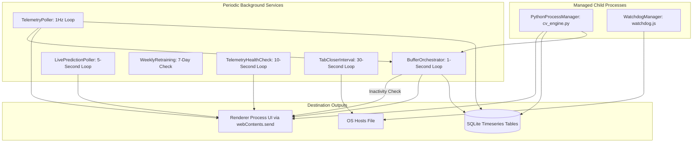

# Main Process Background Services

## 1. Overview & Service Orchestration

Unlike simple desktop apps that sit idle between user clicks, Focus Engine executes several continuous background services within the main process to collect telemetry, process cognitive signals, enforce system boundaries, and manage child processes.



---

## 2. Core Background Services

### 1. `TelemetryPoller` (`telemetryPoller.ts`)
- **Execution Frequency**: Every $1000\text{ ms}$ ($1\text{ Hz}$).
- **Lifecycle**: Started via `telemetry:start(sessionId, mode)`; stopped via `telemetry:stop()`.
- **Workflow on Each Tick**:
  1. Queries the active OS foreground window (`activeWindowTracker.getActiveWindow()`).
  2. Identifies if the window is a browser; if so, extracts the domain name via `domainClassifier.ts`.
  3. Classifies the target as `productive`, `distraction`, or `neutral`.
  4. Logs the window focus record to `window_focus_events` table in SQLite.
  5. Calculates Keystrokes Per Minute (KPM) via `kpmTracker.ts` using a 60-second sliding window.
  6. Computes idle seconds via `activityTimestampTracker.ts`.
  7. Broadcasts `telemetry:active-window`, `telemetry:kpm-update`, and `telemetry:activity-update` to the UI.

---

### 2. `BufferOrchestrator` (`bufferOrchestrator.ts`)
- **Execution Frequency**: Every $1000\text{ ms}$ ($1\text{ Hz}$).
- **Role**: Computes the user's real-time cognitive energy level (the Focus Buffer, $0 \dots 100$).
- **Workflow on Each Tick**:
  1. Samples 4 real-time signal mappers:
     - $S_{\text{cv}}$ via `cvSignalMapper.ts` ($0.0 \dots 1.0$)
     - $S_{\text{kb}}$ via `keyboardSignalMapper.ts` ($0.0 \dots 1.0$)
     - $S_{\text{mouse}}$ via `mouseSignalMapper.ts` ($0.0 \dots 1.0$)
     - $S_{\text{win}}$ via `windowSignalMapper.ts` ($0.0 \dots 1.0$)
  2. Calculates composite focus score:
     $$\text{Score} = w_{\text{cv}} S_{\text{cv}} + w_{\text{kb}} S_{\text{kb}} + w_{\text{mouse}} S_{\text{mouse}} + w_{\text{win}} S_{\text{win}}$$
  3. Applies decay or recovery:
     - If Score $\ge 0.5$: Buffer recovers ($+1.0/\text{sec}$ up to $100.0$).
     - If Score $< 0.5$: Buffer decays ($-2.0/\text{sec}$ down to $0.0$).
  4. Evaluates State Machine (`bufferStateMachine.ts`):
     - $\ge 50$: `'focused'`
     - $20 - 49$: `'warning'`
     - $< 20$: `'critical'`
  5. Evaluates Emergency Thresholds:
     - **Inactivity Auto-Pause**: If user idle $> 300\text{ seconds}$, freezes buffer and emits `session:auto-pause` to the UI.
     - **Buffer Depletion Force-End**: If buffer hits $0$, terminates the session immediately with `session:force-end`.
  6. Writes periodic snapshots to `buffer_snapshots` and state transitions to `buffer_state_transitions`.

---

### 3. `PythonProcessManager` (`pythonProcessManager.ts`)
- **Role**: Manages the child Python process executing `python/cv_engine/cv_engine.py` for webcam computer vision.
- **IPC Protocol**: Line-delimited JSON over `stdin` / `stdout`.
- **Process Lifecycle**:
  - Spawns using virtual environment Python binary (`python/cv_env/Scripts/python.exe` or system `python3`).
  - Sets `stdio: ['pipe', 'pipe', 'pipe']`.
  - Parses JSON lines from stdout:
    ```json
    {"face_present": true, "pitch": -4.2, "yaw": 2.1, "roll": 0.5, "gaze_x": 0.49, "gaze_y": 0.51, "attention_score": 88}
    ```
  - Dispatches parsed metrics to `cvMetricsRepository.ts` and notifies `BufferOrchestrator`.
  - Dispatches clean exit commands over `stdin` (`{"command": "stop"}\n`) and falls back to `SIGTERM` / `SIGKILL` on timeout.

---

### 4. `LivePredictionPoller` (`livePredictionPoller.ts`)
- **Execution Frequency**: Every $5000\text{ ms}$ ($0.2\text{ Hz}$).
- **Role**: Gathers recent 30-second rolling telemetry features, formats an input vector, and invokes the trained Random Forest classifier (`python/ml/predict.py`).
- **Output**: Real-time focus classification (`focused`, `distracted`, `fatigued`, `idle`) with model confidence ($0 \dots 100\%$), broadcasted via `telemetry:live-prediction`.

---

### 5. `WeeklyRetraining` (`weeklyRetraining.ts`)
- **Execution Frequency**: Checked at app startup and evaluated daily.
- **Role**: Automated model maintenance.
- **Workflow**:
  - Checks `settings` key `ml_last_retrained_at`.
  - If $\ge 7\text{ days}$ have elapsed:
    1. Extracts real user sessions and telemetry via `python/ml/real_data_extractor.py`.
    2. Builds an updated feature dataset via `python/ml/dataset_builder.py`.
    3. Retrains the model via `python/ml/train_focus_model.py`.
    4. Evaluates validation accuracy against existing model; if superior, atomically replaces `focus_model.pkl`.
    5. Updates `ml_last_retrained_at` in SQLite.
