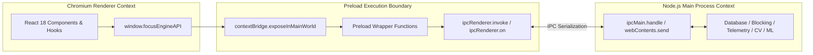

# Preload Layer Overview

## 1. Introduction & Role

The **Preload Layer** (`src/preload/index.ts`) is the secure mediator bridging the Electron Main Process and the Chromium Renderer Process. In modern Electron applications with `contextIsolation: true`, the frontend cannot access Node.js runtime APIs directly (`fs`, `child_process`, `net`, `path`).

The Preload script acts as a controlled gateway:
- It executes in a privileged environment with access to Node.js and Electron's `ipcRenderer`.
- It selectively exposes an immutable, strictly typed API object (`window.focusEngineAPI`) to the renderer via `contextBridge.exposeInMainWorld()`.
- It translates frontend function calls into asynchronous IPC invocations (`ipcRenderer.invoke`).
- It wraps real-time push events (`ipcRenderer.on`), returning clean **unsubscribe functions** to prevent memory leaks in React hooks.



---

## 2. Directory Layout & Artifacts

```text
src/preload/
├── index.ts                          # Preload implementation & contextBridge exposure
└── index.d.ts                         # Global TypeScript interface declarations for window.focusEngineAPI
```

### TypeScript Ambient Types (`src/preload/index.d.ts`)
The ambient declaration file extends the global `Window` object:
```typescript
import { ElectronAPI } from '@electron-toolkit/preload'

declare global {
  interface Window {
    electron: ElectronAPI
    focusEngineAPI: FocusEngineAPI
  }
}
```
This enables full autocompletion, type checking, and parameter validation inside all React hooks and components across the entire renderer codebase.

---

## 3. High-Level API Surface

The `focusEngineAPI` exposed to the frontend encompasses 6 core functional domains:

1. **Session Management**: `saveSession`, `getAllSessions`, `getSessionSummary`.
2. **Domain & App Blocking**: `startBlocking`, `stopBlocking`, `isBlockingActive`, `getBlockedDomains`, `addBlockedDomain`, `removeBlockedDomain`, `toggleBlockedDomain`, `killBlacklistedApps`, `getBlacklistedApps`, `addBlacklistedApp`, `removeBlacklistedApp`, `toggleBlacklistedApp`.
3. **Computer Vision & Hardware Settings**: `startCV`, `stopCV`, `getCVSummary`, `getCVEnabled`, `setCVEnabled`, `getCVPermission`, `setCVPermission`, `getCalibration`, `setCalibration`, `getDefaultCalibration`, `resetCalibrationToDefault`.
4. **Telemetry & OS Polling**: `startTelemetry`, `stopTelemetry`, `getWindowHistory`, `getCategoryBreakdown`, `getDistractionEvents`, `getLiveMouseCounts`.
5. **Focus Buffer & Cognitive State**: `getCurrentFocusBuffer`, `pauseBuffer`, `resumeBuffer`, `getBufferSnapshots`, `getBufferStateTransitions`, `getBufferStateTimeSummary`, `auditSessionBuffer`.
6. **Analytics & Recommendations**: `analytics.getHeatmap`, `analytics.getStreaks`, `analytics.getProductivitySummary`, `analytics.getRecommendations`, `analytics.triggerRetrain`, `analytics.getRetrainHistory`.
7. **Real-Time Push Subscriptions**: `onActiveWindowUpdate`, `onKpmUpdate`, `onActivityUpdate`, `onFocusBufferUpdate`, `onFocusBufferStateChanged`, `onDistractionEvent`, `onSessionAutoPause`, `onSessionForceEnd`, `onTelemetryHealthWarning`, `onCVUpdate`, `onCVError`, `onMLPrediction`.
