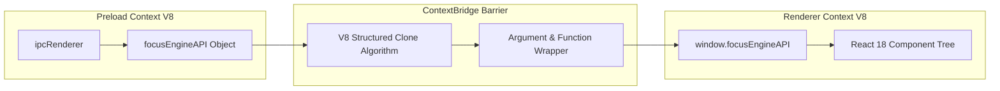

# ContextBridge Implementation & Security

## 1. Context Isolation & Prototype Poisoning Defense

In older Electron architectures (pre-context isolation), preload scripts assigned objects directly to the window:
```javascript
// DANGEROUS LEGACY ANTIPATTERN (NOT USED IN FOCUS ENGINE):
window.ipcRenderer = ipcRenderer
```
If a malicious third-party script, injected ad, or compromised npm frontend package ran in the DOM, it could override `Array.prototype.push`, monkey-patch `ipcRenderer.send`, or execute arbitrary shell commands via Node.js primitives exposed on `window`.

Electron's `contextBridge` solves this by constructing a **one-way, cloned bridge** between two completely separate V8 execution contexts:
1. **The Preload Context**: Has access to Node.js / Electron internals.
2. **The Renderer Context**: Has access only to standard DOM and Web APIs.



---

## 2. Implementation in Focus Engine

Located at the bottom of `src/preload/index.ts`:

```typescript
if (process.contextIsolated) {
  try {
    contextBridge.exposeInMainWorld('electron', electronAPI)
    contextBridge.exposeInMainWorld('focusEngineAPI', focusEngineAPI)
  } catch (error) {
    console.error(error)
  }
} else {
  // @ts-ignore (define in dts)
  window.electron = electronAPI
  // @ts-ignore (define in dts)
  window.focusEngineAPI = focusEngineAPI
}
```

### Key Security Properties of `exposeInMainWorld`:
1. **Immutable Property Definition**: The exposed properties (`window.focusEngineAPI`) are non-configurable and read-only. A script in the renderer cannot overwrite or replace `window.focusEngineAPI.saveSession` with a malicious proxy.
2. **Prototype Cleansing**: Functions passed across the bridge are wrapped in trampoline functions. Prototype modifications in the renderer context (e.g. altering `Function.prototype.call`) cannot execute inside the Preload context.
3. **Structured Serialization**: All payloads passed as arguments to API methods are serialized using the V8 Structured Clone Algorithm. Functions, DOM elements, or native symbols cannot be smuggled into the main process.

---

## 3. Parameter Marshalling & Transformation

The Preload bridge is not a dumb passthrough; it performs explicit argument normalization and shaping.

### Example: Session Argument Polymorphism Normalization
In `focusEngineAPI.saveSession`:
```typescript
saveSession: (args: SaveSessionArgs) => {
  if (args.mode === 'pomodoro') {
    return ipcRenderer.invoke('session:save', {
      sessionId: args.sessionId,
      mode: args.mode,
      sessionType: args.sessionType,
      startTime: args.startTime,
      endTime: args.endTime,
      durationPlannedSec: args.durationPlannedSec,
      durationActualSec: args.durationActualSec,
      completed: args.completed,
      endReason: args.endReason,
      autoPausedCount: args.autoPausedCount,
      pauseCount: args.pauseCount
    })
  } else {
    return ipcRenderer.invoke('session:save', {
      sessionId: args.sessionId,
      mode: args.mode,
      sessionType: null, // Explicitly normalized for standard mode
      startTime: args.startTime,
      endTime: args.endTime,
      durationPlannedSec: null,
      durationActualSec: args.durationActualSec,
      completed: args.completed,
      endReason: args.endReason,
      autoPausedCount: args.autoPausedCount,
      pauseCount: args.pauseCount
    })
  }
}
```
This guarantees that regardless of how the frontend passes session details, the payload received by `sessionHandlers.ts` strictly conforms to the SQLite column definitions.
