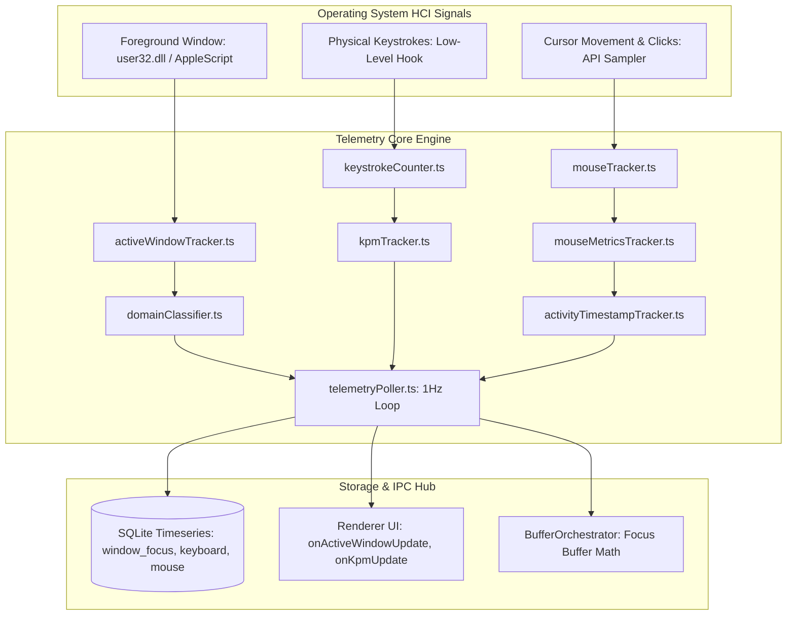

# Telemetry Subsystem Overview

## 1. Introduction & Philosophy

The **Telemetry Subsystem** in Focus Engine is the sensory nervous system of the application. It continuously measures real-time physical human-computer interaction (HCI) without intrusive surveillance or keystroke logging:

1. **Active Window & Domain Tracking**: Samples the foreground application window every second, classifying software into `productive`, `distraction`, or `neutral`.
2. **Typing Velocity (KPM)**: Measures typing cadence in Keystrokes Per Minute (KPM) to gauge cognitive engagement, without logging keystroke characters or text content.
3. **Mouse Dynamics & Cursor Kinematics**: Samples cursor velocity, displacement vectors, click frequency, and idle durations.
4. **Activity Liveness & Idle Detection**: Derives exact idle seconds since the last physical input event, triggering automated session pauses when the user steps away.
5. **Real-Time Data Streaming & Storage**: Streams 1Hz metrics to the React renderer via IPC while persisting sliding-window records to SQLite timeseries tables.



---

## 2. Telemetry Directory Layout (`src/main/telemetry/`)

```text
src/main/telemetry/
├── activeWindowTracker.ts        # Native OS foreground window title & process query
├── activityTimestampTracker.ts   # Tracks epoch timestamp of latest physical interaction
├── distractionDetector.ts        # Cross-references active window against domain/app rules
├── domainClassifier.ts           # Heuristic parser classifying URLs & apps into categories
├── keystrokeCounter.ts           # Low-level hook capturing aggregate keystroke pulses
├── kpmTracker.ts                 # 60-second sliding window KPM calculation & scaling
├── mouseMetricsTracker.ts        # Flushes clicks, movements, and idle seconds to DB
├── mouseTracker.ts               # Samples raw cursor coordinates and click events
├── telemetryHealthCheck.ts       # Watchdog ensuring OS event listeners remain alive
├── telemetryPoller.ts            # Central 1Hz background orchestration loop
└── validateTelemetry.ts          # Schema validation for incoming telemetry packets
```

---

## 3. Privacy-First Engineering Principles

Focus Engine is designed from the ground up to respect user privacy:
- **No Keylogging**: Focus Engine **never records which keys were pressed**. `keystrokeCounter` only increments an integer counter ($N \leftarrow N + 1$) when an event fires. Passwords, messages, and code text are never captured, buffered, or stored.
- **No Screen Captures**: No screenshots or desktop recording occurs. Only the window title string and process name are inspected.
- **100% Local Storage**: All telemetry is stored strictly in `userData/focus-engine.db` on the user's local SSD. No metrics, telemetry packets, or analytics leave the workstation.
