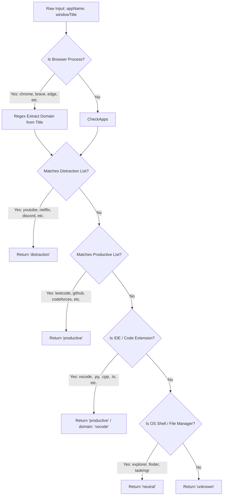

# Activity Classification & Idle Tracking

## 1. Domain & Application Classification (`domainClassifier.ts`)

When an active window title and executable name are captured, Focus Engine classifies the context into one of four categories: `productive`, `distraction`, `neutral`, or `unknown`.



---

## 2. Classification Dictionaries & Heuristics

### 1. Browser Domain Extraction Regex
```typescript
const domainRegex = /([a-z0-9|-]+\.[a-z0-9|-]+(?:\.[a-z]{2,})?)/gi
```
Captures trailing domain patterns in window titles such as:
- `"Dynamic Programming - LeetCode - Google Chrome"` $\rightarrow$ `leetcode.com`
- `"Lofi Hip Hop Radio - YouTube - Brave"` $\rightarrow$ `youtube.com`

### 2. Productive Mapping Dictionary
```typescript
const PRODUCTIVE_MAP = {
  codeforces: 'codeforces.com',
  leetcode: 'leetcode.com',
  geeksforgeeks: 'geeksforgeeks.org',
  stackoverflow: 'stackoverflow.com',
  github: 'github.com',
  'google docs': 'docs.google.com',
  codechef: 'codechef.com',
  atcoder: 'atcoder.jp',
  notion: 'notion.so'
}
```

### 3. Distraction Mapping Dictionary
```typescript
const DISTRACTION_MAP = {
  youtube: 'youtube.com',
  instagram: 'instagram.com',
  facebook: 'facebook.com',
  discord: 'discord.com',
  netflix: 'netflix.com',
  reddit: 'reddit.com',
  twitter: 'twitter.com',
  'x.com': 'x.com'
}
```

### 4. Software Development Environment Detection
- Process checks: `vscode`, `code`, `visual studio`.
- File extension matching in title:
  ```typescript
  const PRODUCTIVE_EXTENSIONS = [
    '.cpp', '.py', '.js', '.ts', '.tsx', '.jsx', 
    '.html', '.css', '.rs', '.go', '.java', '.kt'
  ]
  ```
  If an engineer is working on `bufferOrchestrator.ts — Focus Engine`, the window is immediately categorized as `productive`.

---

## 3. Physical Idle Tracking (`activityTimestampTracker.ts`)

Understanding whether a user is actively reading, thinking, or has completely abandoned their computer is crucial for accurate productivity metrics.

### 1. Architecture & Calculation
- Maintains an in-memory timestamp: `lastActivityTimestamp = Date.now()`.
- Updated whenever:
  - Keystroke counter registers a key down (`onKeyHookEvent`).
  - Mouse tracker registers a cursor displacement $> 3\text{ px}$ or a mouse click.
- Idle duration formula:
  $$\text{IdleSeconds} = \left\lfloor \frac{\text{Date.now}() - \text{lastActivityTimestamp}}{1000} \right\rfloor$$

### 2. Operational Idle Tiers

| Duration | State Label | Impact on Focus Buffer |
|---|---|---|
| **$0 - 15\text{ s}$** | Active | Normal signal weighting (Typing / Movement active) |
| **$16 - 60\text{ s}$** | Reading / Thinking | Neutral state; buffer maintains equilibrium |
| **$61 - 300\text{ s}$** | Extended Inactivity | Buffer begins progressive decay ($-2.0/\text{sec}$) |
| **$> 300\text{ s}$** (5 min) | Critical Absence | **Triggers Inactivity Auto-Pause** via IPC |

---

## 4. Distraction Detection & Penalty Deduction (`distractionDetector.ts`)

When `telemetryPoller` detects that the foreground window has changed:
1. It passes `appName` and `windowTitle` to `classifyWindow()`.
2. If `category === 'distraction'`:
   - It records a distraction violation in `distraction_events` table in SQLite:
     ```sql
     INSERT INTO distraction_events (session_id, event_type, event_data, timestamp)
     VALUES (?, 'window_distraction', ?, ?);
     ```
   - It notifies `BufferOrchestrator`, which applies a direct **$-10$ point penalty** to the live Focus Buffer.
   - It emits `telemetry:distractionEvent` to the UI, triggering the `DistractionAlert.tsx` ambient banner to prompt the user back on task.
