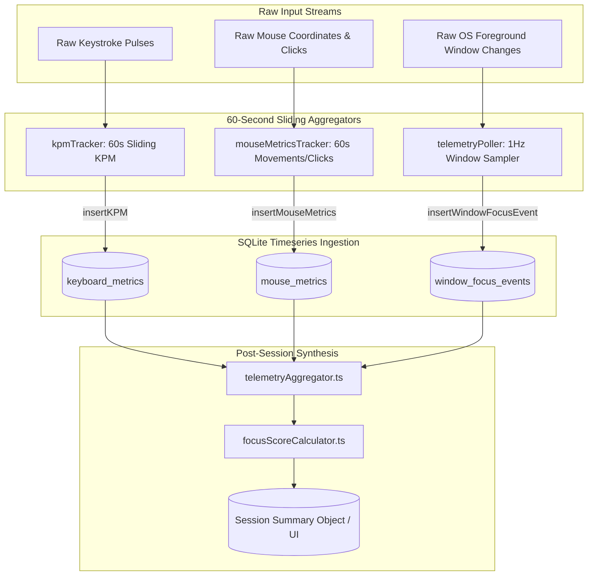

# Telemetry Data Processing & Aggregation

## 1. Overview & Data Ingestion Pipeline

Raw telemetry events captured at high frequencies must be processed, normalized, and persisted into structured SQLite tables without degrading CPU performance or filling the disk.



---

## 2. Sliding Window KPM Calculation & Scaling

In `src/main/telemetry/kpmTracker.ts`:

### 1. Full-Minute Recording
During active sessions, an interval fires every $60\,000\text{ ms}$:
```typescript
const rawCount = keystrokeCounter.resetCount()
insertKPM(this.currentSessionId, rawCount)
```
The raw count directly represents the user's keystrokes per minute for that elapsed minute block.

### 2. Fractional Final-Minute Scaling
When a session is stopped or paused midway through a minute (e.g. after 23 seconds), logging the unscaled raw count would falsely record a dramatically depressed KPM value. Focus Engine scales partial minutes proportionally:

$$\text{KPM}_{\text{scaled}} = \text{round}\left( \frac{\text{rawCount}}{\text{elapsedSeconds}} \times 60 \right)$$

- **Outlier Guard**: If the session lasted $< 3\text{ seconds}$, scaling is bypassed (`KPM = rawCount`) to prevent division by near-zero resulting in artificial 5000+ KPM spikes.

---

## 3. Post-Session Aggregation (`telemetryAggregator.ts`)

When `finalizeSession()` executes, `telemetryAggregator.aggregateSessionSummary(sessionId)` synthesizes thousands of individual timeseries rows into a coherent session report:

### 1. Active Window Category Breakdown
```sql
SELECT category, COUNT(*) as count 
FROM window_focus_events 
WHERE session_id = ? 
GROUP BY category;
```
Calculates exact percentages:
$$\text{ProductiveRatio} = \frac{N_{\text{productive}}}{N_{\text{total}}} \times 100\%$$
$$\text{DistractionRatio} = \frac{N_{\text{distraction}}}{N_{\text{total}}} \times 100\%$$

### 2. Typing Dynamics Summary
```sql
SELECT 
    AVG(kpm) as avg_kpm, 
    MAX(kpm) as peak_kpm,
    SUM(kpm) as total_estimated_keystrokes
FROM keyboard_metrics 
WHERE session_id = ?;
```

### 3. Mouse Activity Summary
```sql
SELECT 
    SUM(clicks) as total_clicks,
    SUM(movements) as total_movements,
    AVG(idle_seconds) as avg_idle_seconds
FROM mouse_metrics 
WHERE session_id = ?;
```

---

## 4. Overall Session Focus Score Calculation (`focusScoreCalculator.ts`)

Focus Engine computes a single, definitive **Focus Score** ($0 \dots 100$) for every completed session using a weighted multi-factor heuristic:

$$\text{Score} = w_w S_w + w_k S_k + w_m S_m + w_{\text{cv}} S_{\text{cv}} - P_{\text{distraction}}$$

| Component | Weight | Metric Measured | Normalization Method |
|---|---|---|---|
| **$S_w$ (Window Focus)** | $0.40$ ($40\%$) | Ratio of productive to total sampled windows | $\frac{N_{\text{productive}}}{N_{\text{total}}} \times 100$ |
| **$S_k$ (Typing Flow)** | $0.20$ ($20\%$) | Typing continuity and cadence consistency | Clamped to $100$ at $KPM \ge 60$ |
| **$S_m$ (Physical Interaction)**| $0.15$ ($15\%$) | Ratio of active time vs. idle periods | $100 - \min(100, \text{AvgIdle} \times 2)$ |
| **$S_{\text{cv}}$ (Visual Attention)**| $0.25$ ($25\%$) | Webcam head pose & gaze attention score | Direct mean from `cv_metrics` |
| **$P_{\text{distraction}}$ (Penalty)**| N/A | Subtracted penalty points | $-5\text{ pts}$ per distraction violation |

The resulting score is clamped between $0$ and $100$ and written to `sessions.focus_score` in SQLite.
