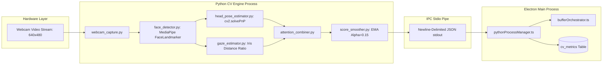

# Computer Vision Subsystem Overview

## 1. Problem Statement & Motivation

Traditional focus software relies solely on OS-level window focus and keystrokes. However, a user can easily sit staring at a smartphone or talk to a colleague while their code editor remains the foreground window, falsely accumulating "focus time."

Focus Engine solves this with an integrated, privacy-first **Computer Vision (CV) Attention Engine**:
- Runs locally on the user's workstation.
- Samples the webcam at low frequency ($2\text{ FPS}$) to minimize CPU consumption ($< 3\%$).
- Detects face presence, computes 3D head pose orientation (Pitch, Yaw, Roll), and tracks eye gaze direction.
- Distinguishes between **active screen focus**, **looking down at keyboard** (productive typing/thinking), and **visual distraction** (looking away at a phone or secondary room area).
- **100% Privacy Guarantee**: No video frames or images are ever written to disk or transmitted over the network. Only anonymized mathematical vectors (angles, gaze ratios, scores) are emitted to Node.js via line-delimited JSON.



---

## 2. Component Architecture & File Inventory

Located in `python/cv_engine/`:

| Module | File | Purpose & Algorithm |
|---|---|---|
| **Webcam Stream** | `webcam_capture.py` | OpenCV `cv2.VideoCapture` threaded frame sampler at $640 \times 480$ resolution |
| **Landmark Detector** | `face_detector.py` | MediaPipe FaceLandmarker task evaluating 478 3D facial landmarks |
| **Head Pose Engine** | `head_pose_estimator.py` | Perspective-n-Point (`cv2.solvePnP`) using 6 3D facial feature points to derive Euler angles |
| **Gaze Estimator** | `gaze_estimator.py` | Iris center (landmarks 468, 473) vs. eye corners horizontal distance ratio |
| **Attention Combiner** | `attention_combiner.py` | Heuristic fusion of face presence, head angles, and gaze direction |
| **Score Smoother** | `score_smoother.py` | Exponential Moving Average (EMA) filter eliminating single-frame blink noise |
| **Production Loop** | `main_loop.py` | Headless CLI loop running at 2 FPS emitting JSON lines to stdout |
| **Task Model** | `face_landmarker.task` | Pre-trained 3.7MB MediaPipe neural network bundle |

---

## 3. Communication Contract (Stdout JSON Protocol)

On every tick (every $500\text{ ms}$ at 2 FPS), `main_loop.py` writes a single JSON record followed by `\n` to `sys.stdout`:

```json
{
  "ts": 1700000000500,
  "frame": 42,
  "face_present": true,
  "landmark_count": 478,
  "confidence": 0.94,
  "yaw": 2.4,
  "pitch": -8.1,
  "roll": 1.2,
  "gaze_direction": "center",
  "gaze_ratio": 0.512,
  "looking_at_screen": true,
  "raw_attention_score": 1.0,
  "smoothed_attention_score": 0.965
}
```

If the camera is disconnected or covered, the engine emits a degraded safe record:
```json
{
  "ts": 1700000001000,
  "frame": 43,
  "face_present": false,
  "landmark_count": 0,
  "confidence": 0.0,
  "yaw": null,
  "pitch": null,
  "roll": null,
  "gaze_direction": null,
  "gaze_ratio": null,
  "looking_at_screen": false,
  "raw_attention_score": 0.0,
  "smoothed_attention_score": 0.820
}
```
This guarantees that Node.js never stalls waiting for a frame.
