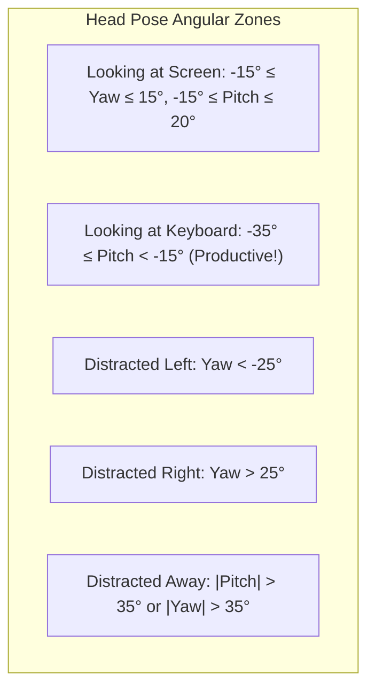

# Head Pose & Gaze Detection Mechanisms

## 1. 3D Head Pose Mathematics (Perspective-n-Point)

Located in `python/cv_engine/head_pose_estimator.py`.

### 1. Mathematical Formulation
Given a set of 3D object points $\mathbf{P}_i = (X_i, Y_i, Z_i)^T$ in world coordinates and their corresponding 2D perspective projections $\mathbf{p}_i = (u_i, v_i)^T$ on the camera image sensor, Perspective-n-Point (PnP) solves for the rigid Euclidean transformation:

$$s \begin{bmatrix} u_i \\ v_i \\ 1 \end{bmatrix} = \mathbf{K} \left( \mathbf{R} \begin{bmatrix} X_i \\ Y_i \\ Z_i \end{bmatrix} + \mathbf{T} \right)$$

Where:
- $s$: Scale factor.
- $\mathbf{K}$: Pinhole camera intrinsic matrix.
- $\mathbf{R}$: $3 \times 3$ orthogonal rotation matrix ($\mathbf{R} \in SO(3)$).
- $\mathbf{T}$: $3 \times 1$ translation vector.

### 2. Intrinsic Camera Matrix Construction
Because webcam sensor intrinsics vary across hardware, Focus Engine approximates the focal length and optical center based on the frame dimensions ($W, H$):

$$\mathbf{K} = \begin{bmatrix} 
f_x & 0 & c_x \\ 
0 & f_y & c_y \\ 
0 & 0 & 1 
\end{bmatrix} = \begin{bmatrix} 
W & 0 & W / 2 \\ 
0 & W & H / 2 \\ 
0 & 0 & 1 
\end{bmatrix}$$

Using `cv2.SOLVEPNP_ITERATIVE`, the Levenberg-Marquardt optimization algorithm minimizes the reprojection error:
$$\arg\min_{\mathbf{R}, \mathbf{T}} \sum_{i=1}^6 \left\| \mathbf{p}_i - \text{proj}(\mathbf{K}, \mathbf{R}, \mathbf{T}, \mathbf{P}_i) \right\|^2$$

---

## 2. Euler Angle Extraction & Pose Classification

Using Rodrigues' rotation formula, the rotation vector $\vec{r}$ is expanded to rotation matrix $\mathbf{R}$:
$$\mathbf{R} = \mathbf{I} + \sin(\theta)\mathbf{K}_{\text{skew}} + (1 - \cos(\theta))\mathbf{K}_{\text{skew}}^2$$

Euler angles in degrees are extracted from $\mathbf{R}$:
- **Yaw** ($\psi$): Horizontal panning (Turning head left or right).
- **Pitch** ($\theta$): Vertical elevation (Nodding head up or down).
- **Roll** ($\phi$): Lateral tilt (Tilting ear towards shoulder).



### The "Looking at Keyboard" Engineering Decision
In naive focus tracking systems, looking down is penalized as a distraction.
However, engineers and writers spend significant portions of productive sessions looking down at their keyboard while typing or brainstorming.

Focus Engine explicitly classifies downward pitch ($-35^\circ \le \theta < -15^\circ$) as:
```python
head_attention = "looking_at_keyboard"
```
When `looking_at_keyboard` is detected, the Attention Combiner assigns `raw_attention_score = 1.0` (Full Focus), preventing false penalties during intensive coding or note-taking!

---

## 3. Eye Gaze Tracking & The Vertical Gaze Decision

Located in `python/cv_engine/gaze_estimator.py`.

### 1. Iris Landmark Index Mapping
MediaPipe with `refine_landmarks=True` yields 478 points:
- **Right Eye**: Iris Center = `468`, Outer Corner = `33`, Inner Corner = `133`.
- **Left Eye**: Iris Center = `473`, Inner Corner = `362`, Outer Corner = `263`.

### 2. Why Vertical Gaze is Excluded (Architectural Decision)
Focus Engine intentionally restricts gaze estimation to the **horizontal axis** (`left`, `center`, `right`):
- **Eyelid Occlusion**: Estimating vertical gaze using 2D iris ratios is extremely noisy because upper eyelids partially cover the iris when the user blinks or looks slightly downwards.
- **Redundancy**: Downward head pitch is already tracked with high accuracy by the 3D Head Pose Estimator.
- **Distraction Relevance**: True visual distractions (checking a smartphone on the desk, looking at a second person in the room, looking at a secondary monitor) are predominantly horizontal angular shifts.

---

## 4. Hardware Calibration Offsets

Webcams are rarely positioned at exact eye level directly in front of the user:
- Laptop webcams are mounted below eye level, angled upwards.
- Monitor-mounted webcams are mounted high, looking downwards.

Focus Engine accounts for this via `calibration.py` and `Settings.tsx`:
- The user completes a 5-second calibration look at their screen center.
- Focus Engine stores baseline offsets:
  $$\psi_{\text{adjusted}} = \psi_{\text{raw}} - \psi_{\text{baseline}}$$
  $$\theta_{\text{adjusted}} = \theta_{\text{raw}} - \theta_{\text{baseline}}$$
- All classification boundary checks evaluate against the calibrated neutral center, preventing persistent false distraction penalties.
