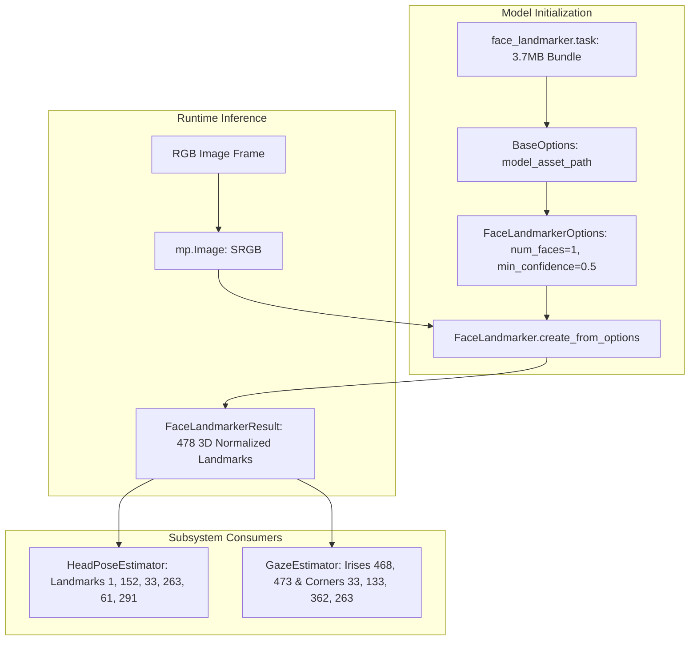

# MediaPipe Model Integration & Node.js Bridge

## 1. MediaPipe Model Architecture & Configuration

Focus Engine integrates Google's **MediaPipe Face Landmarker** neural network (`face_landmarker.task`, bundled locally at `python/cv_engine/face_landmarker.task`).



### 1. Initialization Parameters (`face_detector.py`)
```python
import mediapipe as mp
from mediapipe.tasks.python import BaseOptions
from mediapipe.tasks.python.vision import FaceLandmarker, FaceLandmarkerOptions, RunningMode

base_options = BaseOptions(model_asset_path=model_path)
options = FaceLandmarkerOptions(
    base_options=base_options,
    running_mode=RunningMode.IMAGE,
    num_faces=1,
    min_face_detection_confidence=0.5,
    min_face_presence_confidence=0.5,
    min_tracking_confidence=0.5,
    output_face_blendshapes=False,
    output_facial_transformation_matrixes=False
)
self.detector = FaceLandmarker.create_from_options(options)
```

- **`num_faces=1`**: Focuses computation solely on the primary user sitting directly before the screen, ignoring people walking in the background.
- **`min_face_detection_confidence=0.5`**: Balances rapid acquisition with rejection of false-positive shadow patterns.

---

## 2. The Node.js Subprocess Bridge (`pythonProcessManager.ts`)

Located in `src/main/cv/pythonProcessManager.ts`.

### 1. Python Environment Resolution
Focus Engine dynamically locates the Python virtual environment across Windows and Unix platforms:
```typescript
function getPythonExecutablePath(): string {
  const isWin = process.platform === 'win32'
  const venvPython = isWin
    ? join(app.getAppPath(), 'python', 'cv_env', 'Scripts', 'python.exe')
    : join(app.getAppPath(), 'python', 'cv_env', 'bin', 'python')
  
  if (fs.existsSync(venvPython)) return venvPython
  return isWin ? 'python' : 'python3' // Fallback to system PATH
}
```

### 2. Spawning & Line-Delimited JSON Stream Parsing
```typescript
this.childProcess = spawn(
  pythonPath,
  [scriptPath, '--camera', '0', '--fps', '2.0'],
  { stdio: ['pipe', 'pipe', 'pipe'] }
)

// Stream buffer accumulator to handle packet fragmentation
let stdoutBuffer = ''
this.childProcess.stdout.on('data', (chunk: Buffer) => {
  stdoutBuffer += chunk.toString()
  const lines = stdoutBuffer.split('\n')
  stdoutBuffer = lines.pop() || '' // Keep trailing partial line in buffer

  for (const line of lines) {
    if (!line.trim()) continue
    try {
      const record = JSON.parse(line.trim())
      this.handleCVRecord(record)
    } catch (err) {
      console.error('[PythonProcessManager] Failed to parse JSON line:', err)
    }
  }
})
```

---

## 3. Telemetry Ingestion & Storage

On every valid JSON record:
1. **Forward to `BufferOrchestrator`**: The `smoothed_attention_score` updates the cognitive buffer mapper in real time.
2. **Forward to UI**: Emits `cv:update` to the React dashboard.
3. **Database Insertion**: Writes to `cv_metrics` in SQLite:
   ```sql
   INSERT INTO cv_metrics (
       session_id, face_present, pitch, yaw, roll, 
       gaze_direction, gaze_ratio, looking_at_screen, 
       raw_attention_score, smoothed_attention_score, timestamp
   ) VALUES (?, ?, ?, ?, ?, ?, ?, ?, ?, ?, ?);
   ```
4. **Session Summary Aggregation**:
   When the session finishes, `cvMetricsRepository.getSummary(sessionId)` calculates:
   - Total faces detected count vs. total frames sampled ($\text{FacePresenceRate}$).
   - Average pitch, yaw, and attention score.
   - Longest continuous looking-at-screen duration.
