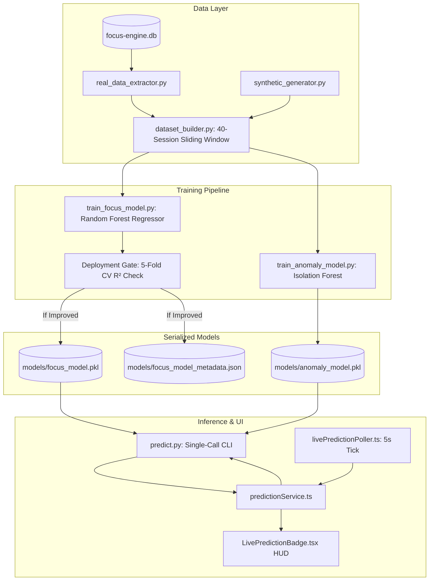

# Machine Learning Subsystem Overview

## 1. Introduction & Objectives

While rule-based heuristics can calculate basic averages, cognitive focus is non-linear and context-dependent:
- A developer switching between a browser tab and VS Code every 15 seconds might be actively debugging against documentation (productive flow).
- Another user switching between YouTube, Discord, and Slack every 15 seconds is suffering severe attentional fragmentation (distraction).
- Circadian rhythms (time of day) and day of the week heavily influence cognitive stamina.

The **Machine Learning Subsystem** in Focus Engine models these multi-dimensional behavioral patterns:
1. **Focus Score Regression**: A **Random Forest Regressor** predicting the expected focus score ($0 \dots 100$) based on rolling telemetry and circadian features.
2. **Behavioral Anomaly Detection**: An **Isolation Forest** that flags sessions with abnormal behavioral dynamics (e.g. erratic window thrashing or simulated activity).
3. **Cold-Start Synthetic Bootstrapping**: Uses a synthetic session generator to provide baseline intelligence out-of-the-box, gradually transitioning to 100% personalized real user data as sessions are completed.
4. **Automated Weekly Retraining**: A background pipeline that audits and retrains models every 7 days without user intervention.



---

## 2. Directory Structure (`python/ml/`)

```text
python/ml/
├── constants.py                      # Shared 13-feature array order contract
├── dataset_builder.py                # Merges real SQLite sessions with synthetic pool (40 window)
├── eda.py                            # Exploratory Data Analysis & visual correlation generator
├── eda_findings.md                   # Statistical findings and correlation report
├── generate_notebook.py              # Auto-generates Jupyter notebook (eda.ipynb)
├── predict.py                        # Fast CLI inference endpoint reading stdin, emitting JSON
├── real_data_extractor.py            # Queries SQLite database to extract real session feature vectors
├── synthetic_generator.py            # Generates realistic synthetic sessions for cold-start bootstrap
├── train_anomaly_model.py            # Trains scikit-learn IsolationForest for outlier detection
├── train_focus_model.py              # Trains scikit-learn RandomForestRegressor with 5-fold CV
├── training_results.md               # Benchmark metrics, feature importances, and validation report
│
├── data/                             # Dataset storage
│   ├── dataset.csv                   # Current active 40-session training window
│   ├── real_sessions.csv             # Extracted real user sessions
│   └── synthetic_pool.csv            # Pool of pre-generated synthetic baseline sessions
│
└── models/                           # Production serialized artifacts
    ├── focus_model.pkl               # Serialized Random Forest Regressor
    ├── anomaly_model.pkl             # Serialized Isolation Forest
    ├── feature_importances.json      # Gini importance breakdown across 13 features
    └── focus_model_metadata.json     # R², MAE, CV scores, and deployment timestamp
```

---

## 3. High-Level Performance Summary

From `training_results.md`:
- **Regression Algorithm**: `RandomForestRegressor(n_estimators=100, max_depth=5, random_state=42)`
- **Anomaly Detection**: `IsolationForest(contamination=0.10, random_state=42)`
- **Top Predictive Feature**: `app_switches` ($38.5\%$ Gini importance), followed by `avg_buffer` ($13.6\%$) and `max_buffer` ($7.4\%$).
- **Test Set Mean Absolute Error (MAE)**: $\approx 5.49\text{ points}$ on a $0 - 100$ scale.
- **Inference Latency**: $< 120\text{ ms}$ per call via lightweight Python process invocation.
