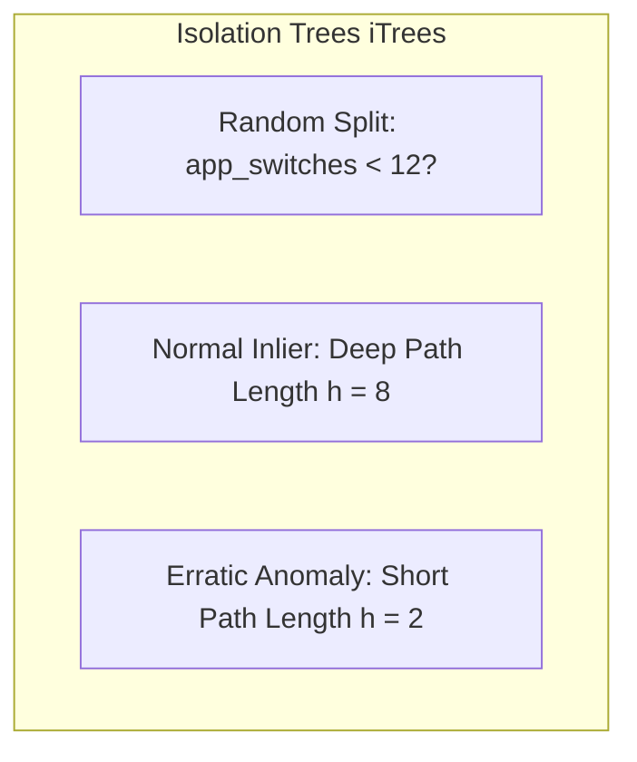

# Machine Learning Model Architecture

## 1. Focus Score Predictor (Random Forest Regressor)

Located in `python/ml/train_focus_model.py`.

### 1. Mathematical Formulation
The focus prediction engine employs an ensemble of $B = 100$ randomized decision trees trained via bootstrap aggregation (bagging).

Given a 13-dimensional input feature vector $\mathbf{x} \in \mathbb{R}^{13}$:
1. For each tree $b \in \{1, \dots, B\}$, a bootstrap sample $\mathcal{D}_b$ of size $N$ is drawn with replacement from the training dataset.
2. At each node split, a random subset of $m = \lfloor \sqrt{13} \rfloor = 3$ features is evaluated to select the split point that maximizes variance reduction:
   $$\Delta \text{Var} = \text{Var}(S) - \frac{|S_L|}{|S|}\text{Var}(S_L) - \frac{|S_R|}{|S|}\text{Var}(S_R)$$
3. The final continuous Focus Score prediction $\hat{y}(\mathbf{x})$ is the ensemble mean:
   $$\hat{y}(\mathbf{x}) = \frac{1}{B} \sum_{b=1}^B T_b(\mathbf{x})$$

### 2. Hyperparameter Configuration & Anti-Overfitting Design
```python
model = RandomForestRegressor(
    n_estimators=100,
    max_depth=5,
    random_state=42
)
```

- **`n_estimators=100`**: Provides stable variance reduction and ensemble convergence.
- **`max_depth=5` (Critical Decision)**: Because the active training window comprises a compact dataset ($N = 40$ sessions), unconstrained deep trees would immediately overfit to idiosyncratic noise. Capping depth at 5 limits the maximum leaf nodes to $2^5 = 32$, forcing trees to learn generalized, high-level behavioral patterns.
- **No Feature Scaling Required**: Decision trees split on individual orthogonal feature thresholds. Unlike Neural Networks or SVMs, Random Forests require zero Min-Max or Z-score normalization, preserving the natural physical units of KPM, seconds, and buffer values.

---

## 2. Behavioral Anomaly Detector (Isolation Forest)

Located in `python/ml/train_anomaly_model.py`.

### 1. Mathematical Intuition
Traditional outlier detection calculates distance from the cluster centroid (e.g. Mahalanobis distance or k-NN), which is computationally expensive and assumes parametric distributions.

**Isolation Forest** isolates anomalies explicitly by taking advantage of two quantitative properties:
1. Anomalous instances are **few in number**.
2. They have **attribute values drastically different** from normal inliers.



In a forest of random partitioning trees (iTrees), an anomaly requires very few random splits to become isolated in a leaf node:
- Average path length $c(n)$ of an unsuccessful search in a Binary Search Tree (BST):
  $$c(n) = 2 \ln(n - 1) + 0.5772156649\text{ (Euler's Constant)} - \frac{2(n - 1)}{n}$$
- Anomaly score $s(x, n)$ based on average path length $E(h(x))$ across all trees:
  $$s(x, n) = 2^{-\frac{E(h(x))}{c(n)}}$$
  - As $E(h(x)) \to 0 \implies s \to 1$ (Definite Anomaly).
  - As $E(h(x)) \to n - 1 \implies s \to 0$ (Definite Inlier).

### 2. Training on High-Focus Baselines
```python
model = IsolationForest(contamination=0.10, random_state=42)
```
- **Training Set Filtering**: The Isolation Forest is trained exclusively on **high-focus sessions** (`focus_score >= 70`).
- **Contamination = 0.10**: Assumes $10\%$ natural behavioral variance within productive sessions.
- **Inference Output**:
  - `+1`: Normal inlier flow (consistent focus behavior).
  - `-1`: Anomaly flagged (erratic task thrashing or synthetic simulation detected).
  - Evaluation tests show that low-focus sessions ($< 50$) are correctly flagged as anomalies over **$80\%$ of the time**.
