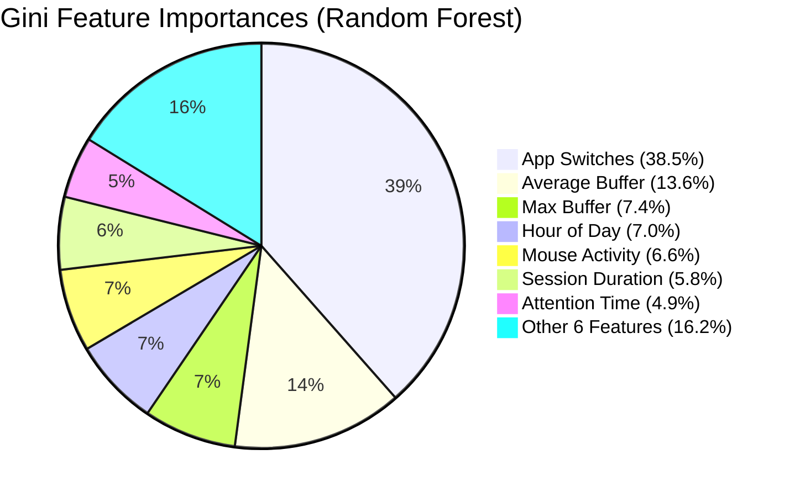

# Feature Engineering & Gini Importance Analysis

## 1. The 13 Aligned Feature Definitions

Focus Engine enforces a strict feature contract defined in `python/ml/constants.py`:

```python
FEATURES = [
    "avg_buffer",
    "min_buffer",
    "max_buffer",
    "focus_time",
    "attention_time",
    "avg_kpm",
    "mouse_activity",
    "pause_count",
    "app_switches",
    "session_duration",
    "hour_of_day",
    "day_of_week",
    "session_mode_is_standard"
]
```

### Feature Specification & Derivation

| # | Feature Name | Data Type | Physical Units | Derivation Source | Description |
|---|---|---|---|---|---|
| 1 | `avg_buffer` | Float | $0.0 - 100.0$ | `buffer_snapshots` | Arithmetic mean of live cognitive buffer values |
| 2 | `min_buffer` | Float | $0.0 - 100.0$ | `buffer_snapshots` | Deepest trough buffer reached during session |
| 3 | `max_buffer` | Float | $0.0 - 100.0$ | `buffer_snapshots` | Highest peak buffer achieved |
| 4 | `focus_time` | Integer | Seconds | `buffer_state_transitions` | Total seconds spent in `'focused'` state ($\ge 50$) |
| 5 | `attention_time`| Integer | Seconds | `cv_metrics` | Seconds with head/gaze directed at screen or keyboard |
| 6 | `avg_kpm` | Float | Keystrokes/min | `keyboard_metrics` | Mean typing velocity during active segments |
| 7 | `mouse_activity`| Float | Velocity/Clicks | `mouse_metrics` | Composite scaled sum of mouse clicks and displacements |
| 8 | `pause_count` | Integer | Count | `sessions` | Total manual and auto-pause interventions |
| 9 | `app_switches` | Integer | Count | `window_focus_events` | Total foreground application context changes |
| 10| `session_duration`| Integer | Seconds | `sessions` | Total actual duration ($E_{\text{total}}$) |
| 11| `hour_of_day` | Integer | $0 - 23$ | `sessions.start_time` | Circadian hour when session was launched |
| 12| `day_of_week` | Integer | $0 - 6$ | `sessions.start_time` | Day of week ($0 = \text{Monday} \dots 6 = \text{Sunday}$) |
| 13| `session_mode_is_standard`| Integer | $0$ or $1$ | `sessions.session_mode` | One-hot flag: $1 = \text{Standard}$, $0 = \text{Pomodoro}$ |

---

## 2. Empirical Feature Importances (Gini Impurity)

Extracted from production training metadata (`python/ml/models/feature_importances.json`):



### Statistical Analysis & Key Insights

1. **`app_switches` is the Dominant Predictor ($38.5\%$)**:
   - High task-switching frequency exhibits a massive negative correlation ($r = -0.74$) with focus score.
   - When a user Alt-Tabs or clicks between applications more than 15 times in a 25-minute Pomodoro, cognitive fragmentation destroys deep work momentum.
2. **`avg_buffer` is the Strongest State Metric ($13.6\%$)**:
   - The multi-modal Focus Buffer accurately integrates fine-grained attention across the session, serving as the single best continuous reflection of cognitive energy.
3. **`hour_of_day` Circadian Effect ($7.0\%$)**:
   - Exploratory Data Analysis (EDA) shows pronounced bimodal productivity peaks:
     - Morning Peak: 09:00 – 11:30 (High focus scores, high KPM).
     - Late Afternoon Dip: 14:00 – 16:00 (Elevated task switching and idle times).
     - Evening Secondary Peak: 20:00 – 22:00.

---

## 3. Data Preprocessing & Missing Value Imputation

In real-world desktop usage, some sensors may be absent (e.g. webcam disabled, leading to missing `attention_time`, or pure reading sessions with zero typing, leading to missing `avg_kpm`).

Focus Engine implements robust preprocessing in `train_focus_model.py`:
1. **Target Filtering**: Rows with missing `focus_score` are dropped:
   ```python
   df = df.dropna(subset=['focus_score'])
   ```
2. **Median Imputation for Features**:
   ```python
   numeric_cols = df.select_dtypes(include=[np.number]).columns
   for col in numeric_cols:
       if col in ['focus_score', 'is_synthetic', 'timestamp']: continue
       if df[col].isnull().any():
           df[col] = df[col].fillna(df[col].median())
   ```
   Median imputation is chosen over mean imputation because it is immune to extreme outlier skew (e.g. a single 3-hour session skewing duration).
