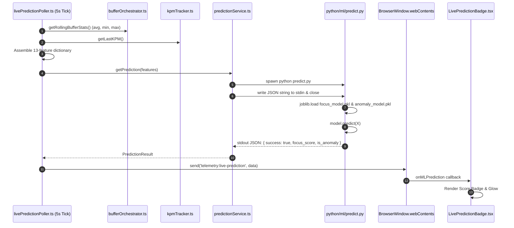

# Real-Time Prediction Pipeline & Automated Retraining

## 1. Real-Time Inference Architecture

During active sessions, Focus Engine runs a real-time machine learning inference loop that classifies user cognitive state every 5 seconds without disturbing the main UI thread.



---

## 2. Feature Assembly in Node.js (`livePredictionPoller.ts`)

Every 5000ms, `LivePredictionPoller` samples running services to populate the 13 feature vector:

```typescript
const now = new Date()
const features: Record<string, number> = {
  avg_buffer: bufferStats.avg,
  min_buffer: bufferStats.min,
  max_buffer: bufferStats.max,
  focus_time: bufferStats.focusedSeconds,
  attention_time: cvStats.attentionSeconds,
  avg_kpm: kpmTracker.getLastKPM(),
  mouse_activity: mouseStats.activityScore,
  pause_count: sessionContext.pauseCount,
  app_switches: windowStats.switchCount,
  session_duration: sessionContext.elapsedSeconds,
  hour_of_day: now.getHours(),
  day_of_week: (now.getDay() + 6) % 7, // Convert Sunday=0 to Monday=0
  session_mode_is_standard: sessionContext.mode === 'standard' ? 1 : 0
}
```

---

## 3. Subprocess Safety & Timeout Protection (`predictionService.ts`)

Because external Python processes can theoretically hang if an OS antivirus locks a file, `predictionService.ts` wraps the execution in a **5-second safety timeout**:

```typescript
const timeoutId = setTimeout(() => {
  console.error('[PredictionService] Python prediction timed out (5s). Killing process...')
  processInstance.kill()
  resolve({ success: false, error: 'Process timeout exceeded' })
}, 5000)
```
- If Python terminates cleanly within 100ms, the timeout is cleared via `clearTimeout(timeoutId)`.
- If Python hangs, the process is killed via `SIGKILL`, and the Promise resolves with `{ success: false }`, ensuring Node.js never leaks zombie child processes or memory.

---

## 4. UI Visualization (`LivePredictionBadge.tsx`)

The React frontend listens via `window.focusEngineAPI.onMLPrediction()`:
- **Score $\ge 75$**: Emerald Badge ("Deep Focus Flow").
- **Score $50 - 74$**: Indigo Badge ("Active Work").
- **Score $< 50$**: Amber Badge ("Attention Fragmented").
- **`is_anomaly === true`**: Red Warning Outline ("Irregular Behavioral Pattern Detected").

---

## 5. Automated Weekly Retraining Daemon (`weeklyRetraining.ts`)

Located in `src/main/ml/weeklyRetraining.ts`.

### 1. Verification Trigger
On app startup (`app.whenReady()`) and every 24 hours, `checkAndTriggerRetrain()` evaluates:
```typescript
const lastRetrained = settingsRepository.get('ml_last_retrained_at')
const sevenDaysMs = 7 * 24 * 60 * 60 * 1000

if (!lastRetrained || Date.now() - Number(lastRetrained) >= sevenDaysMs) {
  await this.triggerRetrain()
}
```

### 2. Multi-Step Execution Pipeline
When triggered, `weeklyRetraining.ts` spawns the training sequence sequentially:
1. `real_data_extractor.py`: Extracts new SQLite session rows.
2. `dataset_builder.py`: Rebalances the 40-session sliding window.
3. `train_focus_model.py`: Evaluates cross-validation and updates `focus_model.pkl`.
4. `train_anomaly_model.py`: Retrains the Isolation Forest.
5. Updates `ml_last_retrained_at` in the SQLite `settings` table with current timestamp.
