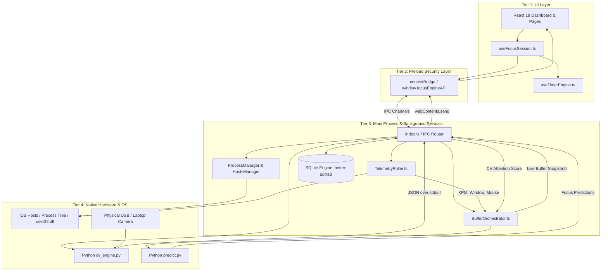

# Cross-Module Interactions

## 1. System Integration Overview

Focus Engine consists of six primary sub-ecosystems operating across three process tiers:
1. **Renderer UI Tier**: React 18, custom hooks, and SVG visualization widgets.
2. **Preload Security Tier**: `contextBridge` gateway providing typed IPC wrappers.
3. **Main Process & Services Tier**: Electron Node.js, SQLite database, OS blocking, telemetry pollers, Focus Buffer state machine, and Python child processes (CV & ML).

---

## 2. Key Interface Boundaries

### Interface A: Frontend to Main Process (`window.focusEngineAPI`)
- **Protocol**: Electron IPC (`ipcRenderer.invoke` $\leftrightarrow$ `ipcMain.handle`).
- **Data Types**: Plain JavaScript Objects serialized via V8 Structured Clone Algorithm.
- **Contract**: Every request returns `{ success: boolean, data?: T, error?: string }`.
- **Primary Channels**:
  - `session:save`: Initiated by `useFocusSession.finalizeSession()`.
  - `blocking:start` / `blocking:stop`: Configures OS hosts file redirection.
  - `appBlocking:killBlacklisted`: Scans and terminates unauthorized EXEs.
  - `telemetry:start` / `telemetry:stop`: Activates the 1Hz telemetry polling loop.

---

### Interface B: Main Process to Python Subprocesses (`stdio`)
- **Protocol**: Child process line-delimited JSON streams over `stdin` and `stdout`.
- **Child 1 (CV Engine)**:
  - Long-running persistent process (`python/cv_engine/main_loop.py`).
  - Emits 1 JSON line every $500\text{ ms}$ containing `yaw`, `pitch`, `gaze_direction`, and `smoothed_attention_score`.
  - Node.js parses lines using an accumulating buffer to handle chunk boundaries cleanly.
- **Child 2 (ML Predictor)**:
  - Ephemeral single-call CLI (`python/ml/predict.py`).
  - Node.js passes 1 JSON line containing the 13 feature vector via `stdin` and closes the stream.
  - Python executes inference, writes `{ success: true, focus_score, is_anomaly }` to `stdout`, and exits.

---

### Interface C: Telemetry to Cognitive Buffer (`BufferOrchestrator`)
- **Protocol**: In-memory direct method calls within the Main Process.
- On every 1-second tick:
  - `telemetryPoller` passes current `kpm` to `keyboardSignalMapper.ts`.
  - `telemetryPoller` passes active window classification to `windowSignalMapper.ts`.
  - `mouseMetricsTracker` passes cursor velocity to `mouseSignalMapper.ts`.
  - `pythonProcessManager` passes CV score to `cvSignalMapper.ts`.
- `BufferOrchestrator` computes the composite score and updates the state machine.

---

### Interface D: Main Process to SQLite (`better-sqlite3`)
- **Protocol**: Synchronous native C++ bindings.
- **Transactions**: Multi-table insertions and aggregations are wrapped in `db.transaction()` blocks to guarantee atomicity.
- **WAL Mode**: `PRAGMA journal_mode = WAL;` allows simultaneous concurrent readers while a background writer appends telemetry snapshots.
