# End-to-End System Data Flow

## 1. Complete Session Lifecycle Data Flow

This document traces the complete end-to-end journey of data through Focus Engine, from the user's initial button click to retrospective analytics and machine learning model retraining.

```mermaid
sequenceDiagram
    autonumber
    actor User
    participant Dash as React Dashboard
    participant UFS as useFocusSession.ts
    participant Preload as window.focusEngineAPI
    participant Main as Electron Main Process
    participant Subsystems as Blocking / Telemetry / Buffer
    participant PyCV as Python CV Process
    participant DB as SQLite (focus-engine.db)
    participant PyML as Python ML Process

    rect rgb(30, 30, 50)
        Note over User,Main: Phase 1: Session Initiation
        User->>Dash: Clicks "Start Focus (25m)"
        Dash->>UFS: startPomodoroSession('focus', 25)
        UFS->>Preload: startBlocking(), startTelemetry(), startCV()
        Preload->>Main: IPC 'blocking:start', 'telemetry:start', 'cv:start'
        Main->>Subsystems: Injects hosts rules, starts 1Hz poller
        Main->>PyCV: Spawns cv_engine.py child process
    end

    rect rgb(30, 50, 30)
        Note over User,PyCV: Phase 2: Active Real-Time Execution
        loop Every 200ms (Frontend Clock)
            UFS->>UFS: Computes Date.now() difference, updates TimerDisplay
        end
        loop Every 500ms (CV Stream)
            PyCV->>Main: JSON Line: { pitch, yaw, gaze, attention_score }
            Main->>DB: INSERT INTO cv_metrics
            Main->>Subsystems: Forwards score to BufferOrchestrator
        end
        loop Every 1000ms (OS Telemetry & Buffer)
            Subsystems->>DB: INSERT INTO window_focus_events
            Subsystems->>Subsystems: Computes Focus Buffer (+1.0 recovery or -2.0 decay)
            Subsystems->>Main: Broadcasts 'telemetry:active-window' & 'telemetry:buffer-update'
            Main->>Dash: Updates LiveTelemetryPanel & FocusBufferGauge
        end
        loop Every 5000ms (Machine Learning)
            Main->>PyML: Spawns predict.py via stdin JSON
            PyML-->>Main: { focus_score: 88.5, is_anomaly: false }
            Main->>Dash: Broadcasts 'telemetry:live-prediction'
        end
    end

    rect rgb(50, 30, 30)
        Note over User,DB: Phase 3: Teardown & Persistence
        User->>Dash: Session hits 0:00 or user stops session
        Dash->>UFS: stopSession() / auto_complete
        UFS->>Preload: stopBlocking(), stopTelemetry(), stopCV()
        Preload->>Main: Reverts hosts file, stops pollers, terminates Python CV
        UFS->>Preload: saveSession(sessionRecord)
        Preload->>Main: IPC 'session:save'
        Main->>DB: INSERT INTO sessions
        UFS->>Preload: getSessionSummary(sessionId)
        Preload->>Main: IPC 'telemetry:getSessionSummary'
        Main->>DB: Aggregates category breakdown, KPM, CV means
        Main-->>Dash: Displays Summary Completion Modal
    end

    rect rgb(40, 40, 60)
        Note over Dash,PyML: Phase 4: Analytics & Retraining
        User->>Dash: Navigates to Analytics Page
        Dash->>Preload: analytics.getHeatmap(), getStreaks()
        Preload->>Main: Queries SQLite aggregated matrices
        Main-->>Dash: Renders 7x24 heatmap and streak counters
        Note over Main,PyML: Weekly Background Retraining
        Main->>PyML: weeklyRetraining checks (>= 7 days)
        Main->>PyML: Spawns dataset_builder & train_focus_model
        PyML->>DB: Extracts real sessions, retrains Random Forest, replaces focus_model.pkl
    end
```

---

## 2. Real-Time Data Ingestion Frequencies

Focus Engine coordinates multiple asynchronous loops operating at harmonized frequencies:

| Loop / Operation | Frequency | Layer | Destination |
|---|---|---|---|
| **Timer Tick** | **$5\text{ Hz}$** ($200\text{ ms}$) | React Renderer (`useTimerEngine`) | SVG Circular Progress Ring |
| **CV Frame Sampling** | **$2\text{ Hz}$** ($500\text{ ms}$) | Python Process (`main_loop.py`) | Main Process `pythonProcessManager` |
| **OS Window & Buffer Tick**| **$1\text{ Hz}$** ($1000\text{ ms}$) | Main Process (`telemetryPoller`, `BufferOrchestrator`) | SQLite `window_focus_events`, `buffer_snapshots`, React HUD |
| **ML Inference Poller** | **$0.2\text{ Hz}$** ($5000\text{ ms}$) | Main Process (`livePredictionPoller`) | `LivePredictionBadge.tsx` HUD |
| **Health Check Liveness** | **$0.1\text{ Hz}$** ($10\,000\text{ ms}$) | Main Process (`telemetryHealthCheck`) | React Health Warning Banner |
| **Process Blacklist Audit**| **$0.033\text{ Hz}$** ($30\,000\text{ ms}$) | Main Process (`tabCloserInterval`, `useFocusSession`) | `taskkill` / `pkill` enforcement |
| **KPM & Mouse Segments** | **$0.016\text{ Hz}$** ($60\,000\text{ ms}$) | Main Process (`kpmTracker`, `mouseMetricsTracker`) | SQLite `keyboard_metrics`, `mouse_metrics` |
| **Model Retraining Check** | **Daily / Startup** | Main Process (`weeklyRetraining`) | Background Python retraining pipeline |
