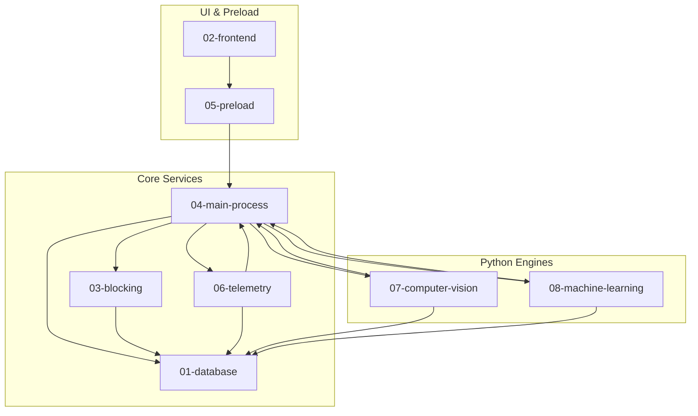

# Cross-Module Dependencies & Team Collaboration

## 1. System Dependency Matrix

This document maps all inter-module dependencies across the Focus Engine codebase to enable independent development and clear architectural boundaries.

---

## 2. Shared Data Structures & Contracts

To prevent cross-module incompatibilities, several key contracts define the interfaces between components:

| Contract / Schema | Location | Defining Module | Consuming Modules | Description |
|---|---|---|---|---|
| `SessionMode`, `SessionType` | `src/renderer/types/timer.ts` | Frontend | Preload, Main IPC, Database | Bounded session modes (`'pomodoro' \| 'standard'`) |
| `TimerState` | `src/renderer/types/timer.ts` | Frontend | React Dashboard, TimerDisplay | State machine states (`'idle' \| 'running' \| 'paused' \| 'completed'`) |
| `FEATURES` Array | `python/ml/constants.py` | Machine Learning | `dataset_builder.py`, `train_focus_model.py`, `predict.py`, `predictionService.ts` | 13-feature array defining exact column alignment for ML inputs |
| `ActiveWindowInfo` | `src/main/telemetry/activeWindowTracker.ts` | Telemetry | DomainClassifier, TelemetryPoller, React UI | `{ appName, windowTitle, domain, category }` |
| `BufferSnapshot` | `src/main/buffer/bufferOrchestrator.ts` | Focus Buffer | BufferSnapshotsRepository, React Gauge, ML Poller | Composite buffer score ($0 \dots 100$) and 4 component signals |
| `CalibrationData` | `src/main/database/settingsRepository.ts` | Database / Settings | CV Engine, Settings Page, Dashboard | Camera angle pitch/yaw baseline offsets |

---

## 3. Database Table Ownership & Access Patterns

| SQLite Table | Primary Writer Subsystem | Reader Subsystems | Access Pattern |
|---|---|---|---|
| `sessions` | Session Handlers (`finalizeSession`) | Analytics, History, ML Dataset Builder | Write-once on session completion; read for historical views |
| `blocked_domains` | Settings (`addDomain`, `removeDomain`) | Hosts Blocker (`blockDomains`), Tab Closer | Low frequency CRUD; cached read on session startup |
| `blacklisted_apps` | Settings (`addApp`, `removeApp`) | Process Manager (`killBlacklistedApps`) | Low frequency CRUD; cached read on session startup |
| `blacklisted_app_kills`| Process Manager (`logKillEvent`) | Session Summary, Recommendation Engine | Appended upon process termination |
| `window_focus_events` | Telemetry Poller (`telemetryPoller.ts`)| Telemetry Aggregator, Heatmap, ML Extractor | 1Hz streaming write during active focus sessions |
| `keyboard_metrics` | KPM Tracker (`kpmTracker.ts`) | Telemetry Aggregator, Focus Score Calculator | 60-second block appended during sessions |
| `mouse_metrics` | Mouse Tracker (`mouseMetricsTracker.ts`)| Telemetry Aggregator, Focus Score Calculator | 60-second block appended during sessions |
| `cv_metrics` | CV Subprocess Bridge (`pythonProcessManager`)| CV Summary, Buffer Orchestrator, ML Extractor | 2Hz streaming write when camera tracking is active |
| `buffer_snapshots` | Buffer Orchestrator (`bufferOrchestrator`)| Buffer Diagnostics, Debug Page, ML Extractor | Periodic timeseries snapshots of cognitive energy |
| `settings` | Settings Repository | CV Engine, Weekly Retraining, User Interface | Key-value configuration storage |

---

## 4. Four-Person Engineering Team Ownership & Collaboration

To support four engineers collaborating effectively without blocking each other:

### Engineer 1: Database, Analytics & Frontend Workstream
- **Primary Modules**: `docs/01-database/`, `docs/02-frontend/`, `docs/12-analytics/`, `src/main/database/`, `src/main/analytics/`, `src/renderer/`
- **Responsibilities**:
  - SQLite schema management, WAL mode tuning, and table migrations.
  - Analytics aggregation queries (circadian heatmaps, streak calculation, productivity KPIs, recommendations).
  - React 18 component architecture, layout shells, views, and dark-mode styling.
  - Precision differential time calculation engine (`useTimerEngine.ts`), session orchestration (`useFocusSession.ts`), SVG dials, and post-session modal summaries.
- **Integration Touchpoints**:
  - Consumes the IPC API provided by Engineer 3 (`window.focusEngineAPI`) and binds UI components to telemetry and buffer states published by Engineer 2.
  - Supplies historical session access and repository methods consumed by Engineer 4 (ML dataset extractor).

---

### Engineer 2: Telemetry & Focus Buffer Engine Workstream
- **Primary Modules**: `docs/06-telemetry/`, `docs/11-focus-buffer/`, `src/main/telemetry/`, `src/main/buffer/`
- **Responsibilities**:
  - Operating system telemetry collection (Win32 active window polling, KPM tracking, mouse activity, idle tiers).
  - Dynamic focus buffer energy reservoir (`FocusBuffer.ts`, exponential decay, $+0.5/\text{sec}$ additive recovery, clamping).
  - State machine evaluation (`focused`, `warning`, `critical`, `paused`), transitions, and distraction penalty deduplication.
  - Signal mapping architectures (`cvSignalMapper`, `keyboardSignalMapper`, `mouseSignalMapper`, `windowSignalMapper`).
  - Session focus score aggregation and ML training target calculation (`focusScoreCalculator.ts`).
- **Integration Touchpoints**:
  - Ingests raw facial attention and gaze streams from Engineer 4's Python CV engine.
  - Writes buffer snapshots, transitions, and telemetry rows into Engineer 1's SQLite repositories.
  - Emits real-time buffer updates and state changes over IPC channels managed by Engineer 3 to be consumed by Engineer 1's frontend.

---

### Engineer 3: Blocking, Main Process & Security Workstream
- **Primary Modules**: `docs/03-blocking/`, `docs/04-main-process/`, `docs/05-preload/`, `src/main/blocking/`, `src/preload/`, `src/main/ipc/`, `src/main/index.ts`
- **Responsibilities**:
  - Application lifecycle management and window initialization (`index.ts`).
  - Preload bridge implementation and context isolation security.
  - Operating system hosts file redirection and detached crash watchdog daemon.
  - OS process tree inspection and application termination (`taskkill`/`pkill`).
  - Centralized IPC routing architecture and security mediation across all modules.
- **Integration Touchpoints**:
  - Exposes typed IPC contracts consumed by Engineer 1's frontend; supervises and manages child processes and background services developed by Engineer 2 and Engineer 4.

---

### Engineer 4: Computer Vision & Machine Learning Workstream
- **Primary Modules**: `docs/07-computer-vision/`, `docs/08-machine-learning/`, `python/cv_engine/`, `python/ml/`
- **Responsibilities**:
  - Python Computer Vision pipeline (OpenCV frame processing, MediaPipe Face Landmarker 478 points, 3D solvePnP head pose, iris gaze ratio).
  - High-performance local WebSocket server (`ws://127.0.0.1:8765`) streaming real-time visual attention telemetry.
  - Scikit-learn machine learning pipeline (Random Forest regression, Isolation Forest anomaly detection, dataset curation, 5-fold CV).
  - Real-time prediction daemon and automated weekly retraining scheduler (`predict.py`, `train_focus_model.py`).
- **Integration Touchpoints**:
  - Streams 30-fps CV attention and gaze metrics over WebSockets to Engineer 2's `cvSignalMapper`.
  - Queries historical session rows from Engineer 1's SQLite database to build ML training sets and feed predictions to the analytics dashboard.
