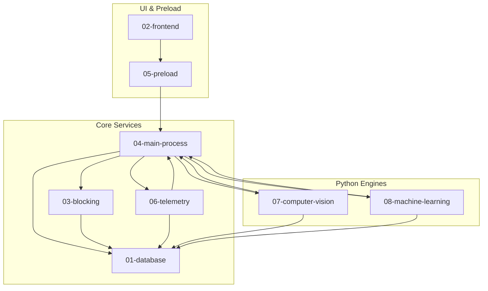

# Cross-Module Dependencies & Team Collaboration

## 1. System Dependency Matrix

This document maps all inter-module dependencies across the Focus Engine codebase to enable independent development and clear architectural boundaries.

---

## 2. Shared Data Structures & Contracts

To prevent cross-module incompatibilities, several key contracts define the interfaces between components:

| Contract / Schema | Location | Defining Module | Consuming Modules | Description |
|---|---|---|---|---|
| `SessionMode`, `SessionType` | `src/renderer/types/timer.ts` | Frontend | Preload, Main IPC, Database | Bounded session modes (`'pomodoro' \| 'standard'`) |
| `TimerState` | `src/renderer/types/timer.ts` | Frontend | React Dashboard, TimerDisplay | State machine states (`'idle' \| 'running' \| 'paused' \| 'completed'`) |
| `FEATURES` Array | `python/ml/constants.py` | Machine Learning | `dataset_builder.py`, `train_focus_model.py`, `predict.py`, `predictionService.ts` | 13-feature array defining exact column alignment for ML inputs |
| `ActiveWindowInfo` | `src/main/telemetry/activeWindowTracker.ts` | Telemetry | DomainClassifier, TelemetryPoller, React UI | `{ appName, windowTitle, domain, category }` |
| `BufferSnapshot` | `src/main/buffer/bufferOrchestrator.ts` | Focus Buffer | BufferSnapshotsRepository, React Gauge, ML Poller | Composite buffer score ($0 \dots 100$) and 4 component signals |
| `CalibrationData` | `src/main/database/settingsRepository.ts` | Database / Settings | CV Engine, Settings Page, Dashboard | Camera angle pitch/yaw baseline offsets |

---

## 3. Database Table Ownership & Access Patterns

| SQLite Table | Primary Writer Subsystem | Reader Subsystems | Access Pattern |
|---|---|---|---|
| `sessions` | Session Handlers (`finalizeSession`) | Analytics, History, ML Dataset Builder | Write-once on session completion; read for historical views |
| `blocked_domains` | Settings (`addDomain`, `removeDomain`) | Hosts Blocker (`blockDomains`), Tab Closer | Low frequency CRUD; cached read on session startup |
| `blacklisted_apps` | Settings (`addApp`, `removeApp`) | Process Manager (`killBlacklistedApps`) | Low frequency CRUD; cached read on session startup |
| `blacklisted_app_kills`| Process Manager (`logKillEvent`) | Session Summary, Recommendation Engine | Appended upon process termination |
| `window_focus_events` | Telemetry Poller (`telemetryPoller.ts`)| Telemetry Aggregator, Heatmap, ML Extractor | 1Hz streaming write during active focus sessions |
| `keyboard_metrics` | KPM Tracker (`kpmTracker.ts`) | Telemetry Aggregator, Focus Score Calculator | 60-second block appended during sessions |
| `mouse_metrics` | Mouse Tracker (`mouseMetricsTracker.ts`)| Telemetry Aggregator, Focus Score Calculator | 60-second block appended during sessions |
| `cv_metrics` | CV Subprocess Bridge (`pythonProcessManager`)| CV Summary, Buffer Orchestrator, ML Extractor | 2Hz streaming write when camera tracking is active |
| `buffer_snapshots` | Buffer Orchestrator (`bufferOrchestrator`)| Buffer Diagnostics, Debug Page, ML Extractor | Periodic timeseries snapshots of cognitive energy |
| `settings` | Settings Repository | CV Engine, Weekly Retraining, User Interface | Key-value configuration storage |

---

## 4. Four-Person Engineering Team Ownership & Collaboration

To support four engineers collaborating effectively without blocking each other:

### Engineer 1: Database & Storage Workstream
- **Primary Modules**: `docs/01-database/`, `src/main/database/`, `src/main/analytics/`
- **Responsibilities**:
  - SQLite schema management and table migrations.
  - Index tuning and query performance optimization.
  - Analytics aggregation queries (heatmaps, streak calculation, productivity KPIs).
- **Integration Touchpoints**:
  - Provides data repository methods consumed by Engineer 2 (Session History) and Engineer 4 (ML Extractor).

---

### Engineer 2: Frontend & Time Calculation Workstream
- **Primary Modules**: `docs/02-frontend/`, `src/renderer/`
- **Responsibilities**:
  - React 18 component design, layout shells, and dark-mode styling.
  - Precision differential time calculation engine (`useTimerEngine.ts`).
  - Session orchestration and modal workflows (`useFocusSession.ts`).
  - SVG visualization gauges (`FocusBufferGauge.tsx`, `TimerDisplay.tsx`, `FocusHeatmap.tsx`).
- **Integration Touchpoints**:
  - Consumes the IPC API provided by Engineer 3 (`window.focusEngineAPI`).

---

### Engineer 3: Blocking, Main Process & Security Workstream
- **Primary Modules**: `docs/03-blocking/`, `docs/04-main-process/`, `docs/05-preload/`, `src/main/blocking/`, `src/preload/`
- **Responsibilities**:
  - Application lifecycle management and window initialization (`index.ts`).
  - Preload bridge implementation and context isolation security.
  - Operating system hosts file redirection and detached crash watchdog daemon.
  - OS process tree inspection and application termination (`taskkill`/`pkill`).
- **Integration Touchpoints**:
  - Exposes typed IPC contracts consumed by Engineer 2; coordinates background services created by Engineer 4.

---

### Engineer 4: Telemetry, Computer Vision & Machine Learning Workstream
- **Primary Modules**: `docs/06-telemetry/`, `docs/07-computer-vision/`, `docs/08-machine-learning/`, `src/main/telemetry/`, `python/`
- **Responsibilities**:
  - Low-level OS telemetry collection (Win32 window polling, KPM tracker, idle detection).
  - Python Computer Vision attention engine (OpenCV, MediaPipe FaceLandmarker, PnP head pose, gaze).
  - Multi-modal Focus Buffer decay/recovery calculation (`bufferOrchestrator.ts`).
  - Scikit-learn machine learning pipeline (Random Forest regression, Isolation Forest anomaly detection, weekly retraining).
- **Integration Touchpoints**:
  - Delivers real-time telemetry streams to Engineer 3's IPC handlers; persists timeseries data via Engineer 1's repositories.
