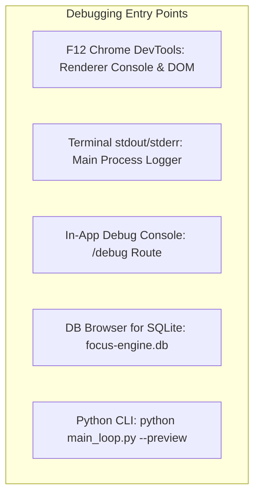

# System Debugging & Diagnostics Guide

## 1. Overview of Debugging Surfaces

Because Focus Engine bridges a Chromium renderer, a Node.js main process, an embedded SQLite database, and two Python subprocesses, diagnosing issues requires knowing where to look:



---

## 2. In-App Diagnostic Console (`Debug.tsx`)

Focus Engine includes a dedicated diagnostic control panel accessible via the sidebar navigation ("Debug"):

### Diagnostic Capabilities:
1. **Synthetic Buffer Manipulation**:
   - Manually increment or decrement the live Focus Buffer by $+10$ or $-10$ points to observe gauge animations and state transitions (`focused` $\to$ `warning` $\to$ `critical`).
2. **Event Simulation**:
   - Trigger simulated distraction events to verify that `DistractionAlert.tsx` appears and penalties are subtracted.
   - Trigger synthetic `session:auto-pause` and `session:force-end` events to test modal recovery flows.
3. **Live Event Stream**:
   - Displays a real-time terminal feed of all IPC messages passing through `focusEngineAPI`.

---

## 3. Database Inspection (`focus-engine.db`)

The SQLite database is stored locally in the Electron `userData` folder:

- **Windows**: `%APPDATA%\focus-engine-temp\focus-engine.db` (usually `C:\Users\<User>\AppData\Roaming\focus-engine-temp\focus-engine.db`)
- **macOS**: `~/Library/Application Support/focus-engine-temp/focus-engine.db`
- **Linux**: `~/.config/focus-engine-temp/focus-engine.db`

### Inspecting via CLI:
```bash
# Open SQLite database
sqlite3 "%APPDATA%\focus-engine-temp\focus-engine.db"

# Check table row counts
SELECT 'sessions', COUNT(*) FROM sessions
UNION ALL
SELECT 'cv_metrics', COUNT(*) FROM cv_metrics
UNION ALL
SELECT 'window_focus_events', COUNT(*) FROM window_focus_events;
```

---

## 4. Troubleshooting Common Development Pitfalls

### Pitfall 1: `Permission Denied (EPERM / EACCES)` on Hosts Modification
- **Symptom**: When starting a focus session, the UI displays:
  `Permission Denied: Focus Engine lacks administrative permissions to modify the hosts file.`
- **Cause**: The terminal running `npm run dev` lacks OS administrative privileges.
- **Resolution**:
  - Windows: Close terminal $\to$ Open PowerShell as Administrator $\to$ `npm run dev`.
  - macOS/Linux: Run with `sudo npm run dev`.

---

### Pitfall 2: Python CV Process Fails to Start
- **Symptom**: Webcam LED never turns on; CV attention score remains $0\%$.
- **Cause**: The Python virtual environment is missing or lacks MediaPipe dependencies.
- **Resolution**:
  1. Test Python manually:
     ```bash
     .\python\cv_env\Scripts\python.exe python\cv_engine\main_loop.py --preview
     ```
  2. If an `import mediapipe` error appears, activate the venv and reinstall:
     ```bash
     pip install -r python/cv_engine/requirements.txt
     ```

---

### Pitfall 3: macOS Camera Privacy TCC Block
- **Symptom**: `Could not open camera 0`.
- **Cause**: macOS Transparency, Consent, and Control (TCC) has not granted Terminal/Electron permission to access the webcam.
- **Resolution**:
  - Open **System Settings** $\to$ **Privacy & Security** $\to$ **Camera** $\to$ Enable toggle for your terminal application (e.g. iTerm2, Terminal, or VS Code).
