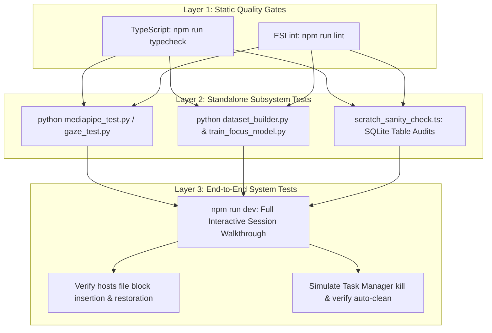

# Testing & Quality Assurance Guide

## 1. Testing Strategy Overview

Because Focus Engine enforces strict rules against modifying existing source code during this migration phase, verification relies on comprehensive static analysis, subsystem harness tests, and integration sanity checks.



---

## 2. Static Analysis & Type Safety Checks

Execute all static verification commands before committing documentation or code changes:

### 1. TypeScript Strict Typecheck
```bash
npm run typecheck
```
Executes two distinct TypeScript configurations:
- `tsconfig.node.json`: Validates Electron main process and preload files with Node.js ambient types.
- `tsconfig.web.json`: Validates React components and hooks with DOM and React 19 types.

### 2. Linting & Formatting Check
```bash
npm run lint
npm run format
```
Ensures code adherence to `.prettierrc.yaml` and `.eslintrc.cjs` style rules.

---

## 3. Subsystem Test Harnesses

### 1. Computer Vision Test Suite (`python/cv_engine/`)
Execute the dedicated Python verification scripts:
```bash
cd python/cv_engine

# 1. Test webcam hardware acquisition
python webcam_test.py

# 2. Test MediaPipe Face Landmarker detection
python mediapipe_test.py

# 3. Test horizontal iris gaze estimation
python gaze_test.py

# 4. Test Exponential Moving Average smoother
python smoothing_test.py
```
**Acceptance Criteria**:
- All test scripts print `[SUCCESS]` or exit with code `0`.
- Camera LED extinguishes immediately upon test completion.

---

### 2. Machine Learning Test Suite (`python/ml/`)
```bash
cd python/ml

# 1. Verify dataset building & column alignment
python dataset_builder.py

# 2. Verify Random Forest training and 5-fold CV evaluation
python train_focus_model.py

# 3. Verify Isolation Forest anomaly classification
python train_anomaly_model.py
```
**Acceptance Criteria**:
- 5-fold cross-validation R² and MAE metrics are logged.
- Generated `feature_importances.json` verifies that `app_switches` is the top predictor.
- Trained `.pkl` artifacts are created in `python/ml/models/`.

---

## 4. End-to-End Integration Verification Walkthrough

Perform this 5-minute interactive QA checklist in development mode (`npm run dev`):

1. **Session Launch Verification**:
   - Click "Start Focus (25m)".
   - Verify countdown begins at `25:00` and decrements smoothly.
   - Inspect `C:\Windows\System32\drivers\etc\hosts`: Confirm `# FOCUS_ENGINE_BLOCK_START` is present with domain entries.
2. **Telemetry & CV Verification**:
   - Switch active windows to VS Code: Confirm `LiveTelemetryPanel` displays "VS Code" as `Productive`.
   - Ensure the physical webcam LED turns on; verify `CVAttentionPanel` reports live Pitch, Yaw, and Attention Score.
3. **Pause & Resume Verification**:
   - Click "Pause": Confirm countdown freezes, buffer decay halts, and state switches to `paused`.
   - Click "Resume": Confirm countdown re-anchors to `Date.now()` without drift.
4. **Termination & Cleanup Verification**:
   - Click "Stop": Confirm session finalizes and the completion modal appears.
   - Inspect `hosts` file: Confirm the Focus Engine block is completely removed.
   - Confirm webcam LED turns off.
   - Navigate to "History": Confirm the completed session appears in the table with non-null duration and focus score.
