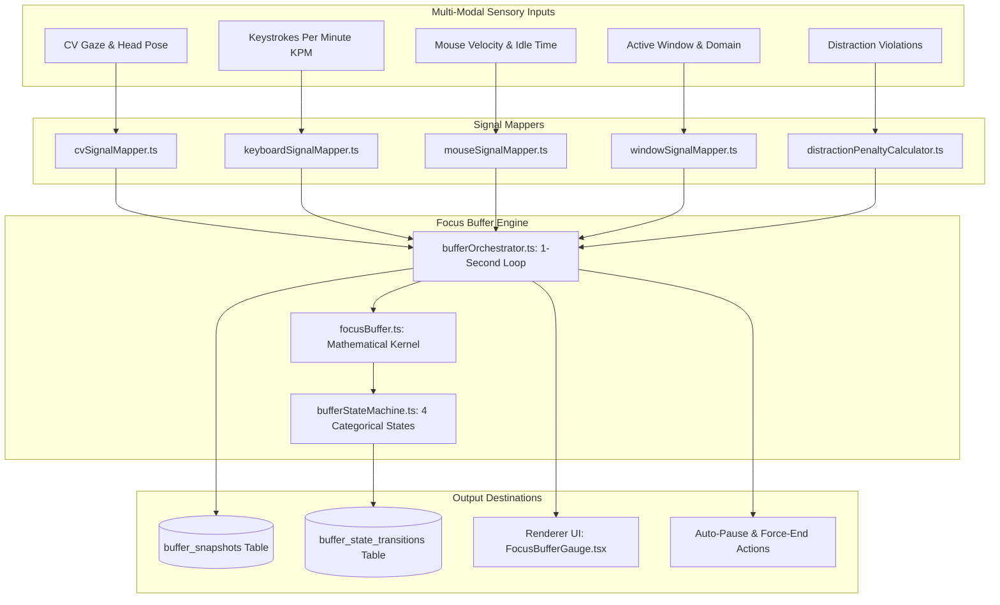

# Focus Buffer Subsystem Overview

## 1. Introduction & Mission

The **Focus Buffer Subsystem** (`src/main/buffer/`) is one of the most innovative and central architectural components of Focus Engine. Rather than treating focus as a static binary flag (focused vs. unfocused), the engine models human attention as a **continuous, dynamic energy reservoir**:

- Bounded mathematically between **$0.0$ and $100.0$ points**.
- Starts at **$100.0$** (full cognitive stamina) at session launch.
- Operates on a **1-second background tick loop** in the Electron Main Process (`bufferOrchestrator.ts`).
- Continuously synthesizes four real-time HCI sensory signals:
  1. **Computer Vision Gaze & Head Orientation ($S_{\text{cv}}$)**
  2. **Typing Cadence & KPM Velocity ($S_{\text{kb}}$)**
  3. **Cursor Dynamics & Idle Time ($S_{\text{mouse}}$)**
  4. **Active Application Category ($S_{\text{win}}$)**
- Features an **additive recovery term** ($+0.5/\text{sec}$) during high-flow states and **multiplicative decay with subtraction penalties** during distractions.
- Automatically triggers **Inactivity Auto-Pauses** and **Force-End Protections** when attention collapses below threshold levels.



---

## 2. Directory Layout (`src/main/buffer/`)

```text
src/main/buffer/
├── bufferDiagnostics.ts              # Diagnostics, audit queries, and timeseries history
├── bufferOrchestrator.ts             # 1-second background orchestrator, overrides, & broadcasts
├── bufferStateMachine.ts             # State transitions (focused -> warning -> critical -> paused)
├── cvSignalMapper.ts                 # Maps MediaPipe attention score into CV multiplier (0.95 - 1.0)
├── distractionPenaltyCalculator.ts   # Subtractive penalties for visits to blacklisted domains
├── focusBuffer.ts                    # Core mathematical class: clamping, recovery, history queue
├── focusBufferSimulation.ts          # Test harness for synthetic buffer decay simulation
├── focusScoreCalculator.ts           # Post-session multi-factor aggregate focus score formula
├── keyboardSignalMapper.ts           # Maps KPM into keyboard multiplier
├── livePredictionPoller.ts           # 5-second polling service feeding ML models
├── mouseSignalMapper.ts              # Maps cursor movement and idle duration into mouse multiplier
└── windowSignalMapper.ts             # Maps productive/neutral/distraction window to multiplier
```

---

## 3. The 4 Categorical Buffer States

The continuous numeric buffer value ($0.0 \dots 100.0$) maps directly to four formal behavioral states:

| State | Numeric Threshold | Color Aesthetic | Behavioral Meaning |
|---|---|---|---|
| **`focused`** | **$75.0 - 100.0$** | Emerald / Cyan Glow | Deep cognitive immersion; active work flow |
| **`warning`** | **$40.0 - 74.9$** | Amber Warning Pulse | Attention slipping; prolonged idle or minor distraction |
| **`critical`** | **$10.0 - 39.9$** | Red Rapid Pulse | Severe distraction; user at imminent risk of losing session |
| **`paused`** | **$< 10.0$** | Frozen Grey | Buffer depleted; triggers automated system intervention |

---

## 4. Key Subsystem Capabilities

1. **10-Second Warmup Buffer**: During the first 10 seconds of a session, all multipliers are pinned to $1.0$ and penalties are suppressed, giving the user time to settle into their workstation.
2. **10-Second Look-Away Grace Period**: A single glance away from the monitor (e.g. checking a clock or stretching) is completely forgiven. Decay only activates after $10$ consecutive seconds of inattention.
3. **Reading & Thinking Override**: If the user's face is oriented toward the monitor ($S_{\text{cv}} = 1.0$), all keyboard and mouse idle penalties are neutralized. The system understands that reading code or thinking is productive work!
4. **Typing-Mouse Interlock**: When typing actively ($KPM \ge 5$), lack of mouse movement is never penalized.
