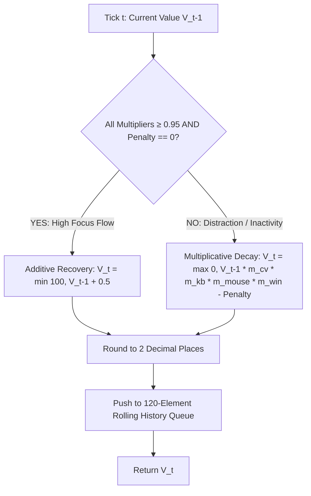

# Focus Buffer Mathematical Formulations & Dynamics

## 1. Core Mathematical Model

Located in `src/main/buffer/focusBuffer.ts`.

The Focus Buffer operates as a discrete-time dynamical system evaluated every second ($t \in \mathbb{N}$):



---

## 2. Mathematical Formulations

### Condition for Additive Recovery (Flow State)
$$\text{IsHighlyFocused} \iff \left( m_{\text{cv}} \ge 0.95 \land m_{\text{kb}} \ge 0.95 \land m_{\text{mouse}} \ge 0.95 \land m_{\text{win}} \ge 0.95 \land P_{\text{distraction}} = 0 \right)$$

### Formula 1: Additive Recovery Mode
When in a sustained high-focus flow state, the buffer recovers linearly at a controlled rate of **$+0.5$ points per second**:

$$V_t = \min\left(100.00, \; V_{t-1} + 0.50\right)$$

- **Recovery Time Constant**: Starting from a warning trough of $50.0$, full recovery to $100.0$ takes exactly:
  $$t_{\text{recover}} = \frac{100.0 - 50.0}{0.50} = 100\text{ seconds (1m 40s)}$$

---

### Formula 2: Multiplicative Decay & Subtractive Penalty Mode
When attention slips or distraction occurs, the buffer decays proportionally:

$$V_t = \max\left(0.00, \; V_{t-1} \cdot m_{\text{cv}} \cdot m_{\text{kb}} \cdot m_{\text{mouse}} \cdot m_{\text{win}} - P_{\text{distraction}}\right)$$

Where:
- $V_{t-1}$: Previous buffer value.
- $m_{\text{cv}} \in [0.90, 1.0]$: Computer vision attention multiplier.
- $m_{\text{kb}} \in [0.90, 1.0]$: Keystrokes per minute cadence multiplier.
- $m_{\text{mouse}} \in [0.90, 1.0]$: Cursor interaction multiplier.
- $m_{\text{win}} \in [0.90, 1.0]$: Active window classification multiplier.
- $P_{\text{distraction}} \ge 0$: Discrete subtractive penalty points (e.g. $-10\text{ pts}$ for blacklisted websites).

---

### Formula 3: Precision Clamping & Float Normalization
To prevent IEEE-754 floating-point drift (e.g. `99.4999999999999`):
$$V_t = \frac{\text{round}(V_t \times 100)}{100}$$

---

## 3. Concrete Numerical Walkthroughs

### Scenario A: Additive Recovery from Warning
- **Initial State**: $V_0 = 74.00$ (Warning Zone).
- **Multipliers**: $m_{\text{cv}} = 1.0, m_{\text{kb}} = 1.0, m_{\text{mouse}} = 1.0, m_{\text{win}} = 1.0, P = 0$.
- **Tick 1**: $V_1 = \min(100, 74.00 + 0.5) = 74.50$.
- **Tick 2**: $V_2 = \min(100, 74.50 + 0.5) = 75.00$ $\implies$ **Transitions to `'focused'` state!**
- **Tick 3**: $V_3 = \min(100, 75.00 + 0.5) = 75.50$.

---

### Scenario B: Multiplicative Inactivity Decay
- **Initial State**: $V_0 = 100.00$. User looks away from screen, stops typing, and stops moving mouse.
- **Grace Period (Ticks 1–10)**: Look-away timer counts up ($1 \dots 10$). Multipliers remain $1.00$. Buffer stays at $100.00$.
- **Tick 11 (Grace Period Expired)**:
  - $m_{\text{cv}} = 0.95$, $m_{\text{kb}} = 0.95$, $m_{\text{mouse}} = 0.95$, $m_{\text{win}} = 1.00$.
  - Composite Multiplier: $0.95 \times 0.95 \times 0.95 \approx 0.857375$.
  - $V_{11} = 100.00 \times 0.857375 = 85.74$.
- **Tick 12**:
  - $V_{12} = 85.74 \times 0.857375 = 73.51$ $\implies$ **Enters `'warning'` state!**

---

### Scenario C: Subtractive Penalty (Blacklisted Domain Hit)
- **Initial State**: $V_0 = 80.00$.
- User opens `reddit.com`.
- Telemetry detects distraction event $\implies P_{\text{distraction}} = 10.0\text{ pts}$, $m_{\text{win}} = 0.90$.
- $V_1 = \max(0, 80.00 \times 1.0 \times 1.0 \times 1.0 \times 0.90 - 10.0) = \max(0, 72.00 - 10.0) = 62.00$.
- A single intentional distraction event immediately slashes $18.0$ points from the buffer!

---

## 4. Rolling History Buffer Queue

The `FocusBuffer` maintains a FIFO ring buffer of the most recent **120 ticks (2 minutes)**:
```typescript
private readonly maxHistorySize: number = 120

this.history.push({ timestamp: Date.now(), value: this.currentValue })
if (this.history.length > this.maxHistorySize) {
  this.history.shift()
}
```
This rolling array powers the real-time sparkline graph rendered inside `FocusBufferGauge.tsx`.
