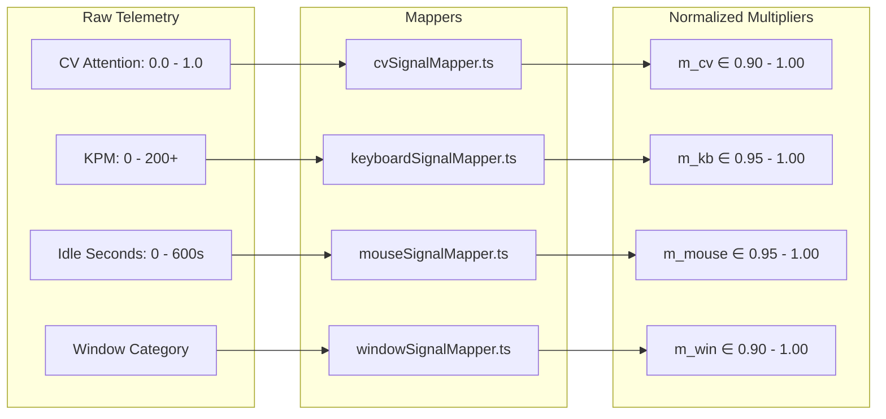

# Signal Mapping Architecture & Cross-Signal Overrides

## 1. Overview of Multiplier Normalization

The four sensory inputs in Focus Engine operate on vastly different physical scales:
- Computer Vision: Gaze vectors & attention probabilities ($0.0 \dots 1.0$).
- Keyboard: Typing speed ($0 \dots 200+\text{ KPM}$).
- Mouse: Idle duration ($0 \dots 3600+\text{ seconds}$).
- Window: Categorical strings (`productive`, `distraction`, `neutral`).

To combine these into the dynamical buffer equation, dedicated **Signal Mappers** normalize each input into a bounded multiplier $m \in [0.90, 1.00]$:



---

## 2. Signal Mapper Implementations

### 1. Computer Vision Signal Mapper (`cvSignalMapper.ts`)
```typescript
export function mapCVToMultiplier(attentionScore: number, facePresent: boolean): number {
  if (!facePresent) return 0.90 // No face detected in frame
  if (attentionScore >= 0.80) return 1.00 // Looking directly at screen / keyboard
  if (attentionScore >= 0.50) return 0.98 // Slight head turn / partial attention
  return 0.95 // Looking away
}
```

---

### 2. Keyboard Signal Mapper (`keyboardSignalMapper.ts`)
```typescript
export function mapKPMToMultiplier(kpm: number, windowCategory: string): number {
  if (kpm >= 15) return 1.00 // Active fluent typing
  if (kpm >= 5) return 0.98 // Intermittent typing / editing
  if (windowCategory === 'productive') return 0.98 // Idle in IDE is forgiven lightly
  return 0.95 // Inactive
}
```

---

### 3. Mouse Signal Mapper (`mouseSignalMapper.ts`)
```typescript
export function mapMouseToMultiplier(idleDurationSec: number, windowCategory: string): number {
  if (idleDurationSec < 30) return 1.00 // Active cursor engagement
  if (idleDurationSec < 60) return 0.98 // Brief reading pause
  if (windowCategory === 'productive') return 0.98 // Thinking in code editor
  return 0.95 // Extended mouse inactivity
}
```

---

### 4. Window Category Signal Mapper (`windowSignalMapper.ts`)
```typescript
export function mapWindowToMultiplier(category: string, domain: string): number {
  switch (category) {
    case 'productive': return 1.00
    case 'neutral':    return 0.98
    case 'unknown':    return 0.97
    case 'distraction':return 0.90
    default:           return 0.97
  }
}
```

---

## 3. Intelligent Override Rules (Context Awareness)

Naive systems evaluate sensors independently, resulting in infuriating false penalties (e.g. penalizing a user for not touching the mouse while reading documentation).

Focus Engine implements **three intelligent interlocks** in `bufferOrchestrator.ts`:

### Override Rule A: The CV Reading / Thinking Exemption
```typescript
if (cvMult === 1.0) {
  keyboardMult = 1.0
  mouseMult = 1.0
}
```
**Rationale**: If the webcam verifies that the user is sitting upright with their eyes directed forward at the screen, they are actively reading or mentally formulating logic. The system sets both keyboard and mouse multipliers to $1.0$, completely disabling idle decay!

### Override Rule B: Typing-Mouse Interlock
```typescript
if (kpm >= 5) {
  mouseMult = 1.0
}
if (idleDurationSec < 20) {
  keyboardMult = 1.0
}
```
**Rationale**: When an engineer is rapidly typing code, they rarely touch the mouse. Conversely, when reviewing long diffs or reading web pages, they scroll with the mouse without typing. This interlock prevents either input from penalizing the other.

### Override Rule C: Session Warmup
```typescript
const isWarmup = this.secondsElapsed <= 10
if (isWarmup) {
  cvMult = 1.0; keyboardMult = 1.0; mouseMult = 1.0; windowMult = 1.0; penalty = 0;
}
```
**Rationale**: Users need a few seconds after pressing "Start" to position their hands, switch to their work window, and adjust their chair. The 10-second warmup guarantees zero startup penalties.
