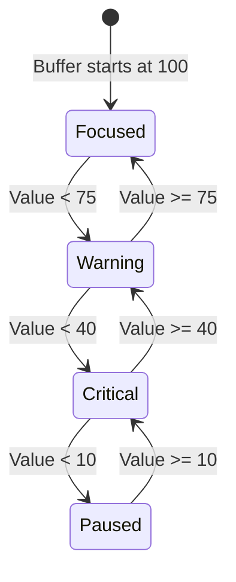

# Buffer State Machine and Transitions Architecture

## 1. Overview and Core Purpose

The **Buffer State Machine** (`src/main/buffer/bufferStateMachine.ts`) serves as the discrete state classifier and transition supervisor for Focus Engine's dynamic energy reservoir (`FocusBuffer`). While the buffer computes a continuous floating-point score between `0.0` and `100.0` every tick (1000 ms), user interfaces, audio cues, system trays, and session lifecycle managers require deterministic, categorical states.

The state machine converts numeric vitality levels into four distinct operational states:
1. `focused` ($\ge 75$)
2. `warning` ($40 \le V < 75$)
3. `critical` ($10 \le V < 40$)
4. `paused` ($V < 10$)

Beyond raw classification, the state machine tracks state dwell times, emits transition events, writes historical transition records into SQLite (`buffer_state_transitions`), and triggers automated session controls when cognitive vitality collapses.

---

## 2. State Classification Hierarchy



### State Definitions and Semantics

| State | Buffer Range | Visual / UI Feedback | System Behavioral Meaning |
|---|---|---|---|
| **`focused`** | `75.0` – `100.0` | Emerald/Green glow, timer active, peaceful UI | Deep cognitive flow. All signals healthy or well within grace allowances. Time spent here is credited as productive deep work. |
| **`warning`** | `40.0` – `74.9` | Amber/Yellow alert border, subtle warning banner | Focus degrading. Gaze drifting, extended pauses, or non-work app switching occurring. Reversible by refocusing. |
| **`critical`** | `10.0` – `39.9` | Crimson/Red pulsing border, urgent visual callouts | Cognitive presence near collapse. Severe penalties or sustained distraction. Immediate risk of session auto-pause. |
| **`paused`** | `0.0` – `9.9` | Full-screen pause overlay, timer halted | Energy exhausted. Focus Engine auto-pauses the session timer. In strict mode, triggers enforcement penalties. |

---

## 3. Transition Evaluation Loop

The state machine is invoked at every tick (1 Hz) by the `BufferOrchestrator`:

```typescript
export interface StateHistoryEntry {
  state: FocusState
  startTime: number
  endTime: number | null
}

export class BufferStateMachine {
  private currentState: FocusState = 'focused'
  private stateStartTime: number = Date.now()
  private history: StateHistoryEntry[] = []

  constructor(initialValue: number = 100) {
    this.currentState = this.determineState(initialValue)
    this.stateStartTime = Date.now()
    this.history.push({
      state: this.currentState,
      startTime: this.stateStartTime,
      endTime: null
    })
  }

  private determineState(value: number): FocusState {
    if (value >= 75) return 'focused'
    if (value >= 40) return 'warning'
    if (value >= 10) return 'critical'
    return 'paused'
  }

  public evaluate(value: number): {
    state: FocusState
    changed: boolean
    previousState: FocusState | null
    durationInPreviousState: number
  } {
    const targetState = this.determineState(value)
    const now = Date.now()
    const changed = targetState !== this.currentState

    let previousState: FocusState | null = null
    let durationInPreviousState = 0

    if (changed) {
      previousState = this.currentState
      durationInPreviousState = now - this.stateStartTime

      // Close the open history entry
      const lastEntry = this.history[this.history.length - 1]
      if (lastEntry) {
        lastEntry.endTime = now
      }

      this.currentState = targetState
      this.stateStartTime = now

      // Push new state node
      this.history.push({
        state: targetState,
        startTime: now,
        endTime: null
      })
    }

    return {
      state: this.currentState,
      changed,
      previousState,
      durationInPreviousState
    }
  }
}
```

### Transition Timing Mechanics
1. **Zero Hysteresis Thresholds**: The state machine operates on clean scalar bounds ($\ge 75, \ge 40, \ge 10$). Because the underlying `FocusBuffer` value has inertia (smooth exponential decay and linear additive recovery), flickering across boundaries is naturally dampened without artificial delay debouncing.
2. **Atomic Timestamp Recording**: Both `startTime` and previous `endTime` use identical clock samples (`now = Date.now()`), guaranteeing continuous time-accounting with zero temporal drift or gaps between intervals.
3. **Open-Ended Tail State**: The currently active state always has `endTime: null` in memory until transitioned or until the session closes.

---

## 4. Database Persistence and IPC Broadcast

When `changed === true`, the orchestrator writes the transition to SQLite and broadcasts the event across IPC to the React frontend:

```typescript
// bufferOrchestrator.ts
const transition = this.stateMachine.evaluate(currentBufferValue)

if (transition.changed && transition.previousState) {
  // 1. Persist to SQLite
  bufferStateTransitionsRepository.insert({
    session_id: this.sessionId,
    state: transition.previousState,
    duration: transition.durationInPreviousState,
    timestamp: Date.now()
  })

  // 2. Broadcast across IPC
  this.window.webContents.send('buffer:state-changed', {
    state: transition.state,
    previousState: transition.previousState,
    durationInPreviousState: transition.durationInPreviousState,
    currentValue: currentBufferValue
  })
}
```

### Schema Mapping (`buffer_state_transitions`)

| Column | Type | Description |
|---|---|---|
| `id` | `INTEGER PRIMARY KEY AUTOINCREMENT` | Unique transition identifier |
| `session_id` | `TEXT NOT NULL` | Foreign key referencing `sessions(session_id)` |
| `state` | `TEXT NOT NULL` | State that was exited (`'focused'`, `'warning'`, `'critical'`, `'paused'`) |
| `duration` | `INTEGER` | Dwell duration in milliseconds spent in this state |
| `timestamp` | `INTEGER NOT NULL` | Epoch millisecond timestamp of transition |

---

## 5. Session Lifecycle Integration

### Auto-Pause on Collapsing Vitality
When the buffer drops below `10.0`, the state machine evaluates to `'paused'`. The orchestrator receives this state change and invokes the session lifecycle manager:
- Stops the session countdown clock to prevent unearned focus credit.
- Freezes telemetry aggregators.
- Emits desktop notifications warning the user that their session has stalled due to loss of focus.
- In strict blocking mode, prompts the user to clear distractions or take an authorized break.

### Aggregate Time Calculation
The state machine provides `getTimeInState(state: FocusState): number` for real-time reporting during an active session:
$$\text{TimeInState}(S) = \sum_{h \in \text{history}, h.\text{state} = S} (h.\text{endTime} \lor \text{now}) - h.\text{startTime}$$

This powers the end-of-session focus percentage metric:
$$\text{FocusPercentage} = \frac{\text{getTimeInState}(\text{'focused'})}{\text{durationActualMs}} \times 100$$
