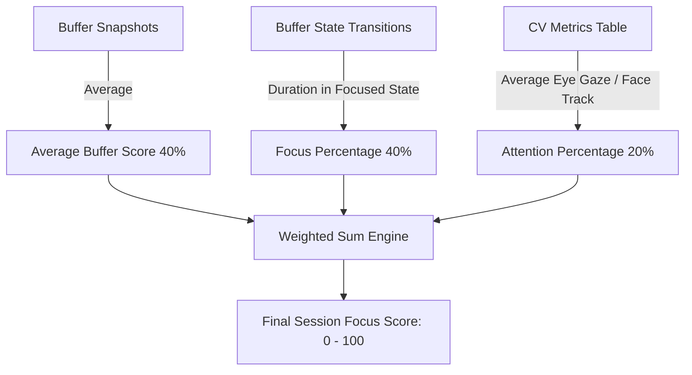

# Focus Score Aggregation and Session Scoring

## 1. Architectural Purpose and ML Target

At the conclusion of every work session, Focus Engine synthesizes continuous telemetry, discrete state transitions, and computer vision logs into a single unified performance metric: the **Focus Score** (`0` to `100`).

The Focus Score (`src/main/buffer/focusScoreCalculator.ts`) fulfills three critical architectural functions:
1. **User Feedback**: Acts as the primary KPI presented in the post-session summary modal, daily dashboard, and calendar streak history.
2. **Analytics & Recommendations**: Serves as the dependent variable aggregated across hour-of-day and day-of-week matrices in `heatmapRepository.ts` and `recommendationEngine.ts`.
3. **Machine Learning Ground Truth**: Serves as the quantitative continuous target label ($y \in [0, 100]$) used during Phase 6 ML model training to evaluate productivity predictors against actual session outcomes.

---

## 2. Mathematical Formulation

The Focus Score is calculated as a weighted linear combination of three normalized components:
$$\text{FocusScore} = \text{round}\left( x \cdot \text{AverageBuffer} + y \cdot \text{FocusPercentage} + z \cdot \text{AttentionPercentage} \right)$$

Where:
- $\text{AverageBuffer} \in [0, 100]$: The arithmetic mean of all 1-minute buffer snapshots.
- $\text{FocusPercentage} \in [0, 100]$: The percentage of total session duration spent strictly in the `'focused'` discrete state ($\ge 75$ buffer vitality).
- $\text{AttentionPercentage} \in [0, 100]$: The average face/eye attention score reported by the MediaPipe CV pipeline.



---

## 3. Dynamic Weight Rebalancing (CV Enabled vs Disabled)

Focus Engine is designed to operate seamlessly whether the user has a webcam enabled or disabled (e.g., desktop rigs without cameras, privacy mode, or poor lighting). When CV metrics are unavailable, the weights automatically rebalance to preserve full $100\%$ scale normalization without penalizing the user.

| Configuration | $x$ (Average Buffer) | $y$ (Focus Percentage) | $z$ (CV Attention) | Total Weight | Normalization Rationale |
|---|---|---|---|---|---|
| **CV Active** | `0.40` (40%) | `0.40` (40%) | `0.20` (20%) | `1.00` (100%) | Balanced synthesis of vitality, state duration, and physical presence. |
| **CV Disabled** | `0.50` (50%) | `0.50` (50%) | `0.00` (0%) | `1.00` (100%) | Attention weight redistributed equally across buffer vitality and focused duration ($0.40 / 0.80 = 0.50$). |

---

## 4. Component Derivation and Queries

### 1. Average Buffer Score
The buffer orchestrator captures a snapshot of `FocusBuffer.currentValue` every 60 seconds and writes it to `buffer_snapshots`. At session completion:
$$\text{AverageBuffer} = \frac{1}{N} \sum_{i=1}^{N} \text{snapshot}_i.\text{value}$$
Because `currentValue` is already clamped in $[0, 100]$, the resulting mean is inherently bounded within $[0, 100]$. If a session completes before the first 60-second snapshot, the starting value ($100$) or final buffer value is used.

### 2. Focus Percentage
The state machine writes discrete transitions to `buffer_state_transitions`. The calculator sums all elapsed durations where `state === 'focused'`:
$$\text{FocusPercentage} = \min\left(100, \max\left(0, \frac{\sum \text{duration}_{\text{focused}}}{\text{duration\_actual\_sec} \times 1000} \times 100\right)\right)$$

### 3. Attention Percentage
If the computer vision pipeline logged valid metrics to `cv_metrics`, the summary query returns `avg_attention_score` ($\in [0.0, 1.0]$):
$$\text{AttentionPercentage} = \text{avg\_attention\_score} \times 100$$

---

## 5. Implementation Code

From `src/main/buffer/focusScoreCalculator.ts`:

```typescript
export interface FocusScoreComponents {
  averageBuffer: number
  focusPercentage: number
  attentionPercentage: number | null
  reweighted: boolean
  finalScore: number
}

export function calculateFocusScore(sessionId: string): FocusScoreComponents | null {
  const session = getSessionById(sessionId)
  if (!session || !session.duration_actual_sec || session.duration_actual_sec <= 0) return null

  // 1. Average Buffer (0 - 100%)
  const snapshots = bufferSnapshotsRepository.getSnapshotsForSession(sessionId)
  let averageBuffer = 0
  if (snapshots.length > 0) {
    const sum = snapshots.reduce((acc, curr) => acc + curr.value, 0)
    averageBuffer = sum / snapshots.length
  }

  // 2. Focus Percentage (0 - 100%)
  const transitions = bufferStateTransitionsRepository.getForSession(sessionId)
  let focusedMs = 0
  for (const t of transitions) {
    if (t.state === 'focused' && t.duration) {
      focusedMs += t.duration
    }
  }
  const focusPercentage = Math.min(100, Math.max(0, (focusedMs / (session.duration_actual_sec * 1000)) * 100))

  // 3. Attention Percentage (0 - 100%)
  const cvSummary = cvMetricsRepository.getCVSummaryForSession(sessionId)
  
  let x = 0.40
  let y = 0.40
  let z = 0.20
  
  let attentionPercentage: number | null = null
  let reweighted = false

  if (!cvSummary) {
    // CV Disabled: Reweight so max score is still 100%
    x = 0.50
    y = 0.50
    z = 0.00
    reweighted = true
  } else {
    attentionPercentage = cvSummary.avg_attention_score * 100
  }

  const finalScore = Math.round(
    (x * averageBuffer) + 
    (y * focusPercentage) + 
    (z * (attentionPercentage || 0))
  )

  return {
    averageBuffer: Math.round(averageBuffer),
    focusPercentage: Math.round(focusPercentage),
    attentionPercentage: attentionPercentage !== null ? Math.round(attentionPercentage) : null,
    reweighted,
    finalScore
  }
}
```

---

## 6. Persistence and Lifecycle Hook

When a session finishes or is terminated:
1. `sessionManager.endSession(sessionId)` executes.
2. `calculateFocusScore(sessionId)` is computed.
3. The resulting `finalScore` is written directly into `sessions.focus_score` in SQLite.
4. Downstream analytics subscribers (`streakCalculator`, `heatmapRepository`, `productivityAnalytics`) immediately reflect the new session score on the dashboard.
