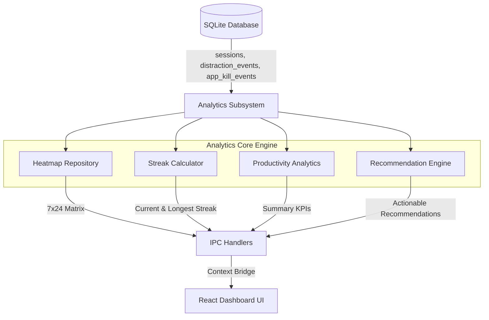

# Analytics & Insights Subsystem Overview

## 1. Executive Summary

The **Analytics Subsystem** (`src/main/analytics/`) transforms historical session records, peripheral telemetry, and distraction logs into high-level behavioral intelligence. Rather than presenting raw, uncurated log streams, the analytics engine aggregates multi-dimensional patterns over time to answer key user questions:
- *When am I cognitively sharpest during the day?*
- *What specific apps or domains trigger the majority of my interruptions?*
- *How continuous is my daily focus habit over days, weeks, and months?*
- *What actions can I take to optimize my work sessions?*

The subsystem is architected around four core modules:
1. **Heatmap Repository** (`heatmapRepository.ts`): Computes a $7 \times 24$ (day of week vs hour of day) matrix of focus scores and session frequencies.
2. **Streak Calculator** (`streakCalculator.ts`): Tracks daily habit continuity across local calendar days, distinguishing active runs from historical records.
3. **Productivity Analytics Engine** (`productivityAnalytics.ts`): Calculates overarching performance KPIs (best hour, worst hour, longest session, uninterrupted focus streak).
4. **Recommendation Engine** (`recommendationEngine.ts`): Synthesizes heuristic distraction patterns with trained machine learning classifiers to deliver personalized, actionable coaching.

---

## 2. Subsystem Architecture and Data Flow



### Primary Database Sources

| Table Name | Attributes Analyzed | Analytical Output |
|---|---|---|
| `sessions` | `start_time`, `duration_actual_sec`, `focus_score`, `completed` | Heatmaps, daily streaks, best/worst hours, session durations |
| `buffer_state_transitions` | `state`, `duration` | Longest uninterrupted focus streak within a session, total focused time |
| `app_kill_events` | `app_name`, `timestamp` | Most distracting desktop application ranking |
| `distraction_events` | `event_type`, `event_data (domain)` | Most distracting web domain ranking |

---

## 3. Core Architectural Principles

### 1. Local Time Rebasing
All raw epoch millisecond timestamps in SQLite are stored in UTC. However, human work habits align strictly with local circadian rhythms. The analytics engine forces SQLite to rebase all timestamps to the user's local operating system timezone via `strftime('%...', start_time / 1000, 'unixepoch', 'localtime')`. A session completed at 1:00 AM local time is correctly categorized as part of that night's work rather than bleeding into the following day's UTC bucket.

### 2. Separation of Pure Math and Persistence
Algorithms like streak computation (`computeStreaksFromDates`) and cell aggregation (`pickBestAndWorstHour`) are decoupled from SQLite drivers and Electron IPC APIs. They accept pure primitive data structures (arrays of date strings or numbers), enabling rapid, deterministic unit testing without database mocking.

### 3. Threshold Gating for Statistical Validity
Recommendations and behavioral coaching are gated behind minimum sample sizes (e.g., minimum 10 completed sessions for global recommendations, minimum 3 sessions for a 2-hour peak focus window). This prevents false pattern recognition based on sparse initial runs.

---

## 4. Subsystem Directory Structure

```
src/main/analytics/
├── heatmapRepository.ts          # 7x24 hour/day focus score & session count aggregation
├── streakCalculator.ts           # Pure streak logic & SQLite calendar-day query
├── productivityAnalytics.ts     # Best/worst hour, longest streaks, summary KPIs
└── recommendationEngine.ts      # Heuristic pattern mining & personalized coaching sentences
```
