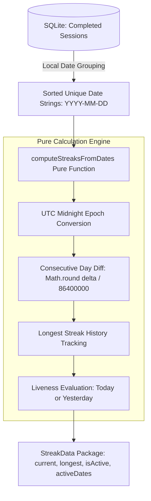

# Daily Streak Calculation Engine

## 1. Overview and Problem Definition

Habit formation in productivity systems relies heavily on gamified streak mechanics. In Focus Engine, a **streak** is defined as an unbroken sequence of consecutive local calendar days during each of which the user finished at least one completed focus session (`completed = 1`).

While conceptually simple, daily streak calculation in desktop software faces subtle temporal edge cases:
1. **Timezone Rebasing**: A session finished at 01:00 AM local time is considered part of "today" by the user who stayed up working, but raw UTC timestamps would categorize it as the previous or next day.
2. **Daylight Saving Time (DST) Jumps**: When clocks change by $\pm 1$ hour (e.g., a 23-hour or 25-hour calendar day), standard millisecond delta calculations ($24 \times 3600 \times 1000$) produce non-integer day deltas ($0.958$ or $1.042$), breaking naive equality checks (`diff === 86400000`).
3. **Streak Liveness Semantics**: A streak is active if the user completed a session today, OR if they completed one yesterday and still have time today to complete a session. If the latest session occurred two days ago, the current active streak is 0, even though historical longest streak remains preserved.

The **Streak Calculator** (`src/main/analytics/streakCalculator.ts`) solves all three problems using pure, timezone-aware algorithms.

---

## 2. Algorithm Architecture



---

## 3. Implementation Analysis

### Calendar Day Indexing & DST Immunity
To eliminate daylight saving time drift, date strings are parsed into calendar components and evaluated at UTC midnight:

```typescript
const MS_PER_DAY = 24 * 60 * 60 * 1000

function localDateStringToUTCMidnightMs(dateStr: string): number {
  const [y, m, d] = dateStr.split('-').map(Number)
  // Treated purely as an abstract calendar-day index (Date.UTC avoids DST shifting the
  // day-to-day delta), not as a literal physical instant.
  return Date.UTC(y, m - 1, d)
}
```

### Pure Streak Math (`computeStreaksFromDates`)

```typescript
export interface StreakData {
  currentStreak: number
  longestStreak: number
  isActive: boolean
  activeDates: string[] // Sorted ascending 'YYYY-MM-DD' strings
}

export function computeStreaksFromDates(dates: string[], now: Date = new Date()): StreakData {
  const sortedDates = Array.from(new Set(dates)).sort()

  if (sortedDates.length === 0) {
    return { currentStreak: 0, longestStreak: 0, isActive: false, activeDates: [] }
  }

  let longestStreak = 1
  let runLength = 1

  for (let i = 1; i < sortedDates.length; i++) {
    const prevMs = localDateStringToUTCMidnightMs(sortedDates[i - 1])
    const currMs = localDateStringToUTCMidnightMs(sortedDates[i])
    const dayDiff = Math.round((currMs - prevMs) / MS_PER_DAY)

    if (dayDiff === 1) {
      runLength += 1
    } else {
      longestStreak = Math.max(longestStreak, runLength)
      runLength = 1
    }
  }
  longestStreak = Math.max(longestStreak, runLength)

  // Liveness check: Active only if the most recent day was today or yesterday
  const today = getLocalDateString(now)
  const yesterday = getLocalDateString(new Date(now.getTime() - MS_PER_DAY))
  const mostRecentDate = sortedDates[sortedDates.length - 1]
  const isActive = mostRecentDate === today || mostRecentDate === yesterday

  return {
    currentStreak: isActive ? runLength : 0,
    longestStreak,
    isActive,
    activeDates: sortedDates
  }
}
```

### SQLite Local Time Integration

```typescript
export const streakCalculator = {
  calculateStreaks(): StreakData {
    const db = getDatabase()

    const rows = db
      .prepare(
        `SELECT DISTINCT strftime('%Y-%m-%d', start_time / 1000, 'unixepoch', 'localtime') as localDate
         FROM sessions
         WHERE completed = 1
         ORDER BY localDate ASC`
      )
      .all() as { localDate: string }[]

    return computeStreaksFromDates(rows.map((r) => r.localDate))
  }
}
```

---

## 4. Edge Case Handling Matrix

| Scenario | Raw Dates | Active Check | Resulting State |
|---|---|---|---|
| **First Session Ever Today** | `['2026-11-01']` | `mostRecent == today` | `currentStreak: 1`, `longestStreak: 1`, `isActive: true` |
| **Completed Session Yesterday, None Today Yet** | `['2026-10-31']` | `mostRecent == yesterday` | `currentStreak: 1`, `longestStreak: 1`, `isActive: true` (Grace day to continue streak) |
| **Completed Session 2 Days Ago, None Yesterday** | `['2026-10-30']` | `mostRecent != today && != yesterday` | `currentStreak: 0`, `longestStreak: 1`, `isActive: false` (Streak lapsed) |
| **DST "Fall Back" (25h Day)** | `dayDiff` evaluates to `25 / 24 = 1.0416` | `Math.round(1.0416) === 1` | Correctly identified as consecutive day ($1$) |
| **DST "Spring Forward" (23h Day)** | `dayDiff` evaluates to `23 / 24 = 0.9583` | `Math.round(0.9583) === 1` | Correctly identified as consecutive day ($1$) |
| **Multiple Sessions on Same Day** | `Set(dates)` | Deduplicated | Exactly one day counted |
