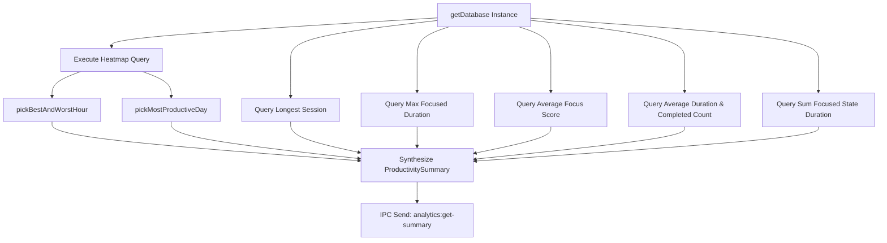

# Productivity Metrics & Key Performance Indicators (KPIs)

## 1. Overview and Metric Taxonomy

The **Productivity Analytics Engine** (`src/main/analytics/productivityAnalytics.ts`) aggregates cross-session metrics into a high-level summary (`ProductivitySummary`). These metrics provide executive-level visibility into cognitive endurance, scheduling efficacy, and cumulative focus volume.

### Summary KPI Structure

```typescript
export interface ProductivitySummary {
  bestHour: HourStat | null
  worstHour: HourStat | null
  mostProductiveDay: DayStat | null
  longestSession: LongestSession | null
  longestFocusStreakMinutes: number
  averageFocusScore: number | null
  averageSessionDurationSec: number | null
  totalSessionsCompleted: number
  totalFocusedMinutes: number
}
```

---

## 2. Metric Derivation and Mathematical Specifications

### 1. Best and Worst Circadian Hours
- **Definition**: The single hour of day ($0 - 23$) associated with the highest (and lowest) session-count weighted focus score.
- **Formulation**:
  $$\text{HourScore}(h) = \frac{\sum_{\text{cell}.\text{hour} = h} \text{cell}.\text{avgScore} \times \text{cell}.\text{sessionCount}}{\sum_{\text{cell}.\text{hour} = h} \text{cell}.\text{sessionCount}}$$
  $$\text{BestHour} = \arg\max_{h} \text{HourScore}(h), \quad \text{WorstHour} = \arg\min_{h} \text{HourScore}(h)$$
- **Rationale**: Weighting by `sessionCount` ensures that a lucky one-off session at 03:00 AM scored at $98\%$ cannot overtake 20 consistently strong sessions at 10:00 AM averaging $91\%$.

### 2. Most Productive Day of Week
- **Definition**: The day of week ($0 = \text{Sunday}$ through $6 = \text{Saturday}$) achieving the highest weighted average focus score.
- **Formulation**:
  $$\text{DayScore}(d) = \frac{\sum_{\text{cell}.\text{day} = d} \text{cell}.\text{avgScore} \times \text{cell}.\text{sessionCount}}{\sum_{\text{cell}.\text{day} = d} \text{cell}.\text{sessionCount}}$$

### 3. Longest Focus Streak (Minutes) vs. Calendar Day Streak
A critical architectural distinction exists between **Daily Calendar Streaks** and **Uninterrupted Focus Streaks**:
- **Daily Calendar Streak** (`streakCalculator.ts`): Measures habit consistency across consecutive calendar days.
- **Longest Focus Streak** (`productivityAnalytics.ts`): Measures continuous cognitive endurance *within a single session*. It is the maximum uninterrupted duration that the state machine spent in the `'focused'` state without dropping into `warning`, `critical`, or `paused`:
  ```sql
  SELECT MAX(duration) as maxDurationMs
  FROM buffer_state_transitions
  WHERE state = 'focused' AND duration IS NOT NULL
  ```
  $$\text{LongestFocusStreakMinutes} = \text{round}\left(\frac{\max(\text{duration}_{\text{focused}})}{60000}\right)$$

### 4. Total Focused Time
Unlike raw wall-clock duration, total focused time represents pure, high-vitality flow:
```sql
SELECT SUM(duration) as totalMs
FROM buffer_state_transitions
WHERE state = 'focused' AND duration IS NOT NULL
```
$$\text{TotalFocusedMinutes} = \text{round}\left(\frac{\sum \text{duration}_{\text{focused}}}{60000}\right)$$

### 5. Longest Session
The single longest completed session recorded in the database, measured by `duration_actual_sec`:
```sql
SELECT session_id, duration_actual_sec, start_time
FROM sessions
WHERE completed = 1 AND duration_actual_sec IS NOT NULL
ORDER BY duration_actual_sec DESC
LIMIT 1
```

---

## 3. Query Execution and Aggregation Flow



---

## 4. UI Dashboard Representation

| KPI Field | Typical Display Format | Visual Representation |
|---|---|---|
| `bestHour` | `"10:00 AM (92% avg)"` | Sun icon, highlighted peak indicator |
| `worstHour` | `"03:00 PM (64% avg)"` | Slump alert, suggested break window |
| `mostProductiveDay` | `"Tuesday"` | Badge indicator on weekly chart |
| `longestFocusStreakMinutes` | `"74 mins"` | Continuous stamina trophy badge |
| `totalFocusedMinutes` | `"48 hrs 20 mins"` | Cumulative deep work odometer |
| `averageFocusScore` | `"84%"` | Radial gauge or large hero percentage |
