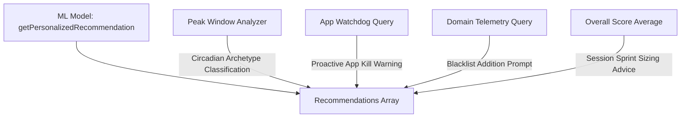

# Recommendation Engine Heuristics & Behavioral Insights

## 1. Architectural Purpose

The **Recommendation Engine** (`src/main/analytics/recommendationEngine.ts`) bridges raw historical data and human behavior. Rather than requiring users to manually interpret SQL heatmaps and process termination tables, the engine synthesizes behavioral patterns into natural-language coaching sentences and actionable adjustments.

The engine integrates two analytical layers:
1. **Rule-Based Heuristic Pattern Mining**: Identifies peak contiguous focus windows, culprit apps, and recurring distraction domains.
2. **Machine Learning Model Inference**: Incorporates personalized recommendations from `ml/personalizedRecommendations.ts`.

---

## 2. Recommendation Result Schema

```typescript
export interface FocusWindow {
  startHour: number
  endHour: number
  avgScore: number
  sessionCount: number
}

export interface DistractingApp {
  appName: string
  killCount: number
}

export interface DistractingDomain {
  domain: string
  visitCount: number
}

export interface RecommendationResult {
  hasEnoughData: boolean
  totalSessionsCount: number
  bestFocusWindow: FocusWindow | null
  mostDistractingApp: DistractingApp | null
  mostDistractingDomain: DistractingDomain | null
  recommendations: string[]
}
```

---

## 3. Pattern Mining Algorithms

### 1. Data Sufficiency Gating
To prevent noisy recommendations based on sparse sample sizes, global insights are gated:
$$\text{hasEnoughData} = (\text{totalSessionsCount} \ge 10)$$
When `hasEnoughData === false`, the dashboard displays a progress indicator prompting the user to complete more sessions before full pattern analysis unlocks.

### 2. 2-Hour Contiguous Peak Window Search
Humans rarely work in isolated 1-hour fragments; cognitive rhythm functions in multi-hour cycles. The engine searches for the best contiguous 2-hour window across the 24-hour day:

$$\text{WindowScore}(h) = \frac{\text{Score}(h) + \text{Score}((h + 1) \bmod 24)}{\text{Count}(h) + \text{Count}((h + 1) \bmod 24)}$$

**Validation Constraints**:
- The window must be backed by at least 3 completed sessions ($\text{sessionCount} \ge 3$).
- The algorithm wraps modulo 24, allowing late-night spans (e.g., 23:00 to 01:00).

```typescript
for (let h = 0; h < 24; h++) {
  const h2 = (h + 1) % 24
  const sessionCount = hours[h].count + hours[h2].count
  const totalScore = hours[h].totalScore + hours[h2].totalScore
  const avgScore = sessionCount > 0 ? totalScore / sessionCount : 0

  if (sessionCount >= 3) {
    if (!bestWindow || avgScore > bestWindow.avgScore) {
      bestWindow = {
        startHour: h,
        endHour: (h + 2) % 24,
        avgScore,
        sessionCount
      }
    }
  }
}
```

### 3. Culprit Distraction App Identification
Queries the process watchdog's termination logs (`app_kill_events`) to identify the executable that most frequently violated focus sessions:

```sql
SELECT app_name, COUNT(*) as killCount 
FROM app_kill_events 
GROUP BY app_name 
ORDER BY killCount DESC 
LIMIT 1
```

### 4. Culprit Distraction Domain Identification
Queries the active window telemetry table for explicit `blacklist_visit` events:

```sql
SELECT json_extract(event_data, '$.domain') as domain, COUNT(*) as visitCount 
FROM distraction_events 
WHERE event_type = 'blacklist_visit' AND json_extract(event_data, '$.domain') IS NOT NULL
GROUP BY domain 
ORDER BY visitCount DESC 
LIMIT 1
```

---

## 4. Natural Language Synthesis Pipeline

The engine converts quantitative statistics into actionable, empathetic coaching sentences:



### Archetype-Driven Circadian Advice

| Peak Hour Range | Circadian Archetype | Generated Coaching Sentence |
|---|---|---|
| **`21:00` – `04:00`** | *Night Owl* | `"Your focus peaks late at night between XX:00 and YY:00 (avg score: ZZ%). If this is when you feel most creative, guard these hours from interruptions."` |
| **`05:00` – `09:00`** | *Early Bird* | `"You are highly productive in the early morning between XX:00 and YY:00 (avg score: ZZ%). Tackle your hardest coding or planning tasks first thing."` |
| **`12:00` – `17:00`** | *Afternoon Executor* | `"Your focus is strongest in the afternoon between XX:00 and YY:00 (avg score: ZZ%). This is your golden window for deep execution."` |
| *Other Hours* | *Standard* | `"Your peak focus window occurs between XX:00 and YY:00 with a strong average focus score of ZZ%."` |

### Actionable Interruption Interventions
- **Culprit App Advice**:
  - Found: `"Spotify.exe was force-closed 14 times during focus sessions. Proactively close it before hitting start to build uninterrupted momentum."`
  - Zero Kills: `"Zero app-killing interruptions recorded. Outstanding job keeping distracting apps closed!"`
- **Culprit Domain Advice**:
  - Found: `"twitter.com triggered 9 distraction events. Consider adding it to your blocked domains list or using our hosts blocker to block it."`
  - Zero Events: `"No visits to blocked sites detected during your focused sessions. Your digital discipline is top-tier."`
- **Stamina Coaching**:
  - Average $\ge 75\%$: Praises cognitive presence and flow.
  - Average $50\% - 74\%$: Suggests eliminating window hopping and stashing mobile devices.
  - Average $< 50\%$: Recommends dropping down to 20-minute hyper-focused sprints to rebuild cognitive stamina without burnout.
